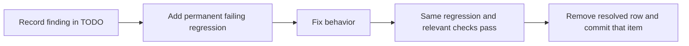

# Contributing

You can help by reporting a problem, documenting a tested setup, or proposing a
focused change. Start with the section that matches your task.

## Report a tested setup

Compatibility reports should identify the distribution, desktop/session type,
GPU/encoder, tablet, Android version, installation method and **fork commit**.
Use the [compatibility template](https://github.com/geraldo-netto/blent/issues/new?template=compatibility.yml).
Reports can be added to [docs/compatibility.md](docs/compatibility.md) with their
version, source and limitations; a successful build is not hardware validation.

## Bugs and questions

Use the [fork issue tracker](https://github.com/geraldo-netto/blent/issues).
Explain the expected result, actual result and reproducible steps. Include
`blent doctor` output and relevant logs: `journalctl --user -u blent -n 200`
for a service launch, or `~/.local/share/blent/daemon.log` for a direct GUI
launch. Remove tokens, device serials and personal details before posting.
For a foreground debug run, stop the existing daemon first and follow
[troubleshooting](docs/troubleshooting.md#black-screen-on-the-tablet); starting
the daemon can change the live display configuration.

## Compatibility and design

Blent does not require backward compatibility (owner decision, October 20, 2026).
Update current callers, formats, documentation and tests together. Do not retain
obsolete aliases, migrations, wrappers or fallbacks solely for old callers.
This does not permit weakening current correctness, native ownership or tests.

Keep public contracts independent of UI, storage and operating-system adapters.
Give each function one responsibility and shared state one authoritative owner.
Platform adapters must report unavailable capabilities explicitly; compilation
alone is not support. Declined macOS and stylus work stays declined.

For resource-owning changes, identify who allocates, borrows, stops and finally
releases each resource. Check failure, cancellation, stale identity and delayed
cleanup paths. A timeout or logical completion is not proof that native access
has ended. Retain explicit bounds and record missing evidence.

## Findings, tests and commits

Documentation-only corrections skip the behavioral regression step; they still
need review and checks appropriate to their content.

- Record every finding as a uniquely identified row in `TODO.md` **before**
  fixing it, preserving the existing table format.
- Record contradictions with both conflicting statements/behaviors, their
  sources and the exact resolution condition. Use **open** for actionable work.
  Reserve **blocked** for an actual missing decision, evidence or prerequisite,
  and name what is missing. Move it to open when that obstacle is removed;
  remove the row only after resolution. Continue independent work meanwhile.
- For each confirmed behavioral bug, add a permanent automated regression to
  the normal suite **before** the fix. Show it failing, then passing after the
  fix, and link it to the issue/TODO ID. Retain it after completion; do not
  delete, skip or weaken it because the bug is fixed.
- If automation is unavailable, record the exact obstacle and missing coverage
  in TODO.md and leave the bug unresolved. During a review-only task, record
  reproductions and required coverage; implement tests with the fixes unless
  tests were explicitly requested during review. Documentation/policy-only
  corrections need no artificial behavioral tests.
- Fix findings in dependency order. Make **one commit per resolved finding**
  and remove only its resolved TODO row. Preserve other open/blocked entries.
- Keep functions/methods at cyclomatic complexity **9 or less**, using
  SonarQube's cyclomatic metric rather than cognitive complexity. The project's
  local measurement tool is accepted; SonarQube itself is not required. For shell,
  use the approved count: 1 plus branches, loops, case alternatives and
  short-circuit operators. This applies to existing project code as well as
  changes; exclude generated code, dependencies, caches and build outputs.
- Enforce at least **80% executable-line coverage per production function/method**
  in the Rust applications, Android app, maintained C helpers and essential installation,
  EVDI setup and packaging scripts. Count Kotlin inline bodies within their
  enclosing method; separately compiled callbacks keep their own requirement.
  Benchmarks and nonessential development tools are exempt from this threshold.
  Retain all tests already developed, including tests outside the coverage scope.
  Keep platform-dependent gaps explicit; unmeasured functions do not pass.
- Share compatible implementations and separate distinct responsibilities.
  Ask when requirements or preferences are unclear before dependent work.

## Building and validation

Use [development](docs/development.md) for build prerequisites, commands and
component test suites. Use the repository Rust formatter wrapper, which includes
modules that `cargo fmt --all` misses. Optional encoder changes also need their
feature-enabled tests.

Run the [complexity gate](scripts/complexity/README.md) and relevant
[per-function coverage gates](scripts/coverage/README.md). Keep parser failures,
unmeasured native functions and unavailable platform checks visible. CI workflows
are manually dispatched; pushes and pull requests do not start them automatically.

Select checks appropriate to the affected components; document exact results
and obstacles. Documentation edits need link/metadata/format checks and any
automated tests that consume the edited files. Do not publish, install on the
working desktop or attach EVDI merely to validate documentation.

Measure performance claims. Host `Latency packet-ready→render-ACK` figures cover
encoded-packet readiness to render-acknowledgement receipt; they exclude
capture, encoding and packetizer assembly. Include workload, settings and
hardware; see [benchmarks](docs/benchmarks.md#how-latency-is-measured).

## Pull requests

Keep the PR scope coherent and each finding's commit separate. Explain the
problem, resulting behavior and validation. Update both ends and their tests
when the Android/host protocol changes. Distinguish isolated automated coverage
from real-device testing and list remaining limitations.

### Windows preview checks

Run `cargo test --locked -p blent-config --no-default-features` first, then
`cargo test --locked --workspace` on native Windows. The Windows CI workflow
runs both, including mandatory ACL, runtime lease and owned-process tests.
Linux-only EVDI/process-group/desktop fixtures remain on Linux. GNU cross-builds
can link the workspace with `cargo test --locked --workspace --all-features
--target x86_64-pc-windows-gnu --no-run` when MinGW is available. This is a build
check, not physical acceptance. Lifecycle and selected-monitor touch/mouse are
implemented previews; display capture remains unavailable. Wine can exercise
many fixtures but does not replace native Windows security validation.
