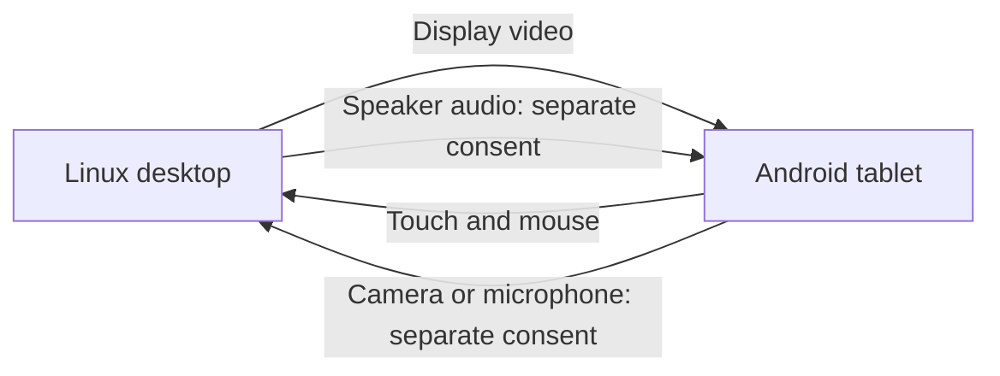

# Blent for Linux — Android Tablet as a USB Second Monitor

Blent turns an Android tablet into an extra Linux display over a USB cable.
Move windows onto it and use touch/mouse input. You can also share the tablet's
camera, microphone and speakers through separate controls and consent.

**Start here:** [Installation](docs/installation.md) · [Compatibility](docs/compatibility.md)
· [Troubleshooting](docs/troubleshooting.md) · [FAQ](docs/faq.md)

Use matching desktop and Android builds. Android **8.1/API 27** is the minimum;
its decoder must support your selected video format. The fork was unreleased as
of 2026-09-17 and source version remains **1.2.3**. Identify builds by commit as
well as version; development is on `configurable-input-devices`.

**Known desktop risk:** Cinnamon/Xorg has an unresolved restart during virtual-display
attachment (T222). Read [current limitations](docs/compatibility.md#current-fork-limitations)
before setup. Windows is an incomplete preview; macOS and iPad clients are unsupported.

The EVDI kernel driver creates a real extra display, visible in Linux display
settings. No dummy HDMI plug, cloud account or USB tethering is needed. Blent
sends media/input to the connected peer, not a cloud service. Optional release
checks contact GitHub; see [security and privacy](SECURITY.md).

## Quick install

1. **Install matching programs.** Follow [source builds](docs/development.md#building-from-source)
   or [package installation](docs/installation.md). Build formats include AppImage,
   Arch and portable tarball. Recipe availability does not announce a published
   release. The Android debug APK is
   `android/app/build/outputs/apk/debug/app-debug.apk`; release bundles use `blent.apk`.
2. **Prepare Linux.** Check the EVDI driver and input permissions with
   `blent doctor`. Follow setup's reboot guidance. Do not force live EVDI growth
   under Xorg. Open the matching Android app.
3. **Choose a USB route.** Use the table below. A data-capable cable is required.
4. **Start sharing.** Select the tablet in the desktop **Tablets** workspace.
   Resource Start/Stop affects that tablet. If the global display service is
   stopped, start it in **Settings**. Camera/audio also need local tablet consent;
   keep the desktop window open while using them.
5. **Check the desktop output.** Place/enable it in Display settings if needed.
   KDE Wayland has the most automation; X11 input mapping needs `xinput` and
   `xrandr`. Other Wayland desktops depend on compositor support.

| Route | Setup | Limits |
| --- | --- | --- |
| Paired direct USB, Linux | **Connections → USB connection → Find USB devices**; connect, compare Computer/Tablet fingerprints, explicitly approve the matching peer. | No USB debugging required. Preview/native acceptance limits remain visible. Pairing grants no camera/audio consent. |
| ADB over USB | Install `adb`, enable Android USB debugging and authorize the computer. | Host sets up forwarding and normally launches the app. ADB is Android's debugging connection tool; this route uses session tokens. |

Direct USB uses authenticated peer credentials. Its discovery or pairing success
alone does not establish successful display/media delivery. `blent doctor` helps
with diagnosis; it does not certify every desktop combination.

To start at login, enable **Start Blent with the desktop** in the GUI. The full
installer enables a user service or desktop login entry; `make install` preserves
the existing preference. See [autostart and installed paths](docs/installation.md#start-the-host).

## Settings

[Settings guide](docs/settings.md) explains defaults, scope and each control.
Desktop settings live at `~/.config/blent/config.toml` unless an absolute
`XDG_CONFIG_HOME` overrides the location. Android preferences are in its gear menu.

- **Video:** Automatic checks compatible encoders and saves measured tuning.
  Existing explicit choices stay unchanged. [Video guide](docs/video-codecs.md).
- **Tablet screen:** brightness defaults to 50%, display preference to 60 Hz.
  These affect Blent only; stream FPS is separate. Android may override the mode.
- **Resources:** Apply saves preferences; Start requests sharing. Stop retains
  original ownership until cleanup finishes. Selecting another tablet cannot
  retarget work already starting or stopping.
- **Input:** retained Linux pen code forwards pressure, tilt, eraser and button.
  Automated tests are not physical stylus certification; further pen work is
  declined. Graphics-tablet mode controls a host screen without streaming video.
- **Capacity:** one to four display slots are configurable. Historical testing
  used one physical tablet plus simulation; multiple physical tablets are not
  validated and the broader campaign remains declined (T382).

## Documentation

| I want to… | Guide |
| --- | --- |
| Install, start at login or remove Blent | [Installation](docs/installation.md), [uninstall](SECURITY.md#how-to-uninstall-completely) |
| Fix a connection or display problem | [Troubleshooting](docs/troubleshooting.md), [compatibility](docs/compatibility.md) |
| Use a tablet webcam | [Cameras](docs/cameras.md) |
| Use tablet microphone/speakers | [Audio](docs/audio.md) |
| Forget a trusted computer | [Saved computers](docs/saved-computers.md) |
| Tune display quality or resource use | [Settings](docs/settings.md), [video](docs/video-codecs.md), [pipe buffer](docs/pipe-buffer.md), [CPU scheduling](docs/scheduling.md) |
| Understand measurements | [Benchmarks and measurement limits](docs/benchmarks.md) |
| Build or change the project | [Contributing](CONTRIBUTING.md), [development](docs/development.md), [architecture](docs/architecture.md) |
| Understand trust, permissions or licenses | [Security](SECURITY.md), [third-party terms](THIRD_PARTY_LICENSES.md) |

## Performance

Published historical numbers describe their recorded hardware and workload.
They are not current fork certification or total screen latency. The common
packet-to-render-acknowledgement timer excludes capture and encoding; independent
medians cannot be subtracted to measure network delay. See the
[results and methods](docs/benchmarks.md). No total upstream-to-fork speedup is claimed.

## FAQ

USB debugging is needed for ADB, not paired direct USB. Wi-Fi is an optional ADB
route; `blent wifi --off` does not close Android's network ADB listener. See
[connection security](SECURITY.md#connections-and-trust-boundaries).

For hardware, pen, wireless use and dated comparisons with alternatives, read the
[full FAQ](docs/faq.md).

## About

The GUI's **About** page has version/build details, credits, offline project and
Android notices, **Report compatibility** and **Star on GitHub**. Reports open a
prefilled issue for your review; submission is explicit. Navigation stays visible.
**Open installed bundle notices** opens package-specific notices when their
manifest exists and reports when they are missing. Embedded notices do not list
every library installed on the computer.

## Plans and proposals

The [Windows preview](docs/windows-port.md) includes lifecycle, USB preparation,
Settings, tray and opt-in selected-monitor touch/mouse controls. Physical tablet
acceptance is pending; display streaming, stylus and ADB-free USB are unavailable.
See [input preview setup](docs/reviews/2026-09-28-windows-direct-input.md#using-the-input-preview).

Broader Wayland input mapping and PipeWire/dmabuf capture remain proposals without
a committed schedule. HDR is unimplemented: capture is 8-bit. An iPad client would
need transport, native client, build/signing resources and distribution decisions;
no Apple platform or regional route has been selected or verified.

[TODO.md](https://github.com/geraldo-netto/blent/blob/configurable-input-devices/TODO.md)
tracks actionable defects and blocked decisions. Historical reports do not reopen
declined work or establish current support.

## Contributing

Send questions and reports to [fork issues](https://github.com/geraldo-netto/blent/issues).
Include your commit, hardware and relevant settings; see [CONTRIBUTING.md](CONTRIBUTING.md).
The [website source](docs/index.html) is maintained in this repository.

## License

Blent is maintained at [geraldo-netto/blent](https://github.com/geraldo-netto/blent).
Original UScreen copyright (c) 2026 majmichu1 is retained under MIT. Original Blent
contributions copyright (c) 2026 Geraldo Netto. See [COPYRIGHT.md](COPYRIGHT.md)
for attribution/provenance and [LICENSE](LICENSE) for terms.

The unmodified DisplayLink libevdi client library is LGPL-2.1; third-party terms
remain separate. See [THIRD_PARTY_LICENSES.md](THIRD_PARTY_LICENSES.md).
