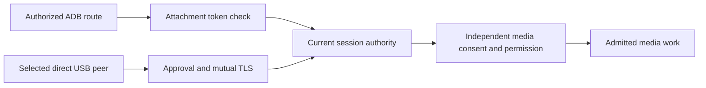

# Security

Blent sends display, input and optional media between your computer and tablet.
It has no account, application telemetry or cloud relay. Keep authentication on,
use ADB networking only on a trusted network, and approve direct USB peers only
after comparing their fingerprints.

| Question | Read |
| --- | --- |
| Who can connect or control media? | [Connections and trust](#connections-and-trust-boundaries) |
| Where are secrets stored? | [Local state](#local-state-and-updates) |
| What changes on my computer? | [Installation changes](#what-installation-changes) |
| How do I remove Blent? | [Uninstall](#how-to-uninstall-completely) |
| What do release signatures prove? | [Release integrity](#release-integrity) |



Neither route protects against software already controlling your desktop user
account or privileged Android debugging access.

## Connections and trust boundaries

### ADB connections

The host video and input servers bind to **127.0.0.1**, on ports 8890/8891
by default, plus two ports per additional tablet slot. On the ADB route, the
tablet reaches these ports through `adb reverse`.

With the default `require_token = true`, each logical tablet attachment gets a
random 256-bit token, encoded as 64 hex characters, shared by its video and input
channels. Replacement, detach and slot reuse invalidate the old credential and
accepted connection leases. A proven same-tablet USB/Wi-Fi migration keeps its
credential but retires the old connections; an unknown identity is treated
conservatively as a replacement. Entropy or private-token publication failure
prevents attachment preparation rather than disabling authentication.

The host delivers credentials over adb on stdin, rather than in process
arguments. Initial attachment and authentication retries use the protected
TokenReceiver broadcast; only an enabled, fresh-attachment auto-launch may open
an Activity. The host attempts to remove both old reverse routes before reusing
the slot, waiting for owned device work and extra-session teardown. An offline
device may not acknowledge cleanup: the revoked token still rejects its late
connections. Keep authentication enabled; **tokenless mode cannot provide this
attachment isolation**, even though existing accepted leases are still retired.
Video and input must authenticate before receiving video or injecting input. In disabled
mode, video accepts tokenless clients or consumes one optional saved 64-byte
hex token without checking its value. This explicit disabled-authentication
mode is never used when token authentication is enabled. Incomplete optional prefixes expire
three seconds after their first byte; malformed or extra input closes the viewer.

Processes running as the same Linux user can read the token. Authorized adb
hosts and privileged Android apps are also inside the trust boundary: the
Android token-update activity requires the system DUMP permission, available
to adb shell and privileged apps. The ordinary launcher ignores token extras.
This is not isolation from compromised software running as your own user.

### Wi-Fi debugging

`blent wifi` runs `adb tcpip 5555`: it **opens the tablet's adb listener on
the network**, then stores its address for reconnection. The host video/input
ports remain on loopback. Use this only on a trusted local network.
`blent wifi --off` forgets the address and disconnects that adb connection;
it does not turn off the tablet's TCP listener. To return adbd to USB mode,
use `adb -s TABLET_SERIAL_OR_IP:5555 usb` with the identifier shown by
`adb devices`, or reboot the tablet and verify its debugging settings.
See [Android's adb instructions](https://developer.android.com/tools/adb#wireless).

These application privacy statements do not describe the static website, which
loads fonts from Google and a social preview from GitHub.

### Direct USB connections

The Linux broker and Android connection worker authenticate each other with stock
TLS and the exact approved certificate fingerprints. USB device metadata alone
is untrusted. Saved approval requires fresh TLS proof on reconnect; it never
automatically grants camera or microphone permission. Media still needs its own
current local Start, permission and resource lease. Revocation stops new work
immediately, while original native workers retain cleanup responsibility.

The local Linux broker uses private same-user IPC and transfers actual loopback
listener capabilities. A remote peer cannot choose arbitrary host ports or paths.
Credentials still protect local media endpoints. Direct USB needs no ADB reverse
mapping. See the [connection contract](docs/reviews/2026-10-10-t846-connection-contract.md)
for exact identity, byte limits and retirement requirements, and its scoped
physical-acceptance limits. Windows direct USB remains unsupported.

## Local state and updates

### Linux runtime files

<details>
<summary>Exact directory validation, token paths and permissions</summary>


The runtime base is an existing `$XDG_RUNTIME_DIR`, otherwise an existing
`/run/user/<uid>`, otherwise `$HOME/.cache` (`/tmp/.cache` if HOME is absent).
Blent uses a `blent` subdirectory. Runtime-path selection returns an error
unless the resolved base belongs to the current UID, has owner read/write/search
permissions and cannot be written by group/other users. Base symlinks (such as a
relocated HOME cache) are resolved before validation. The final `blent`
directory is opened with `O_DIRECTORY | O_NOFOLLOW` and must belong to the same
UID with permission bits 0700. Existing unsafe paths are refused without changing
their ownership or permissions; a selected unsafe path does not trigger fallback.
The primary slot publishes its current token in `token`; extra slots use
`token-1`, `token-2`, and `token-3`. Attachment preparation atomically replaces
these private files. A retained file after disconnection is not evidence of a
live or authorized route; retired credentials cannot authenticate.
Creation/open/validation errors propagate to startup and capture; doctor reports
them, and cleanup skips paths it cannot validate. Token and FIFO creation request
mode 0600 and use only accepted runtime paths. These checks do not protect
against the same user or root replacing their own directories after validation.

</details>

Direct USB has separate Linux paths: `$XDG_RUNTIME_DIR/blent-usb` for live broker
state, and `$XDG_STATE_HOME/blent/connection` for identity and saved trust (default
`~/.local/state/blent/connection` when XDG_STATE_HOME is unset). The launch adapter
requires absolute configured paths. Do not delete these while the broker runs;
removing persistent identity changes future pairing.

### Android state and update checks

Android disables application backup and explicitly excludes the token-bearing
`blent.xml` preferences from legacy backup, cloud backup and device transfer.
Both rule files are referenced by the packaged manifest and covered by the
Android regression suite. Device-transfer exclusions matter because some OEMs
ignore `allowBackup=false` for that transport; see
[Android's backup rules](https://developer.android.com/identity/data/autobackup).

Optional HTTPS checks read the fork's latest release metadata from GitHub.
The daemon first checks after 30 seconds and then approximately daily while
running; the GUI checks at startup; Android checks at most once per Activity
instance when started, so Activity recreation can cause another request.
`check_updates = false` disables host checks; the app has its own *Check for
newer releases* switch. No application update is downloaded or installed
automatically. With no published fork release, no newer release is announced.

## What installation changes

Run the daemon as your ordinary desktop user. The supplied services are
systemd **user** services; the executable does not enforce a ban on root.
Privileged setup prepares devices and permissions so root is unnecessary
for normal streaming.

| Installed or changed state | Purpose |
| --- | --- |
| User-local `blent`, `blent-gui`, `blent-audio`, `blent-usb-broker`, `blent-usb-io` and `evdi_helper` binaries, menu entry, icons, user service and optional `XDG_CONFIG_HOME/autostart/blent.desktop`, or their package-managed counterparts | Application launch, optional audio sessions and optional desktop-session autostart |
| `/etc/modprobe.d/blent-evdi.conf` (script) or `/usr/lib/modprobe.d/blent-evdi.conf` (package) | Default `options evdi initial_device_count=2` at module load |
| `/etc/modprobe.d/blent-gpu-order.conf`, generated by setup or native package hooks when physical GPU modules are found | Requests physical GPU modules before EVDI on the next load; an existing file or symlink is preserved |
| `/etc/modules-load.d/blent.conf` (script) or `/usr/lib/modules-load.d/blent.conf` (package) | Boot-module list for init systems that read `modules-load.d`; other init systems need their own configuration |
| `/etc/udev/rules.d/60-blent-uinput.rules` or `/usr/lib/udev/rules.d/60-blent-uinput.rules` | Seat-user access to `/dev/uinput`; this permits synthetic input |
| Distribution packages selected by the full installer | Runtime/build dependencies |

Project setup helpers preserve a loaded EVDI module and existing devices,
adding missing capacity or reporting why it cannot be added. This does not
resolve the separate Cinnamon crash observed during virtual-display attachment
(T222). See [installation.md](docs/installation.md) before changing a live
display setup. Package-manager changes and external EVDI installations are not
automatically undone by removing application files.

## How to uninstall completely

1. Stop camera sessions in **Cameras**, and microphone/speaker sessions in
   **Audio**. For terminal sessions, press Ctrl+C in each `blent camera` or
   `blent audio` terminal and wait for exit. These owners are independent;
   `blent stop` does not stop them.
2. Disconnect direct USB in the connection controls and close the GUI. If
   `blent-usb-broker` remains running, use the desktop process monitor's normal
   **End/Terminate** action for that exact executable and wait for exit. Do not
   delete its runtime or trust files while it or its helper still runs.
3. Stop the display daemon before removing files. For systemd:

```bash
systemctl --user disable --now blent
```

For a terminal or direct GUI launch, use `blent stop`. Then remove **the
installation method you used**:

For a portable AppImage, delete the downloaded image after all its processes
have exited. If you used `--install-user`, also remove its
[registered image, wrappers and launchers](docs/appimage-plan.md#launch-and-install-for-your-user).
Inspect the saved `gui-backup.*` copy before deleting it; it may belong to your
previous installation. User service/autostart cleanup below applies as well.

For packages or source/tarball installs:

- Native package: `sudo pacman -R blent`; retained Debian fixture installations
  use `sudo apt remove blent`.
  Inspect the proposed transaction. Dependencies and repository settings may remain.
- Default source/tarball installation: remove these application-owned files:

```bash
rm -f ~/.local/bin/blent ~/.local/bin/blent-gui ~/.local/bin/blent-audio ~/.local/bin/evdi_helper
rm -f ~/.local/bin/blent-usb-broker ~/.local/bin/blent-usb-io
rm -f ~/.local/bin/libevdi.so.1 ~/.local/bin/libevdi.so.1.15.0
rm -f ~/.config/systemd/user/blent.service
rm -f ~/.config/autostart/blent.desktop
rm -f ~/.local/share/applications/blent.desktop
rm -f ~/.local/share/icons/hicolor/scalable/apps/blent.svg
rm -f ~/.local/share/icons/hicolor/scalable/apps/blent-pen.svg
systemctl --user daemon-reload
```

Run the final reload command only when a systemd user manager is available.
Remove the desktop-autostart entry after either installation method if the GUI
or installer created it; native package removal does not remove user preferences.

Adapt the binary path if you selected a custom `BIN_DIR`. Both user installers
use an absolute `XDG_DATA_HOME` for launchers/icons and an absolute
`XDG_CONFIG_HOME` for the user unit and desktop-autostart entry. Unset, empty or
relative values use the HOME defaults shown above. Adjust those cleanup paths
to your selected bases and remove only the named Blent files. Native packages
own their files under `/usr`; let the package manager remove them instead of
deleting arbitrary system libraries.

Remove the following only if Blent created them and you do not need their
settings for another EVDI/uinput application:

```bash
sudo rm -f /etc/modprobe.d/blent-evdi.conf
sudo rm -f /etc/modprobe.d/blent-gpu-order.conf
sudo rm -f /etc/modules-load.d/blent.conf
sudo rm -f /etc/udev/rules.d/60-blent-uinput.rules
sudo udevadm control --reload
```

The GPU-order file can remain after native package removal because setup generated
it on this machine. Inspect its ownership and contents first: setup preserves
preexisting files and symlinks, so the name alone does not establish that Blent
created it. Keep any rule maintained by the administrator or needed by another
application. If the rule was copied into an initramfs, update that image using
the distribution's procedure; deleting the source file alone does not update it.

Settings are in `$XDG_CONFIG_HOME/blent` when XDG_CONFIG_HOME is absolute,
otherwise `~/.config/blent`. Logs/PID state from direct GUI launches are in
`~/.local/share/blent`; service logs are in the user journal. After stopping,
remove unwanted settings/state and the selected runtime `blent` directory
listed above. After the direct USB broker and helper have exited, you may also
remove their runtime directory and unwanted saved identity/trust at the separate
paths above. This forgets local pairing state. Check the display state directory
for a pending `osk-restore` backup before removal: on
KDE, restore the desired virtual-keyboard setting first. Journal records,
external dependencies, kernel modules and repository configuration require
separate management; deleting these directories does not remove them.
Reboot if you need boot-module or device-access changes to take full effect;
do not unload an in-use EVDI module as an uninstall step.

On the tablet, uninstall Blent normally. If Wi-Fi debugging was enabled,
return adbd to USB mode as described above.

## Release integrity

The publishing workflow produces `SHA256SUMS` and verifies uploaded asset
hashes before publication. Checksums detect changes relative to that manifest;
they do not independently authenticate its publisher.

The fork's permanent Android release key is provisioned; its public certificate
and SHA-256 fingerprint are recorded in [release signing](docs/release-signing.md).
Builds use `io.github.geraldo_netto.blent`. Release bundling and publication
verify a valid APK signature with exactly the designated certificate, package,
launcher and non-debuggable status before proceeding. Independent local builds
may use another key, but the official release gate rejects them. These checks
do not establish the identity of previously built or installed APKs. The fork
installs separately from upstream, with separate private settings; installers
do not remove the existing app.

Android updates require compatible signing credentials;
a debug APK, a differently signed release, a version downgrade or platform
requirements can prevent installation over an existing app. Such a failure
alone does not establish who built the APK. Preserve the chosen release key
for future updates; do not delete app data to bypass a mismatch without first
understanding which build you are installing.
