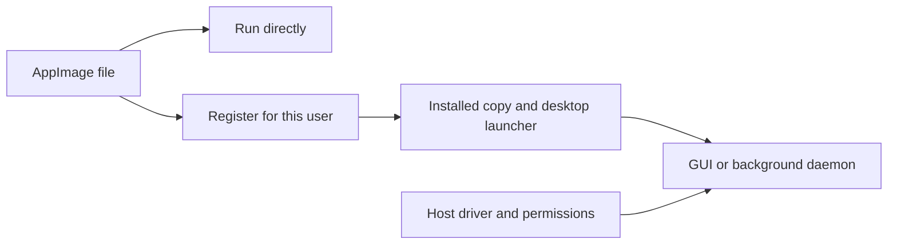

# Install and use the AppImage

Use the AppImage to run Blent without installing its desktop libraries separately.
You still need a compatible Linux desktop, EVDI driver and device permissions;
follow [installation prerequisites](installation.md#linux-artifacts-and-prerequisites).

This is a supported **build format**, not a release announcement. AppImage replaced
the Debian release asset in T308; Arch and portable tarball builds remain available.



Run directly to try the package. Register it to keep a stable installed copy and
launch it from your desktop menu. Neither route installs the kernel driver.

## Launch and install for your user

On Linux x86-64 with glibc 2.36 or newer:

```bash
chmod +x blent-1.2.3-x86_64.AppImage
./blent-1.2.3-x86_64.AppImage               # GUI
./blent-1.2.3-x86_64.AppImage status        # daemon CLI
./blent-1.2.3-x86_64.AppImage --daemon --help
```

Stop any running Blent daemon before explicitly registering this distribution:

```bash
./blent-1.2.3-x86_64.AppImage --install-user
```

Registration installs these files:

| Component | Location or behavior |
| --- | --- |
| Image copy | `$XDG_DATA_HOME/blent/appimage/Blent.AppImage`; default data directory: `~/.local/share` |
| Command launchers | `~/.local/bin/blent` and `~/.local/bin/blent-gui`, both using this distribution |
| Desktop launcher and user service | Point to the installed copy |
| Previous GUI executable/link | Saved under `$XDG_DATA_HOME/blent/appimage/gui-backup.*/blent-gui` for rollback; its symlink target is unchanged |

The installed wrapper extracts the image when needed, so it works without FUSE
(the filesystem facility normally used to mount an AppImage). Registration
preserves preferences and autostart intent. Existing desktop login entries are
redirected to this copy; an enabled service gets its entry repaired even when
the desktop does not activate `graphical-session.target`.

Registration does **not** start streaming, enable autostart, activate EVDI,
uninstall packages or change system configuration. Use the GUI to change
autostart. Repeated registration reuses the managed launcher; paths and arguments
with spaces or shell metacharacters remain literal.

### Update or switch from a Debian package

1. Stop the daemon and close the old GUI.
2. Register the new AppImage with `--install-user`.
3. Open the installed desktop launcher.

Preferences stay in the same user location. Removing the old Debian system
package is optional: inspect that transaction yourself. Registration does not
remove kernel packages, rules or preferences.

Keep the installed image in place. A running portable GUI reports a missing
launcher if its outer image moves. It uses systemd only when the service's
installation marker matches this image path; otherwise it starts its own
foreground daemon.

## Without FUSE; replacing libevdi

The [runtime supports extraction](https://docs.appimage.org/user-guide/troubleshooting/fuse.html):

```bash
./blent-1.2.3-x86_64.AppImage --appimage-extract-and-run
# Or retain an editable directory:
./blent-1.2.3-x86_64.AppImage --appimage-extract
./squashfs-root/AppRun --install-user
```

Registration from a manually extracted directory copies it to
`$XDG_DATA_HOME/blent/appimage/Blent.AppDir`. Registration from automatic
extract-and-run copies the original image. The launcher propagates extraction
mode to children. Every independently launched daemon invokes the outer image
again and owns its own runtime lifetime; closing the GUI cannot unmount the
daemon's files. Manually extracted execution uses the persistent directory.

`usr/bin/libevdi.so.1.15.0` remains unmodified and replaceable, with the
`libevdi.so.1` link beside the helper. Use an extracted directory to replace it
with an ABI-compatible library and retain the applicable license notices.

## Bundled dependencies and host requirements

The bundle supplies desktop programs and libraries. Your computer supplies the
kernel, graphics drivers and device access. The details below help diagnose
library or codec problems; ordinary installation does not require changing them.


The bundle contains the GUI, daemon, helper, Bash, pinned upstream **FFmpeg
6.1.6/ffprobe**, Debian ADB and discovered dependencies. FFmpeg is built from
unmodified, checksum-pinned source on Debian 12, with its libav libraries linked
into the executables. Its external libx264, libx265, libvpx and libaom codec libraries
have a private search directory that takes precedence over matching host
libraries. AppImage therefore uses its selected codec build independently of
the operating system's FFmpeg package.

The build includes H.264/HEVC/VP9/AV1 VAAPI and H.264/HEVC/AV1 NVENC support,
plus software H.264, VP9 and AV1. A compiled backend still needs compatible
host hardware/drivers and a usable tablet decoder. Automatic selection retains
the existing compatibility, quality, measured timing and render-progress checks;
installing a newer codec library does not prove that AV1 or HEVC is fastest.
The generic x86-64 build retains runtime CPU dispatch rather than requiring
the build machine's instruction set. Stock source receives no codec patches;
Blent supplies its existing low-latency runtime options.
The bundled libx265 software encoder also preserves the existing HEVC framing
regressions; it is not an additional automatic-selection candidate.

Other matching host library SONAMEs are preferred, with bundled fallbacks, for
GPU and desktop integration. Dynamically loaded X11/Wayland libraries are also
included; the helper prefers its sibling libevdi. Private search paths apply
only to bundled executables. AppRun does not set a global `LD_LIBRARY_PATH`
that could affect host utilities. This is an ABI baseline, not a promise that
every distribution or graphics stack works.

The host still supplies its matching glibc/loader, GPU implementations and kernel
interfaces. EVDI/DKMS for the running kernel, graphics drivers, `/dev/uinput`, USB
permissions and any Xorg/compositor integration remain host setup. Follow
[installation prerequisites](installation.md); the bundle includes the explicit
`usr/share/blent/setup-evdi.sh` tool. Core host utilities and a Linux desktop
session are required. No package smoke check deliberately attaches EVDI.

## Build inputs, licenses and sources

This section is for packagers and redistributors. Keep matching source archives
and notices with the binary package. The checks below verify collected inputs;
they do not establish legal completeness.

### Reproducible inputs

`packaging/appimage/build.py` consumes the portable Debian 12 Linux bundle.
`packaging/ci/Dockerfile` supplies the dependencies and matching source indexes.
Packaging tools/runtime are pinned with SHA-256 in `tools.json`; a changed or
missing digest fails before execution. Every bundled ELF is checked against the
glibc 2.36 ceiling. Missing libraries or corresponding sources fail packaging.
`ffmpeg.json` pins the upstream FFmpeg source and NV codec headers;
`ffmpeg_bundle.py` verifies them before extraction/build. Packaging builds this
version with two compiler jobs by default (`--ffmpeg-jobs 1..128`); a previously
built prefix may be supplied with `--ffmpeg-prefix`, but its recipe, executable
hashes, versions and encoder inventory must pass verification. Downloaded source
archives are cached under `--ffmpeg-cache`; each build gets its own working tree.

### What to distribute

The required `blent-<version>-AppImage-sources.tar.gz` asset contains exact
Debian corresponding-source archives and descriptors, Rust dependency sources,
the pinned libevdi source, upstream FFmpeg/NV header archives with their build
manifest, and AppImage runtime source. Debian archive checksums
are verified against their source descriptors. `usr/share/doc/blent/bundled`
contains dependency copyright files and a version/license/source manifest.
Project source is supplied by the matching release tag. Keep the source asset,
notices and matching project source alongside any redistribution.

### Rust notices and source selection

Rust notices retain their crate-relative paths, including nested font licenses,
`UNLICENSE`, notice directories and Cargo's declared `license_file`. The manifest
records each notice's SHA-256 and verifies its bytes against the corresponding
crate source archive. Missing declared files, absent or empty notices, symlinks
and nonregular notice files fail packaging. Existing output paths are not replaced.
Notice discovery is filename-based; it does not establish legal completeness.

Some published crates omit their workspace license texts. The repository's
`packaging/appimage/supplemental-notices/manifest.json` pins recovered texts for
18 exact crate versions. The collector verifies crate metadata, manifest bytes,
upstream revision and notice hashes, then adds them under `.blent-upstream-notices/`
in an owned temporary source copy. Notice outputs and source archives preserve
that namespace; the output manifest records supplemental provenance. Cargo's
cache remains unchanged. Unknown/mismatched versions and missing required inputs
fail; no license text is inferred or downloaded.

The release script and collector share the host/GUI build options in
`packaging/appimage/rust_build.py`. Source selection queries each build separately
for Linux x86-64 using locked, offline Cargo metadata and `cargo tree --edges
normal,build`. Tree membership selects dependencies; metadata supplies exact
package identities and source paths. This excludes dev-only dependencies and
dev-feature unification while retaining build helpers and enabled native audio.
The union is deduplicated by package ID, and each crate record identifies its
selecting build manifests. Ambiguous identities, external path dependencies and
missing roots fail explicitly. Cargo caches must already contain selected inputs.

### Publication checks

The publisher verifies the AppImage, source archive, Arch recipe, Linux tar,
APK and `SHA256SUMS` as one complete asset set before publishing. Legacy Debian
metadata remains only for historical regression coverage and is not a release
format. Maintainer: [Geraldo Netto](https://github.com/geraldo-netto).
