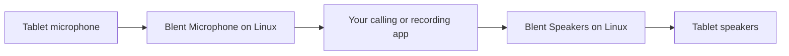

# Use the tablet microphone and speakers

Blent can present the tablet microphone as a Linux input device and send sound
from a Linux application to the tablet speakers. Each direction has its own
Start/Stop controls. Starting Blent, applying settings or reconnecting does
**not** start audio or change your system's default sound devices.

## Before you start

- Use matching Linux and Android builds. Linux audio needs a running PipeWire
  user server, its client library and SPA modules. PulseAudio-only, Windows and
  macOS audio backends are unsupported.
- Packaged builds include the isolated `blent-audio` helper. Source builds need
  `--features blent/native-audio`, PipeWire/SPA development headers and libclang
  (`libpipewire-0.3-dev`, `libspa-0.2-dev`, `libclang-dev` on Debian-family systems).
  AppImage uses the host's PipeWire runtime to match its modules.
- Choose the connection separately for microphone and speakers in the desktop
  **Audio** tab. ADB is the default. For **Direct USB**, use the full **Tablet**
  fingerprint shown by USB connection controls. A USB target and ADB serial
  cannot be selected together. USB never silently falls back to ADB.
- Direct USB requires an `accessory-transport` build and remains experimental.
  Physical acceptance covers the selected API 36 RugKing Pad 2 Pro, not all tablets.

Missing audio dependencies fail audio Start without preventing display sharing.
For ADB, leave [Blent's temporary mappings](adb-media-mappings.md) under its control
until cleanup finishes. Other ADB operations and unrelated mappings remain usable.

## Start sharing

1. In the desktop **Audio** tab, select the direction, connection and preferences.
   **Apply** only saves them; it does not start audio or restart the display.
2. Choose **Start** for that direction. On the tablet, approve the offered audio
   session. Microphone capture also needs Android microphone permission;
   speaker playback does not.
3. In your calling/recording application, choose **Blent Microphone** as its input
   or **Blent Speakers** as its output. Blent does not reroute other applications
   or mirror the existing system mix automatically.
4. Choose **Stop** when finished. The session's Linux device is removed. If status
   remains **Stopping**, cleanup is still pending; that direction cannot restart
   until its original workers and connection have retired.

The two directions remain independent. Pairing trusts a computer; it does not
consent to recording or playback. A new USB offer needs fresh local Start.
The CLI equivalents are `blent audio --direction microphone` and
`blent audio --direction speakers`. Add `--serial TABLET_SERIAL` for an explicit
ADB tablet or `--usb-peer <full-tablet-fingerprint>` for direct USB. Ctrl-C/SIGTERM
requests stop and waits for original pipeline cleanup.

## Choose settings

| Control | Meaning and tradeoff |
| --- | --- |
| Speech / Raw | Speech requests communication processing and available echo cancellation. Raw requires advertised unprocessed support; it is not available on every tablet. Neither choice guarantees acoustic quality. |
| Application buffer | 20–200 ms in 10 ms steps; default 40 ms. Smaller buffers tolerate less timing variation; larger buffers add lag. This excludes device, transport and PipeWire buffering. |
| Tablet microphone gain | 0–200%; default 100%. Android can follow the host processing choice or override it. |
| Tablet speaker volume | 0–100%, for this audio track only. |
| Built-in input/output preference | Requests the tablet's built-in microphone or speaker. The actual route is reported separately. |
| Request low-latency speaker mode | Off by default. Android may decline it; granted mode is reported. It can use more power and does not change the native buffer request. |
| Background audio | Requires a host request and explicit tablet consent/settings. Start while the app is visible. A foreground service and Stop notification keep approved background audio identifiable. |

Changing tablet settings stops that direction. Foreground-only audio stops when
the app hides. Microphone permission loss, native errors, Android silencing or an
observed route change ends capture. An observed speaker-route change requires
explicit Start again; reconnecting never resumes either direction automatically.

Speaker focus denial prevents playback. Temporary focus loss pauses and clears
queued sound; focus regain can resume only the same active session. Permanent
focus loss stops it. A dead Android playback object may be recreated within its
existing authorization, discarding the interrupted block.

## Quality and troubleshooting

If Start fails, read the direction's status first: check connection/trust,
permission, PipeWire availability and supported processing mode. Raw processing
was explicitly unsupported in the selected RugKing test. Do not disable consent
to work around a failure.

The application drops stale audio and plays silence when input runs out. Device
clock correction uses native counters when available; unavailable counters leave
bounded playback at its nominal rate and report drift as unmeasured. Buffer
settings and counters are not measurements of microphone-to-speaker delay.

Selected-device [speaker](reviews/artifacts/2026-10-20-media-acceptance/T860/README.md)
and [microphone/duplex](reviews/artifacts/2026-10-20-media-acceptance/T859/README.md)
checks passed. [Later debugging-off reconnect checks](reviews/artifacts/2026-10-21-t1237/README.md)
and [Stop checks](reviews/artifacts/2026-10-21-media-acceptance/T1238/README.md)
record fresh consent and original worker retirement. These are bounded observations,
not certification of other devices, sustained clock drift, echo cancellation or
acoustic latency. Muted low-latency tests found about 67 ms less counter-estimated
queued audio; they did not measure sound reaching a listener.

For exact packet schemas, deadlines, ownership rules and regression evidence,
see the [audio technical reference](audio-reference.md).
