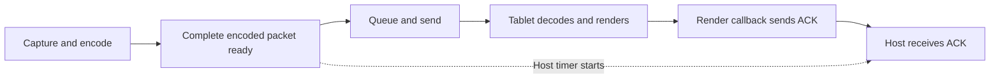

# Benchmarks

Blent has dated measurements, not a universal speed or battery-life guarantee.
Results depend on hardware, settings and workload. There is **no matched total
speedup measurement** comparing upstream with the current fork.

For tuning, start with [video settings](video-codecs.md), [pipe capacity](pipe-buffer.md)
and [scheduling](scheduling.md). For evidence, choose a report below. A *replay*
feeds recorded or synthetic data into one component; it does not measure the
whole tablet experience.

## Fork measurement guide

| Report | What it establishes, and what it does not |
| --- | --- |
| [Fork performance](benchmarks/2026-09-21-fork-performance.md) | Matched changes and resource counts, with implementation status; no total speedup claim. |
| [First physical baseline](benchmarks/2026-09-17-device-baseline.md) | AMD VAAPI, Ulefone tablet and sustained USB battery observations. Different hardware from the upstream series below. [Benchmark archive](benchmarks/README.md). |
| [Scheduling](benchmarks/2026-09-21-scheduling/README.md) | High gets more CPU under contention; no consistent live video-latency gain. High is requested by default; Normal remains available. |
| [GPU prototype](benchmarks/2026-09-21-gpu-adapter/README.md) | Matched USB trials: measured process CPU down 32.7%, source-update-to-render-ACK median up from 28.72 to 37.43 ms. FIFO remains default; corrupt imports are rejected. [Initial feasibility](benchmarks/2026-09-21-gpu-capture.md). |
| [Conversion and workers](benchmarks/2026-09-17-conversion.md) | T383 dirty-work scheduling, scaled kernels, scalar/vector comparisons and 128 participants. Isolated CPU results, not display or battery gains. |
| [Packet storage](benchmarks/2026-09-17-packet-storage.md) | Owned libavcodec buffers, allocation/pool reuse and slow-consumer retention; only this stage is measured. |
| [CLI assembly](benchmarks/2026-09-17-cli-assembly.md) | T407 owned reads and bounded assembly against T384, with 1/2/4 sessions; preserves push and actual read-boundary measurements. |
| [Timing bookkeeping](benchmarks/2026-09-17-timing.md) | T404 Android lookup cache and Rust acknowledgement/sample reuse: lookup times and allocation calls, not display latency or power. |
| [Decoder profiles](benchmarks/2026-09-18-decoder-profiles.md) | T386 lifetime/recreation checks, 84 profile and 36 correlated trace trials. Keeps synchronous defaults and distinguishes output from render notifications. |
| [Frame pacing](benchmarks/2026-09-18-frame-pacing.md) | T399: 96 valid trials and whole-picture admission. Sparse input increased delay; render-latest found no ready backlog. Defaults retained. |
| [Codecs](benchmarks/2026-09-18-codecs.md) | Matched quality, VAAPI depth/concurrency and physical decoding. T400 gates depth one and low-latency H.264; failed VAAPI HEVC and slow software AV1 remain documented. |
| [Power policy](benchmarks/2026-09-18-power-policy.md) | T388 opt-in setting, tests and USB lock lifecycle. That report does not establish sustained battery-life improvement; its desktop/power follow-ups are historical status. |
| [Decoder input](benchmarks/2026-09-18-decoder-input.md) | T403 staging versus direct codec-buffer reads. Staging stays default; no kernel zero-copy or battery claim. |
| [Input batching](benchmarks/2026-09-17-input-batching.md) | Native bytes and synchronization checked; writes fell from 256 to 38 for the recorded sequence. Counting writers, not live input latency. |
| [Readiness](benchmarks/2026-09-17-readiness.md) | T405 native writer/optional Rust reader versus the preceding revision: cancellation, 1/2/4-session CPU, reads and frame age. |
| [Pipe capacity](benchmarks/2026-09-17-pipe-capacity.md) | Isolated host transport: 1–32 MiB requests and slow-reader frame age. The experiment does not alter installed applications. |
| [Lossless RGB](benchmarks/2026-09-18-frame-compression.md) | T419 host frame/rectangle/tile/XOR and native decompression. No production mode; reconstruction, presentation and battery gains were not established. |
| [USB 2.0](benchmarks/2026-09-18-usb2-compatibility.md) | The selected tablet negotiated 480 Mb/s; ADB throughput and 2,960 replay pictures checked. Charging/battery results are separate. |

[Performance research](reviews/2026-09-17-performance-scalability.md) separates
hypotheses from measurements. The broader T382 multi-tablet campaign remains
declined; an old report's proposed follow-up does not reopen it.

## Historical upstream series

Historical results inherited from the upstream project (historical upstream),
retained with their original numbers. They describe one host and one tablet,
not measurements rerun on this fork. The initial series covers 1.0.0–1.1.0;
the CPU/capture sections also contain explicitly labeled 1.2.0 follow-ups.
Their separate measurement dates were not recorded here. No raw sample set
is included, so the statistical results cannot be independently reconstructed
from this document alone.

## Test configuration

| | |
| --- | --- |
| Initial series dates, as reported | 2026-08-26 to 2026-08-31 |
| Initial series versions | upstream 1.0.0–1.1.0; later comparisons labeled below |
| Host | Laptop, NVIDIA GeForce RTX 5060 Laptop GPU, Bazzite (Fedora Atomic) with KDE Plasma 6 on Wayland, kernel 7.2 |
| Tablet | Samsung Galaxy Tab S9 Ultra (Snapdragon 8 Gen 2), 2960×1848 @ 90 Hz |
| Link | USB-C cable, adb over USB; Wi-Fi tests on a 5 GHz (tablet) / 6 GHz (host) link to the same router, RSSI −37 / −44 dBm |
| Stream | 2960×1848, 90 fps target, constant-quality VBR (`quality = 12`, `bitrate` cap 60 Mbps), H.264 NVENC unless stated |
| Desktop content | a mostly static desktop with occasional window movement; bitrate on a static desktop settles around 0.5–4 Mbps |

## How latency is measured

An acknowledgement (ACK) is the tablet's message that its render callback ran.
It does not prove the physical moment a pixel became visible. In the tables,
**p50** is the median and **p95** is the value at or below which 95% of samples fall.



The host timer runs from the complete packet being ready until the host receives
the ACK. It excludes capture, encoding and earlier packet assembly. The precise timer definitions follow.

The daemon starts a host-clock timer when a complete encoded access unit is
ready for broadcast, after encoding and CLI packetizer buffering. The app
returns its sequence number after Android's `onFrameRendered` callback runs;
the timer stops when the host receives that acknowledgement over the input
socket. The current log label **packet-ready→render-ACK (host clock)** measures **encoded
packet ready → render acknowledgement received**, including forward queueing,
transport, decoding/rendering, callback scheduling and the return message.
It is not a camera measurement of pixels becoming visible.

The tablet's **arrival→render-callback (tablet clock)** value covers complete-frame
arrival to execution of its render callback. Each interval reports its own
sample count; missing tablet durations can give them different populations.
Historical logs call these intervals **encode→display** and **decode+render**.
Their legacy **wire** estimate subtracts independent medians. That subtraction
does not isolate transport, host queueing or acknowledgement time. T457 removes
this invalid decomposition; no replacement component can be reconstructed
without the missing paired historical samples.
Benchmark readers accept both the current and historical labels.

Capture, encoding, and time already spent assembling an access unit are outside
that host timer. The helper's separate `capture→fifo` timer begins after
`evdi_grab_pixels` returns and ends after the frame is written to the FIFO;
it excludes the compositor wait and the grab itself. These uncorrelated metrics
do not add up to a measured total display latency.

## Results

### Encoded packet to acknowledgement, USB

| codec | p50 | p95 | notes |
| --- | --- | --- | --- |
| H.264 (NVENC) | 18–22 ms | 23–31 ms | default |
| HEVC (NVENC) | 15–18 ms | 20–23 ms | lower reported latency on this tablet; not a universal codec advantage |
| HEVC Main10 (10-bit) | 16–17 ms | 19–22 ms | similar reported range to 8-bit HEVC |

Alongside the ~22 ms H.264 host-clock figure, the tablet separately reported
about 15 ms from frame arrival to render callback. These independent summaries
do not establish a remaining 5–7 ms transport/queueing component. Encoding time
was outside the host measurement.
On this hardware, `stream_scale = 2` (a quarter of the pixels) brought the
reported p50 from 22 ms to 16 ms at the cost of softer text.

### USB vs Wi-Fi (H.264, quiet link)

| | USB | Wi-Fi, no radio lock | Wi-Fi, with lock (1.0.0+) |
| --- | --- | --- | --- |
| p50 (median of 5-second windows) | 22.0 ms | 32.0 ms | 22.8 ms |
| p95 (median of windows) | 25.3 ms | 113.7 ms | 78.6 ms |
| windows with p95 < 60 ms | 7/7 | 14/73 | 10/31 |
| worst single frame | 32 ms | 5775 ms | 2546 ms |

With the radio lock, this test's median approached USB, while long delays
remained. These observations are consistent with a benefit from reducing
radio power saving; they do not isolate the cause of every delay or establish
that signal strength/router changes cannot help. Other networks and tablets
can behave differently.

### Host CPU

| encoder path | pipeline CPU (helper + encoder) |
| --- | --- |
| ffmpeg child process (default) | ~190 % of a core |
| in-process libavcodec (`--features inproc-encoder`) | ~97 % |

The reported packet-to-acknowledgement latency was similar; this metric does
not establish encoder latency, because its timer begins after encoding.

Historical helper measurement: 96 % of a core before 0.4.0 while the output
was disabled (a poll-loop deadline bug), 1.6 % afterward. Current daemon
lifecycle stops the helper when no display session is needed; the historical
number is not a measurement of current unplugged-daemon CPU usage.

The upstream 1.2.0 follow-up reports FFmpeg 8 encoder-process CPU changing
from ~280 % to ~12 % of a core at a 90 fps target after moving BT.709 tags to
the input to avoid a CPU colour conversion. This is a different version and
measurement from the helper-plus-encoder table; do not compare their totals
as if they were the same workload.

### Frame rate ceiling of the EVDI capture cycle

The helper requests an update, waits for the driver's event, then grabs the
frame into its own buffer. The recorded request wait includes compositor and
driver work; these timers do not prove that every compositor serializes its
next render behind the helper's copy. Upstream measurements at 2960×1848
under continuous motion (the helper reports these stages every 5 seconds):

| half of the cycle | 1.1.0 | 1.2.0 |
| --- | --- | --- |
| compositor answers a request | 9–11 ms | 9–11 ms |
| helper copies the frame (`evdi_grab_pixels`) | 6.3–6.7 ms | 4.0–5.0 ms (huge pages) |
| frames delivered at a 90 fps target | 52–57 /s | 58–63 /s |

At the reported 90 fps target, this setup delivered roughly 60 frames/s.
That does not establish an invariant ceiling for other workloads, drivers or
future changes. `stream_scale` scales after the grab, so it does not reduce
the framebuffer being copied; lowering the virtual resolution does. A
PipeWire/dmabuf path is a proposal whose copy count and performance would
need implementation and measurement.

## Limitations

- One host, one tablet model. Decode/render is a substantial part of the
  measured packet-to-ack interval; total display latency was not measured.
- The historical 90 fps/quality-12 setup is not the fork default: host FPS is
  60, quality is 18, and the app now requests a 60 Hz display mode by default.
- The legacy wire estimate is an invalid decomposition: subtracting independent
  percentiles cannot isolate transport, host queueing or any other stage.
- "Windows with p95 < 60 ms" is a coarse stutter indicator, not a standard.
- This inherited upstream series contains no AMD/Intel VAAPI or libx264 measurement.
  Fork reports above are separate experiments, including AMD VAAPI.

Reports with other hardware are welcome as
[compatibility issues](https://github.com/geraldo-netto/blent/issues/new?template=compatibility.yml);
include the exact commit, hardware, encoder/settings, workload and several
`Latency packet-ready→render-ACK` log lines. The log label alone does not describe a
reproducible benchmark.


## Android control replay

This developer test checks how input messages queue and recover under load.
It uses fake sockets; its numbers are not physical tablet latency.

<details>
<summary>Commands, recorded counts and measurement limits</summary>


T387 adds `ControlLoadTest`, a normal automated test with a repeatable synthetic
input workload. Run it with:

```sh
./android/gradlew -p android testDebugUnitTest --tests com.blent.ControlLoadTest --rerun-tasks
```

The test replays up to 4,800 stylus MotionEvents, each with three historical
samples plus its current sample, and one rendered-frame acknowledgement every
four events. One fake socket drains immediately; another stops at an intentionally
small 8 KiB queue to exercise refusal and whole-connection recovery. The test
asserts ordering-related counts, queue bounds and recovery, without elapsed-time
or allocation thresholds. Per-message JSON remains unchanged.

`T387_RESULT` JSON lines appear in the test XML's `system-out` under
`android/app/build/test-results/testDebugUnitTest/`. The
[2026-09-17 raw result](benchmarks/2026-09-17-control-jvm.json) records the source
hashes, JDK, host and method. In that replay the draining case accepted 20,401
messages; the stalled case accepted 80, refused one and retired the connection
at a peak measured queue of 8,112 bytes. This fake limit is not a production
queue policy: Blent retains OkHttp's existing queue bound.

The artifact's allocation count is the test thread's JVM allocation during the
replay, including synthetic MotionEvents and fake transport encoding. Its GC
count/time applies to the entire test JVM. The sample-age distribution was
constructed at 12, 8, 4 and 0 ms; it validates measurement plumbing and is not an
observed tablet-input latency distribution. These single-run figures establish
neither an Android ART baseline nor a performance improvement. Physical device,
network and thermal validation remains scoped to T388. The broader T382
campaign is closed as `wont_fix`; maintainer multi-tablet testing is outside
the current scope.

Runtime `ControlStatisticsSnapshot` summaries in `BlentTouch` logcat provide
accepted/refused counts, current/peak queue bytes and sample-age count/sum/max.
The counters use scalar storage and exclude tokens and input coordinates.
Measure ART allocation/GC with Perfetto or the Android profiler alongside these
counters when collecting a device baseline. Queue size cannot show delivery or
remote application of a message; use the host response for authoritative mode.

</details>

## Annex B packetizer replay

The packetizer groups encoded video data into complete pictures for transmission.
This replay measures that work in isolation, using synthetic data.

<details>
<summary>Commands, before/after table and exact measurement method</summary>


T384 profiles the default Rust packetizer independently of FFmpeg, EVDI,
networking and Android. The [raw results](benchmarks/2026-09-17-packetizer.json)
record the source hashes, parent commit, Rust 1.90 toolchain, CPU, container
image and all three samples per workload. These are instrumented synthetic
microbenchmarks, not measured changes in tablet FPS or end-to-end latency.

The workloads use deterministic H.264/HEVC syntax with parameter sets,
first/continuation slices and periodic IDR/IRAP markers. Payloads are markers,
not decodable pictures. `fragmented` feeds 40 pictures in seven-byte chunks
three times; `dense` feeds 400 pictures in 16 KiB chunks four times;
`large_nal` feeds two pictures with 1 MiB primary-slice payloads in 4 KiB chunks
twice. Each workload has an unmeasured warmup. Setup and result formatting are
outside the measured region; parser/packet allocation and destruction are inside.

| Codec / workload | Allocations, before → after | Median replay time (ms), before → after |
|---|---:|---:|
| h264 / fragmented | 19,191 → 390 | 2.762 → 0.125 |
| hevc / fragmented | 19,296 → 396 | 2.710 → 0.121 |
| h264 / dense | 8,224 → 3,300 | 1.182 → 0.761 |
| hevc / dense | 8,236 → 3,308 | 1.172 → 0.798 |
| h264 / large_nal | 2,102 → 32 | 519.052 → 4.787 |
| hevc / large_nal | 2,108 → 36 | 518.341 → 5.160 |

Allocations exclude reallocations, which are reported separately in the JSON.
Requested bytes sum allocation sizes; they are not peak retained memory.
Explicit-copy counters cover packetizer payload/header copies and buffer-front
shifts, excluding allocator-internal relocation and metadata copies. Scan
counters sum the spans passed to the scanner, not memory-bus traffic. For
H.264 `large_nal`, about 4.19 MB of input previously supplied about 1.09 GB to
repeated scans; the cursor reduces that to about 4.20 MB. Its explicit copies
fall from about 14.71 MB to 10.50 MB. Input buffering and access-unit assembly
still copy payload bytes; this is not a zero-copy pipeline.

The optimized packetizer retains an incremental scan cursor, rechecks only
possible split-prefix bytes, and borrows each complete NAL from the owned
input buffer while assembling packets. It retains input capacity and shares
immutable codec configuration through `Bytes`. Updating parameter sets creates
a new configuration, so queued packets retain their original headers. Start-code
lengths, partial NALs, multi-slice pictures, prefix SEI ownership, IDR/IRAP join
points, sequence allocation and encoder-generation retirement remain unchanged.

The normal test suite compares chunk sizes 1–129, mixed three/four-byte prefixes,
incomplete tails and large payloads. The same new characterizations pass on the
baseline and optimized implementations; the pre-existing packetization and
software encode/decode regressions remain. Timing has no pass/fail threshold.
The allocator and copy/scan counters are compiled only into the default host's
test binary, and measurement is enabled only on the calling test thread.

Run the current replay safely without opening a display or input device:

```sh
cargo test --locked --release -p blent --bin blent t384_ -- --nocapture
```

To reproduce the instrumented baseline, apply the committed
[baseline patch](benchmarks/2026-09-17-packetizer-baseline.patch) to parent
`5bbeb5b`. The patch adds the same measurement harness without the optimization:

```sh
baseline_dir=$(mktemp -d)
baseline_patch="$PWD/docs/benchmarks/2026-09-17-packetizer-baseline.patch"
git archive 5bbeb5b | tar -x -C "$baseline_dir"
(
  cd "$baseline_dir"
  git apply "$baseline_patch"
  cargo test --locked --release -p blent --bin blent t384_ -- --nocapture
)
```

Use the recorded toolchain and compare source hashes before comparing results.
`T384_PROFILE` lines contain the raw JSON. Three samples on a shared workstation
support this local comparison; broader hardware, power and multi-tablet claims
are not established. The broader T382 campaign is closed as `wont_fix` for now.

</details>
