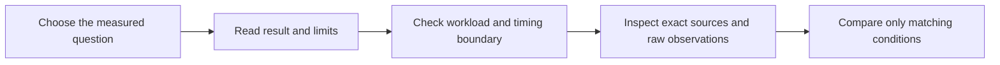

# Historical benchmark reports

These reports describe specific builds, hardware and workloads. Start with the
[measurement overview](../benchmarks.md) for results grouped by topic, or use
the file map below. Original measurements, commands and source identities are retained.
Historical “current”, “pending” and TODO statuses refer to the recorded milestone;
[TODO.md](../../TODO.md) is the active work list. Retired tracking does not mean
acceptance passed. Archived commands are reproduction records, not instructions
to run unreviewed old tooling or resume declined experiments.



For shared terms and historical scope, see the [archive guide](../history.md).
Related investigations are in the [review archive](../reviews/README.md); the
[artifact guide](../reviews/artifacts/README.md) explains test evidence.

## Report and evidence map

Small evidence indexes and checksum-covered tables stay unchanged. Their rows
below explain what they mean and where they belong. Expanding a report shows
the original detailed record; its numbers are not recertified for current code.

| File | What it establishes |
| --- | --- |
| [2026-09-17-cli-assembly](2026-09-17-cli-assembly.md) | Packet assembly used less CPU and copied fewer bytes in isolated host replays. This excludes encoding, transport, Android and battery use. |
| [2026-09-17-cli-assembly / evidence](2026-09-17-cli-assembly/README.md) | Artifact key for the packet-assembly comparison. Only the final series supports numeric comparisons; the cached-binary comparison is explicitly invalid. |
| [2026-09-17-conversion](2026-09-17-conversion.md) | Scaled conversion and sparse-work scheduling improved some measured costs. A later stride defect limits the historical padded-layout timings; native conversion did not show a universal gain. |
| [2026-09-17-device-baseline](2026-09-17-device-baseline.md) | One tablet sustained the tested motion stream but lost battery charge while USB-powered. This baseline is not a before/after optimization comparison. |
| [2026-09-17-discovery](2026-09-17-discovery.md) | A stalled synthetic device no longer blocked ready devices. The fixtures establish discovery isolation, not physical multi-tablet throughput. |
| [2026-09-17-fake-tablet](2026-09-17-fake-tablet.md) | Reusable receive storage greatly reduced the fake client's copying cost. The client acknowledges receipt without decoding or rendering. |
| [2026-09-17-input-batching](2026-09-17-input-batching.md) | Batching preserved every input event and synchronization boundary while reducing counted writes. No physical input-latency improvement was measured. |
| [2026-09-17-packet-storage](2026-09-17-packet-storage.md) | Large known packet allocations avoided a publication copy. The measured savings concern packet ownership, not total encoding or display latency. |
| [2026-09-17-pipe-capacity](2026-09-17-pipe-capacity.md) | Larger pipes sometimes reduced transfer CPU but held older frames behind a slow reader. The experiment did not justify an unconditional larger default. |
| [2026-09-17-readiness](2026-09-17-readiness.md) | Immediate readiness shortened raw-transfer tails, with higher CPU in some large concurrent cases. Notification and cancellation correctness were tested separately. |
| [2026-09-17-stream-resources](2026-09-17-stream-resources.md) | Encoded storage and slow-viewer retention became bounded. The budget excludes raw frames, parser staging, socket buffers and total process memory. |
| [2026-09-17-timing](2026-09-17-timing.md) | Timing bookkeeping gained correct thread/generation ownership and faster common lookups. Some lookup patterns cost more; these are not display-latency results. |
| [2026-09-18-codecs](2026-09-18-codecs.md) | Constrained Baseline reduced the tested tablet's H.264 delay, with a bandwidth tradeoff. Advertised HEVC support failed native trials; codec labels alone did not predict performance. |
| [2026-09-18-decoder-input](2026-09-18-decoder-input.md) | Direct reads into codec buffers did not show a useful tablet latency benefit. The staged heap path remained the default, with both paths retaining cancellation tests. |
| [2026-09-18-decoder-input/initial-table](2026-09-18-decoder-input/initial-table.md) | Initial decoder-input cohort table. Keep separate from the reviewed cohort; medians summarize that cohort's three trials. |
| [2026-09-18-decoder-input/reviewed-table](2026-09-18-decoder-input/reviewed-table.md) | Reviewed decoder-input cohort table after cancellation fixes. It does not establish a useful direct-input advantage. |
| [2026-09-18-decoder-profiles](2026-09-18-decoder-profiles.md) | Callback decoding reduced sparse polling but did not improve latency and increased allocations. Lifetime fixes were retained independently of performance selection. |
| [2026-09-18-decoder-profiles/profiles-table](2026-09-18-decoder-profiles/profiles-table.md) | Seven-profile decoder cohort table. CPU uses one core as 100%; callback timing is not optical presentation. |
| [2026-09-18-decoder-profiles/traces-table](2026-09-18-decoder-profiles/traces-table.md) | Separate correlated decoder-trace cohort. Its shorter trials and final lifetime fix must not be pooled with the earlier profile series. |
| [2026-09-18-frame-compression-resources](2026-09-18-frame-compression-resources.md) | The tablet's decoder and display services contribute costs outside the app process. This research defines a bounded renderer comparison; short observations establish no energy result. |
| [2026-09-18-frame-compression](2026-09-18-frame-compression.md) | Lossless rectangle compression warranted a prototype, but synthetic scenes understated photographic bandwidth. Host decompression and short native checks did not establish battery or display gains. |
| [2026-09-18-frame-pacing](2026-09-18-frame-pacing.md) | Lower input cadence increased the tested decoder's delay. Decode-all/render-latest found no ready-output backlog to shorten, so output skipping stayed disabled. |
| [2026-09-18-hevc-interop](2026-09-18-hevc-interop.md) | Tested AMD VAAPI HEVC streams failed on the tablet while x265 controls worked. The observations narrow interoperability, without proving a particular vendor cause or fix. |
| [2026-09-18-packet-framing](2026-09-18-packet-framing.md) | Stock FFmpeg packet boundaries removed a successor-picture wait in the host path. These measurements exclude capture, Android and physical presentation. |
| [2026-09-18-power-policy](2026-09-18-power-policy.md) | Battery saver changed wake-lock ownership without an established battery-saving percentage. The original implementation and incomplete physical comparison are preserved. |
| [2026-09-18-power-validation](2026-09-18-power-validation.md) | Three guarded phases completed; focus loss invalidated the fourth. Missing matched trials and coarse charge readings prevent a battery gain or regression claim. |
| [2026-09-18-profile-selection](2026-09-18-profile-selection.md) | Constrained Baseline gave the best tested latency/fidelity tradeoff on one host/tablet. The comparison includes a USB replay, but excludes compositor capture and optical presentation. |
| [2026-09-18-raw-input](2026-09-18-raw-input.md) | Direct raw input and a shared-memory prototype improved isolated transport costs. Later production shared capture has separate evidence; these figures are not display FPS. |
| [2026-09-18-raw-input/tables](2026-09-18-raw-input/tables.md) | Raw-input throughput and timing tables. Values describe saturated isolated inputs, not encoded or displayed frame rates. |
| [2026-09-18-status-polling](2026-09-18-status-polling.md) | Cached status probes and window-owned workers reduced repeated work. Probe counts and lifecycle tests do not establish faster video or lower tablet power. |
| [2026-09-18-usb-power-comparison](2026-09-18-usb-power-comparison.md) | Only one sustained normal/static phase completed before the paired saver run lost focus. No battery-saving comparison was established. |
| [2026-09-18-usb2-compatibility](2026-09-18-usb2-compatibility.md) | The tested tablet carried the selected stream over real USB 2.0 and acknowledged all replay pictures. This does not qualify all USB 2 devices or prove adequate charging. |
| [2026-09-19-idle-cadence](2026-09-19-idle-cadence.md) | One-update-per-second Baseline remained responsive, but keyframe gaps reached two seconds; High added substantial delay. Cadence changes need coordinated recovery checks. |
| [2026-09-19-idle-cadence / evidence](2026-09-19-idle-cadence/README.md) | Evidence guide for eight sparse-cadence trials and sixteen phases. Missing acknowledgements remain missing; keyframe checks are not a production reconnect test. |
| [2026-09-19-presentation-power](2026-09-19-presentation-power.md) | RGB reduced app CPU but did not show repeatable battery benefit. Surface traces also showed that decoder callbacks can occur for buffers never presented. |
| [2026-09-19-presentation-power / evidence](2026-09-19-presentation-power/README.md) | Evidence guide for presentation diagnosis and the ten-phase battery matrix. It preserves rejected interpretations, signed-current meaning and separate sampling boundaries. |
| [2026-09-19-rectangle-renderer](2026-09-19-rectangle-renderer.md) | RGB rectangles reduced CPU for some UI scenes but increased memory and photographic bandwidth. Presentation results did not establish a latency winner. |
| [2026-09-19-rectangle-renderer / evidence](2026-09-19-rectangle-renderer/README.md) | Evidence guide for renderer cohorts, exact source snapshots, input identities and sampled-memory limits. It preserves separate cohort meanings and historical source provenance. |
| [2026-09-20-damage-regions / evidence](2026-09-20-damage-regions/README.md) | Changed-region conversion saved work on narrow damage while full-frame results varied. The measured optimization does not send raw tiles to Android or establish battery gains. |
| [2026-09-20-evdi-restart / evidence](2026-09-20-evdi-restart/README.md) | A requested restart activated the helper; a diagnostic collector then accidentally ended its shared ADB server. Route restoration recovered video; this was not a paired optimization benchmark. |
| [2026-09-20-evdi-startup / evidence](2026-09-20-evdi-startup/README.md) | A read-only stock-libevdi probe reproduced costly process scans before capture. It explains a plausible startup delay, without a historical stack trace or an ownership-safe bypass. |
| [2026-09-20-forwarding-recovery / evidence](2026-09-20-forwarding-recovery/README.md) | Missing display reverse routes gained guarded repair and permanent regressions. Manual device recovery and later fixture validation are separate evidence. |
| [2026-09-20-idle-writer / evidence](2026-09-20-idle-writer/README.md) | A two-FPS writer experiment reduced idle writes while preserving tested fresh-frame wakeups. Host feasibility did not establish live tablet latency or battery savings. |
| [2026-09-20-live-playback / evidence](2026-09-20-live-playback/README.md) | Passive playback profiling found no dominant CPU starvation in that sample. Six queued-but-unlatched buffers and intermittent audio gaps still lacked cause attribution. |
| [2026-09-20-usb-hub-power / evidence](2026-09-20-usb-hub-power/README.md) | Short charging-port observations were uncontrolled and near full charge. They do not identify a better supply or establish sustained charging power. |
| [2026-09-20-youtube-audio / evidence](2026-09-20-youtube-audio/README.md) | Playback was smooth during a short passive sample, so intermittent Bluetooth audio gaps were not reproduced. Blent display traffic and the independent audio route were distinguished. |
| [2026-09-21-android-lock / evidence](2026-09-21-android-lock/README.md) | Read-only power fields did not identify the reported lock's trigger. No speculative wake-policy change was justified by those retained observations. |
| [2026-09-21-ffmpeg6 / evidence](2026-09-21-ffmpeg6/README.md) | The AppImage pinned and validated stock FFmpeg 6.1.6. Packaging and later live activation established no matched performance gain. |
| [2026-09-21-fifo-demand / evidence](2026-09-21-fifo-demand/README.md) | Skipping unused FIFO conversion reduced the retained helper's CPU during optional GPU capture. EVDI readback continued; total-system energy and latency were not measured. |
| [2026-09-21-fork-performance](2026-09-21-fork-performance.md) | A dated inventory of separate performance experiments. Percentages have different baselines and boundaries and cannot be combined into an overall fork speedup. |
| [2026-09-21-frame-omissions / evidence](2026-09-21-frame-omissions/README.md) | Six omitted compositor buffers each had a newer queued successor. Temporal correlation did not identify where the burst began or prove compressed-packet loss. |
| [2026-09-21-gpu-adapter / evidence](2026-09-21-gpu-adapter/README.md) | Patterned physical trials exposed cross-device corruption and worse GPU-capture latency despite lower measured CPU. The prototype remained optional and FIFO stayed the default. |
| [2026-09-21-gpu-capture](2026-09-21-gpu-capture.md) | Early uniform-color GPU import probes established feasibility only. Later patterned trials superseded their optimistic interpretation and rejected cross-device imports. |
| [2026-09-21-scheduling / evidence](2026-09-21-scheduling/README.md) | Higher scheduling weight changed CPU allocation under controlled contention. Passive playback did not show lower latency or establish an audio-gap fix. |
| [2026-09-21-shared-capture / evidence](2026-09-21-shared-capture/README.md) | Matched shared-input replays supported the optional libx264 adapter, with a small measured latency benefit. CLI/VAAPI remained on FIFO; live activation was a separate check. |
| [2026-09-21-shared-damage / evidence](2026-09-21-shared-damage/README.md) | Per-slot damage histories reduced idle and sparse shared-buffer work while retaining leased pixels. Full-frame results varied; no battery or end-to-end gain was measured. |
| [network-power-protocol](network-power-protocol.md) | Proposed matched USB-versus-network power protocol, not a result or an active test authorization. Transport and power wiring must be identified and held comparable. |
| [power-supply-protocol](power-supply-protocol.md) | Proposed comparison of identified USB power arrangements. Short near-full-battery spot checks cannot establish charging adequacy; the plan preserves matched trials and restoration. |

<details>
<summary>Maintain or repeat the guarded baseline: collection, units and interpretation</summary>

# Device benchmark artifacts

The dated packetizer and control JSON files describe isolated synthetic tests.
Device runs are stored in directories containing build/deployment provenance,
phase boundaries, raw observations, a calculated summary and a timeline plot.
Results are scoped to their recorded build, hardware and workload.

The [2026-09-17 device baseline](2026-09-17-device-baseline.md) is the initial
physical-tablet run for the next optimization comparison.

The [2026-09-18 packet-framing comparison](2026-09-18-packet-framing.md) measures
stock FFmpeg input-to-packet-ready delay on the host, including sparse input
and one/two/four concurrent encoders. It is separate from the physical-tablet
baseline's packet-ready-to-render-ACK observations.

The [2026-09-18 battery-profile validation](2026-09-18-power-validation.md)
records three accepted USB phases and a fourth rejected after focus loss.
It verifies lock ownership but does not establish a battery-saving improvement;
the full matched comparison and streaming-off control remain pending.

## Repeating the device baseline

Build/install both applications first. Keep the Linux release profile and the
Android APK variant/signing configuration identical between comparisons. Record
the source commit and SHA-256 of the daemon, GUI, helper, libevdi and APK. The
default CLI encoder uses the installed stock FFmpeg; record that version too.

The workload requires Linux X11, Python 3 with Tk and python-xlib, an existing
non-primary 1280×800 virtual display and one connected Android tablet already
running a debuggable Blent APK (`run-as` reads the app's process counters).
The collector does not create displays, change settings or
install applications. Its borderless test window covers only the selected
monitor; closing the window or terminating the collector ends the experiment.
Keep the tablet on Blent and leave the USB cable, hub and power source unchanged.

```sh
# Set TABLET_SERIAL to the device shown by adb devices -l.
python3 scripts/benchmarks/run-baseline.py \
  --serial "$TABLET_SERIAL" --geometry 1280x800+3840+0 \
  --output /tmp/uscreen-device-baseline --seconds 300 --warmup 60
python3 scripts/benchmarks/summarize.py /tmp/uscreen-device-baseline \
  > /tmp/uscreen-device-baseline/summary.json
python3 scripts/benchmarks/plot-baseline.py /tmp/uscreen-device-baseline \
  /tmp/uscreen-device-baseline/timeline.png
```

Use a new output directory each time. Adjust the monitor position to the actual
`xrandr --listmonitors` result. The workload has fixed 1280×800 content; a different
resolution needs a separately recorded workload rather than silently scaling
this one. Plotting requires matplotlib; collection and summarization use the
Python standard library plus Tk and python-xlib. The normal automated suite also
requires these modules and Xvfb; its visibility tests use a private X server.
The collector queries Android `getconf CLK_TCK` and `getconf PAGESIZE` before
starting (T446), records the validated values in metadata and uses that same page
size for RSS conversion. Missing, failed or malformed unit queries reject the
run; there are no guessed defaults. Historical runs recorded this tablet's
verified 100 Hz/4,096-byte units and retain their original metadata.

The 36-minute sequence is three paired trials: static/motion, motion/static,
static/motion. Each five-minute measured phase has a one-minute warm-up. Static
content is a fixed text/grid pattern. Motion scrolls the same text at 96 pixels/s
and moves four colored rectangles, scheduled at 60 updates/s. Scheduling counts
describe requested drawing updates, not display presentation. The script records
actual phase timestamps and source hashes. The application remains unmodified.

The T424 visibility guard requires an unlocked logind session
(`XDG_SESSION_ID`, `loginctl`) and a responding Cinnamon, GNOME or freedesktop
ScreenSaver `GetActive` D-Bus interface (`gdbus`). Missing or unknown lock status
rejects the run. Both sources are checked because Cinnamon can report an active
lock screen while logind's `LockedHint` is false. Unlock manually before starting;
the collector never unlocks the desktop.

The workload takes keyboard focus once, after checking lock status. A background
observer checks lock status, exact window geometry, focus and X11 window stacking
every 250 ms plus query time. Each phase boundary checks the latest result; a
result older than two seconds also invalidates the run. Any mapped InputOutput
window overlapping the target above it or its ancestors rejects coverage,
including under compositor redirection. This deliberately rejects transparent
overlapping windows too. It does not prove optical presentation, detect every
brief change between polls or inspect arbitrary compositor effects; keep the
tablet foreground and desktop free of effects/overlays during measurement.

T470 adds a separate tablet session observer. Every half second plus query time,
it uses a read-only ADB query with a two-second deadline to check the Blent PID,
process start time, focused window and reported keyguard state. A changed process,
background app, showing keyguard, failed query or observation older than four
seconds invalidates the workload. It never launches the app, restores focus or
unlocks the tablet. The device must allow `run-as io.github.geraldo_netto.blent` to read its process
stat, as required by the existing process sampler. These periodic checks cannot
prove optical presentation or exclude changes occurring entirely between polls.

Sampler exceptions and log-reader failure/early exit are owned and reported to
the workload; a sampler without a successful collection for 30 seconds is stale.
Cleanup writes `observer.json` with completion/errors and host arrival times for
filtered log records. Android log timestamps retain their native clock and are
not compared directly with host phase boundaries.

Loss of visibility stops the workload and writes `invalid.json`; raw observations
stay in that run's directory. The summary marks it incomplete/invalid, clears
ordinary performance results and places any calculated observations under
`invalid_data` for diagnosis. Older datasets remain readable with visibility
explicitly `unverified`; they are not retroactively certified. Use a new directory
for every retry and exclude invalid/unverified runs from controlled comparisons.
The timeline plotter refuses invalid runs as well. Missing battery, CPU or latency
traces are labelled “No observations”; available traces remain plotted. Its title
uses recorded geometry and visibility status and does not invent encoder/FPS facts.
Summaries require at least two process samples per measured phase with no gap
above 30 seconds, stable Android process identity and retained host/Android logs.
New guarded runs additionally require continuous tablet-session observations,
Android log receipts in each measured phase and clean observer completion.
Missing files, failures and stale evidence quarantine the results with explicit
reasons; sparse video does not require a minimum FPS. The plotter applies these
additional requirements to new guarded runs. Historical observation status stays
`unverified` without the new evidence. Reanalysis of the retained September 17
baseline passed its available-evidence checks; no archived files were changed
and it was not retrospectively certified for foreground continuity.

## What is recorded

| Artifact | Meaning |
| --- | --- |
| `metadata.json` | Source/workload identity, phase plan, host clock-tick units, kernel and Android build. |
| `deployment.json` | Build profile, installed artifact hashes, settings, device/driver/USB information and validation evidence. Supplement per run with its deployment facts. |
| `phases.jsonl` | Actual host UTC/monotonic phase boundaries and workload update counts. |
| `invalid.json` | Failure reason when visibility is lost or the workload is interrupted; excludes the run from valid comparisons. |
| `samples.jsonl.gz` | Five-second process CPU ticks/RSS/threads and host load; thirty-second Android battery/thermal/display observations; minute app memory snapshots. |
| `host-windows.jsonl.gz` | Filtered, original-timestamp performance messages from the service journal. |
| `android.log.gz` | Filtered decoder/statistics messages; no screenshots, input coordinates or tokens. |
| `android-session.jsonl` | Host-timestamped tablet process identity and foreground checks (T470). |
| `observer.json` | Owned collector completion/errors and host log-arrival timestamps (T470). |
| `summary.json` | Per-phase CPU/RSS distributions, charge change and distributions of log-window statistics. |
| `timeline.png` | Battery change, host pipeline CPU and logged latency windows across all phases, including warm-up. |
| `run-integrity.json` | Coverage/continuity checks, recovery provenance and validation evidence. |
| `SHA256SUMS` | Hashes of the archived artifacts. |

Raw line files can be kept uncompressed while collecting. The summarizer accepts
either raw JSONL or `.jsonl.gz`. Preserve raw files and hashes; a summary alone
cannot support later reanalysis. Journal filtering accepts text and byte-array
MESSAGE representations (T410), strips ANSI colors and redacts 64-digit hex
identifiers. The normal tooling suite runs permanent T382/T410 parser/unit tests.

## Interpretation and comparison

CPU is computed from process user+system tick differences divided by elapsed
host monotonic time and clock ticks/second. **100% is one logical core.** PID and
start-time identity must match; a replacement process is not treated as negative
CPU. The host pipeline sums daemon/helper/FFmpeg and excludes the workload,
Cinnamon and Xorg, which are recorded separately. Android app CPU excludes
separate codec/compositor/system processes. RSS includes shared pages; do not
interpret summed RSS as unique physical memory.

The host's `packet-ready→render-ACK (host clock)` label measures **encoded access
unit ready → render acknowledgement received**. It excludes capture, encoding
and packetizer assembly. Historical `encode→display` logs describe the same
interval; the summary and plot readers support both labels. The separate
`tablet arrival→render-callback (tablet clock)` report replaces `decode+render`;
the misleading difference-of-medians `wire` estimate is no longer logged.
The Android timing ends when its render callback runs; callbacks can be delayed
or batched, so it is not optical input-to-photon latency. See the
[MediaCodec callback contract](https://developer.android.com/reference/android/media/MediaCodec.OnFrameRenderedListener).
The helper's `capture→fifo` interval starts after the framebuffer grab. Never add
their independently reported percentiles to estimate end-to-end latency.

Logs contain five-second window percentiles, not per-frame raw durations. The
summary therefore gives distributions **of those window statistics**, including
their median/min/max and window count. A median of window p95 values is not a
pooled frame p95. No frame-level p99 can be reconstructed. The first ten seconds
of log reports after each measured-phase boundary are excluded to avoid mixed
warm-up windows. Encoded FPS is access units divided by the logged interval;
it is not proof that the panel presented every frame.
Reports also have bounded sample storage: the helper retains at most 256
capture-to-FIFO samples per report, and the host latency tracker at most 1,024
acknowledgement samples. These are the implementation's logged statistics,
not an independently sampled trace of every frame.

Android's charge counter uses microampere-hours. The summary computes
`net mA = charge_delta_uAh × 3.6 / elapsed_seconds`; a negative result means the
battery lost charge despite USB power. Report endpoints, duration, temperature
and gauge resolution. This is whole-device **net battery current**, not USB input
current or isolated app power. The reported maximum charging current/voltage is
not a wattmeter reading. See [BatteryManager](https://developer.android.com/reference/android/os/BatteryManager#BATTERY_PROPERTY_CHARGE_COUNTER)
and [Perfetto power-data limitations](https://perfetto.dev/docs/data-sources/battery-counters).

Compare the same static/motion trials at the same resolution, encoder, quality,
rate policy, app brightness, observed refresh, USB route, charging source and APK
variant. Check process continuity, foreground state, temperature and background
load. Repeat runs and report variability; a later run on a different charging
port is a separate power experiment. Small changes below gauge/timing variation
are inconclusive. The broader T382 campaign is closed as `wont_fix` for now;
maintainer multi-tablet testing and large/NUMA-machine measurements are outside
the current scope. Existing single-tablet results and automated coverage remain
scoped to their recorded evidence. Users may tune the supported options and
measure their own setups.

The isolated decoder and static power-control APKs use the same
`showWhenLocked`/`turnScreenOn` Activity flags as UScreen (T460). Their own test
content can remain visible above an existing secure keyguard; they do not unlock
the tablet. Without those flags Android can pause the replay before codec setup,
retire its Surface and produce misleading decoder errors. Switching to another
app still cancels the replay. Discard incomplete trials and verify the observed
refresh rate. This does not relax the unlocked **Linux desktop** requirement.

Codec quality measurements use strict software decoding before comparing pixels
(T461). `codec-host.py` retains error-level diagnostics in `decode.log` and
rejects both a failed process and any decoder error, even if FFmpeg returns zero
and produces the expected frame count through error concealment. Valid frame
counts alone do not establish valid decoding. The permanent regression uses an
unaltered corrupt HEVC fixture from the T422 stock-encoder experiments, with a
clean access unit as its positive control. Historical measurements must be
checked against their retained decode logs before making quality claims.
`codec-match.py` also validates cached measurements (T462): the reference hash
and decoded frame count must match the requested corpus, and `decode.log` must
be present and empty. Missing diagnostics, decode errors or stale corpus results
require a fresh measurement. Legacy warning-level logs containing warnings are
also rejected conservatively; rerun with the current strict decoder to establish
whether the input is clean. Verified existing caches remain reusable.

T469 adds shared content validation in `codec_artifacts.py`. Host encoding and
paced replay verify the raw corpus size and SHA-256 before starting and again
before accepting results. Cache reuse and decoder-fixture export also verify
the encoded file's size/hash, codec selection, dimensions, frame count and
reference format (including FPS). Fixture export checks that its copied result
still matches the retained `result.json`, then verifies the encoded source again
after extraction. Missing or changed artifacts require a fresh measurement;
hashing the replacement file does not establish the old quality result.

New results retain explicit reference-format provenance. Historical results can
use the original retained FFmpeg input command for that format check, alongside
their actual files and clean decode logs. Validation never rewrites historical
metadata or retrospectively establishes physical display performance.


</details>
