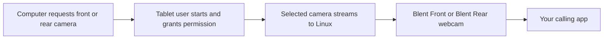

# Use a tablet camera as a Linux webcam

Blent can send the tablet's front or rear camera to a Linux calling application.
Start requires a request on the computer and separate consent on the tablet.



ADB sessions use [Blent-owned temporary connections](adb-media-mappings.md).
Leave those mappings under Blent's control until cleanup finishes; unrelated
ADB operations remain available.

The host **Cameras** tab controls camera sharing: Front/Rear, resolution, frame
rate, bitrate, clockwise rotation (0°, 90°, 180° or 270°), mirroring and whether sharing continues while the tablet app is
hidden or its screen is locked. Lens and resolution stay visible; the remaining
profile controls are under **Advanced camera settings**. Android shows status,
its required camera permission prompt, and explicit **Start camera** / **Stop
camera** actions; camera profile configuration stays on the computer.

Choose a lens and press **Start camera** on the computer. Open Blent on the
tablet, then press its separate **Start camera** and grant camera permission
if requested. Pairing alone does not start capture. In Google Meet or another application, select
**Blent Front** or **Blent Rear**, matching the host selection. Both ordinary
Linux webcams exist while sharing runs, but only the selected lens is live;
the inactive endpoint is black. A browser's webcam picker does not switch lenses.

The small live preview shows the selected webcam’s exported image, including
rotation and mirroring. It uses a thumbnail at up to five updates per second; it
does not open a second camera. Stopped or stale previews clear rather than
retaining the last camera image. Select **180°** when the tablet is upside down,
then **Restart camera** to apply the change.

The camera helper is embedded in the host GUI through a reusable host library.
No separate helper command or display daemon is needed. Keep the host window
open while sharing; **Stop camera** or closing that window requests capture
cleanup and black output. A replacement waits for the original output workers
and FFmpeg decoder and, for direct USB, the original registration to retire.
Unconfirmed cleanup keeps replacement pending; Stop also cancels that pending
start. ADB mappings remain owned through cleanup under the
[exclusive-endpoint contract](adb-media-mappings.md). Physical delegated-effect
acceptance remains separate (T1258). Camera operations never attach EVDI or restart display sharing.

**Apply** saves camera preferences without starting capture. **Start camera**
uses the current controls; **Restart camera** applies changed controls to an
active camera. Opening the host never restores capture automatically. After
an error, correct its cause and press Start/Restart to retry. The tablet can stop
capture or restart the existing computer request while that session remains
available. Its Start action is disabled without a request. Tablet Stop ends
capture without stopping display/input or deleting the computer’s camera outputs;
use Stop on the computer to retire the entire camera session.

**Continue while hidden or locked** defaults off. When enabled, Android starts a
camera foreground service with a persistent notification and holds a CPU wake
lock until capture ends. Start with Blent visible on the tablet; Android's
[camera service restrictions](https://developer.android.com/develop/background-work/services/fgs/service-types#camera)
require foreground permission to initiate this service. Once running, the
Activity may hide or the screen may lock. Lock/sleep actions can require a
manual Android unlock before later foreground-only sharing; the host does not
bypass the tablet’s lock. Foreground-only mode stops when the
Activity hides; reopening it can resume an outstanding host request while its
session remains available. Background mode costs additional tablet power.

Camera sharing carries video only. Optional [tablet microphone and speaker
sessions](audio.md) are implemented separately on Linux/Android, with independent
Start/Stop controls and permissions. Separate selected-device microphone/duplex
acceptance is recorded in [T859](reviews/artifacts/2026-10-20-media-acceptance/T859/README.md);
camera acceptance does not establish it or acoustic AEC effectiveness. Sustained
drift, acoustic quality and other providers remain unqualified. NFC remains
planned separately.

## Prepare the devices

Install your distribution's `v4l2loopback` module package, ADB and FFmpeg. Module
installation/loading may require administrator access and Secure Boot signing.
Load two dedicated virtual webcam devices before starting sharing:

```sh
sudo modprobe v4l2loopback devices=2 video_nr=20,21 \
  card_label="Blent Front,Blent Rear" exclusive_caps=1,1
```

If the module is already loaded with different options, close its consumers
first, unload it with `sudo modprobe -r v4l2loopback`, then run the load command.
Do not unload devices another application is using. Blent checks labels
and takes ownership locks; it does not relabel or replace unrelated webcams.
Your user must have read/write access to these nodes, normally through the
desktop's device-access policy or the `video` group.

Use the updated Android APK and host GUI from the same checkout, preserving the
[release signing identity](release-signing.md). For the default ADB route, connect through
authorized ADB. Leave **Tablet serial** empty with one connected tablet; enter
its ADB serial when multiple tablets are connected. Refresh/reopen a browser's
camera picker if it cached devices before sharing started. A full Stop may end
a browser’s capture track; select the webcam again after a later Start.

For an unreleased checkout, build with `cargo build -p blent-gui` and run
`./target/debug/blent-gui`. Building the checkout does not update an older
installed AppImage automatically.

## Diagnostic command and profile limits

The CLI remains available for headless diagnostics, with the same pipeline:

```sh
blent cameras --lens rear --background --serial TABLET_SERIAL \
  --width 1280 --height 720 --fps 30 --bitrate 3000 --rotation 180 \
  --front-device /dev/video20 --rear-device /dev/video21
```

The command explicitly starts the selected lens (default Front); omit
`--background` for foreground-only capture. Ctrl-C/SIGTERM requests stop and
awaits the original pipeline cleanup. A Ctrl-C registration error also requests
stop and awaits cleanup before returning its diagnostic. Do not run
it alongside GUI camera sharing: both enforce exclusive output ownership.

Default capture is 1280x720, 30 FPS and a 3000 kbit/s H.264 target. Optional
`--mirror` mirrors exported video. Width accepts even values 160–1920; height
accepts even values 120–1080; FPS accepts 5–30 and bitrate accepts 256–20000
kbit/s. These are request limits, not guaranteed modes: Android rejects profiles
its camera does not advertise. A bitrate target is not a measured traffic rate.
Larger profiles cost USB bandwidth, decoding/encoding work and tablet power.

The resolution chooser also offers **320×180 (180p)** and **640×360 (360p)**
for low-detail calls. These preserve the same explicit Start and Android consent.
The 180p output deliberately uses native 640×360 capture and host downscaling;
both presets therefore require the camera to advertise 640×360. Other profiles
use their selected dimensions for native capture. Unsupported native sizes report
an error. The default remains 720p. Lower FPS and bitrate can further reduce the
tablet-to-computer stream. The calling application's own resolution, bitrate and network behavior
determine internet usage; the Blent camera bitrate controls its USB stream.

## Direct USB camera integration status

For paired USB, choose **Direct USB** under **Advanced camera settings** and paste
the full **Tablet** fingerprint from USB connection controls. Choosing USB clears
the ADB serial; choosing ADB clears the USB peer. **Apply** saves; **Start/Restart**
applies the profile without restarting display sharing.

The host needs an `accessory-transport` build. On Android, the offer shows the
requested lens and requires local **Start camera**. **Allow camera in background**
is available only if the computer requested it, and starts off for each new owner.
Pairing and Android permission remain separate. Stop affects only camera sharing.

Direct USB remains experimental. [T858 acceptance](reviews/artifacts/2026-10-20-media-acceptance/T858/README.md)
records front 640×360 and rear 320×180 delivery on an API 36 RugKing Pad 2 Pro,
with debugging on/off, fresh consent after software-only reconnect, separate Stop
and original worker retirement. The 320×180 output uses native 640×360 capture.
Other devices/providers and unrestricted latency or leak freedom are not qualified.

Starting a **new USB connection** can reset that tablet's USB transport and briefly
interrupt an ADB desktop connection. Starting camera sharing on an **existing
authenticated USB connection** does not reset USB. Source loss or revocation ends
the camera registration; start a new host request to invite again.

The host allows two minutes for local media approval by default. Expiry ends the
invitation; it does not prove cleanup or restart capture. Advanced independent
resource deadlines are described in the [technical reference](camera-reference.md#direct-usb-camera-integration-status).

## Adjust freshness and bandwidth

The experimental freshness setting defaults to **150 ms**, range **50–2000 ms**.
It limits extra encoder-queue age, not total camera delay. Lower values can discard
more stale frames but cause more freezing. A fresh keyframe is needed after a gap;
a two-second wait without one stops sharing.

Adaptive bitrate is on by default. Your bitrate is the ceiling; the default
minimum is **1000 kbit/s**, capped by that ceiling. The controller lowers the
target under pressure and raises it after sustained healthy feedback. Turn off
adaptive bitrate for a fixed target. Hardware may not meet a target exactly.
[Exact rules and measurements](camera-reference.md#freshness-and-recovery) explain
the limits; a 150 ms setting does not promise 150 ms recovery or camera latency.

For packet schemas, worker/frame ownership and historical Chrome/USB checks,
read the [camera technical reference](camera-reference.md). Windows and macOS
webcam output adapters are not implemented; Windows preview disables Start.
