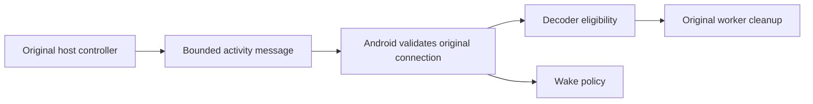

# Display activity signal contract

The host and Android implementations are integrated. Automated joined checks
passed under [T1058](reviews/artifacts/2026-10-19-t1058/README.md) and
[T1011](reviews/artifacts/2026-10-19-t1011/README.md). These tests use controlled
native substitutes; they do not establish physical screen, suspend or power
behavior. The former T914 physical-acceptance tracking was retired without
claiming completion. Current actionable work is in [TODO.md](../TODO.md).

## Purpose

The host tells Android whether display work may continue. A pause stops new
work; it does not prove that a decoder or native resource has finished cleanup.
Every update belongs to its original authenticated connection.

## Message contract

The original authenticated control connection owns the signal sequence. A hint
carries no credential, consent, capture permission or native retirement proof.
An adapter must validate the actual original controller/attachment before sending
or applying it. Equal counters on another connection have no shared identity.
A replacement connection installs a fresh owner and invalidates old callbacks.

The JSON object has exactly four members:

| Member | Contract |
| --- | --- |
| `version` | Integer 1. |
| `revision` | Integer 1 through 9,223,372,036,854,775,807. |
| `stopped` | Integer 0 through `revision`, retaining interruptions of original observed display work. |
| `active` | Boolean desired eligibility, separate from native acquisition. |

Missing/extra members, unknown versions, strings/floats for integer fields,
out-of-range values, future stop fences and non-Boolean activity are rejected.
The Kotlin boundary validates a parsed JSON object; outer framing, syntax and
message capacity remain the control transport's responsibility. Rust serializes
a canonical object below 128 bytes. The schema is independent of engine, UI,
storage, runtime and OS types; shared vectors define language-neutral value cases.

One projection owns its original desired-work observation, last emitted signal
and terminal-failure bit. The existing independent WorkObservation contract
interprets machine publications, including remembered source stop fences. Initial
unavailable observations publish inactive. Continuous unchanged demand emits
nothing. An original observation invalidated by lock, display-off, suspension,
source loss or source replacement increments the stop fence even if latest demand
has already resumed. A consumer must retire its original decoder when that fence
changes; an Active hint cannot skip actual local retirement or fresh codec/config
and keyframe validation.

Absent observation preserves the existing explicit unsupported-source policy.
Composition must distinguish lack of protocol/native observation support from
an unavailable supported source; T1056 supplies that publication boundary. A
signal never infers shutdown from unplug or commands unrelated camera/audio owners.

Revision and stop counters never wrap. Exhaustion makes the original projection
terminal, denies all subsequent publication and requires its adapter to close the
original control lifetime. Reinitializing it under the same connection is forbidden.
A finite counter is an explicit capacity contract, not permission to reuse identity.

The projection contains two bounded value records and one bit, with no allocator,
callback, queue or native handle. Input publications and returned immutable signals
are value copies. The caller owns their storage and bounds retained views and
decoded control messages; copies retain no native authority. Pure operations finish
synchronously. Native cutoff, quiescence, cleanup sponsorship and actual reuse stay
with the existing original control/decoder/wake owners; serialization and model
checks cannot prove native safety. Permanent tests cover shared valid/invalid
vectors, numeric boundaries, terminal exhaustion and 1,024 five-step transition
traces against an independent stop model.

## Original host control publication

Portable session startup binds the same read-only machine source to capture and
input before exposing listeners/work. Each accepted controller retains that view;
authentication and the original attachment gate precede any hint. The initial
`connected` response includes `display_activity` only for configured observation.
Later standalone `display_activity` responses carry the same validated Signal.
Configured Pending/Failed/Stopped or lost supported observations report inactive;
absence of a configured source omits the protocol rather than claiming support.
Underlying backend capabilities remain their independent observation contract.

Each original socket owns one projection. The control loop arms a source notice
before every current-state read, including the first turn after greeting or write.
It observes coalesced stop fences and suppresses unchanged hints. Original
controller replacement/attachment retirement cut off pending publication through
existing guards. Projection errors propagate out of the original handler, closing
its socket and controller lease; finite exhaustion is proven in the common
contract tests, without claiming a native full-counter-cycle experiment.

The source notice is shared with other read-only activity views. Closure publishes
an inactive observation once; subsequent closed notices remain pending. There is
no periodic input timer, new source factory, detached publication task or hint
queue. Input admission remains bounded to 16 sockets, each retaining one projection,
one latest source view and at most one pending serialized response/notice. The
wire hint remains below 256 bytes. Original socket/task/attachment owners sponsor
cleanup on errors, cancellation, peer loss and native shutdown; hints do not
release their resources or alter camera/audio consent.

## Original Android decoder consumption

Each original control connection owns one inbox, an opaque identity and one
immutable current observation. Its identity is independent of wire counters and
remains distinct while any old view is retained. Initial/unavailable/closed views
deny decoding. A connected greeting without the field explicitly selects the
unsupported-source fallback for that connection. Supported observations cannot
withdraw their protocol, regress counters, conflict at the same revision or omit
a stop fence when active becomes inactive. Invalid observations terminally close
the original inbox and retire its control connection. Closing cannot be undone by
late messages; only a new original connection gets a new inbox. Duplicate valid
signals preserve the same immutable current view.

The Activity coordinator applies only the exact current view while foreground,
authenticated and holding the mode from that same original connection. Format and
codec eligibility remain separate requirements. A changed original identity or
remembered stop fence stops the decoder before reconsidering latest desired work,
including coalesced Active observations. Current source withdrawal is checked
before configuration setters that can restart a receiver, including FPS restoration
after a rejected settings request. The selected route, settings, Surface and local
foreground intent remain retained. No hint changes camera/audio owners or consent.

The existing ResourceLane remains the sole isolated-decoder execution/retirement
owner. Resume can replace its latest request but cannot admit it before the old
execute job and original native retirement complete. Failed or unknown native
cleanup retains that original obligation and denies reuse. New workers obtain the
existing fresh video connection, codec/configuration and keyframe path; hints do
not carry video packets or authorize a stale render receipt. The Activity owns its
Surface and lends it to a run; tests release it only after every original run
settles. The wire hint alone establishes no hardware decode/presentation result.

Delivery owns one foreground identity, one latest immutable view and one admitted
UI drain across stop/start. Clearing latest observations never creates another
admission while an old drain is queued. Each scheduled continuation has an exact
once guard, including enqueue-then-throw and duplicate callback faults. Rejected
scheduling cancels that original drain and runs its cancellation cleanup without
applying a native/UI update from a fallback thread. A Default-dispatch hop prevents
inline UI callbacks from recursively resuming yielded work. Stop cuts off the
foreground identity and clears borrowed views; late callbacks cannot apply a new
epoch. Reporting failures cannot bypass drain settlement.

Conservation is at most one admitted drain plus one replaceable pending view, and
at most one original native run plus one latest request per existing lane. No old
view, render receipt or canceled continuation can authorize access after its
original owner is cut off. Conditional eventual UI cleanup requires scheduler/UI
progress; native cleanup additionally requires original worker/native retirement
evidence. Missing evidence keeps ownership and capacity retained, rather than
being converted into a timeout permission. Permanent SDK 27/34 lifecycle tests
hold retirement open, coalesce interruptions, replace/background control owners,
reject malformed/stale signals and exercise unsupported-source fallback plus configuration
callbacks. Dispatch tests cover 1,000 coalesced views and scheduling/report faults;
bounded counter-transition tests cover invalid ranges. Physical native wake and
host/tablet acceptance remains unqualified; joined automated acceptance is linked above.

## Retained support history

T1067 adds one immutable `supportKnown` bit to each original inbox view. An
Observed view requires it; an explicit Unsupported view forbids it. Unavailable
may carry either value: a source that has announced activity observation, including
a malformed announcement, retains that requirement through closure. Closure is
terminal and preserves original identity; late messages cannot modify its view.
History never changes Unavailable's desired state, authenticates a peer or supplies
native retirement proof.

The control owner carries the previous bit into its fresh inbox before opening a
replacement socket. That socket receives a fresh opaque identity and starts
Unavailable. Coalescing observed/lost/replacement updates therefore cannot erase
known source loss before UI delivery. Only the fresh source's own explicit unsupported
greeting resets the bit and records Unsupported. A late old greeting or optional
observer failure cannot reset current history. This is local bounded metadata;
the wire schema and host protocol stay unchanged. Activity wake projection is implemented under
T1061; native power ownership is T1060 and joined automated acceptance is linked above.

The existing original control lock serializes receive/close/replacement. One inbox
owns its mutable support bit and current immutable snapshot; readers borrow those
snapshots without mutating the owner. Replacement copies one Boolean, not an old
source's authority or callbacks. The added state has two values and allocates no
native resource, thread, queue or timer. The containing control owner and existing
one-latest UI delivery bound retained views and settle them through their original
lifetimes. Permanent SDK 27/34 regressions cover closure, malformed claims, closed
legacy sources, fresh identities, explicit fallback, old callbacks and observer
faults, alongside the existing bounded counter-transition checks.

## Current source view

T1068 composes the existing inbox in one control-lifetime `DisplayActivitySource`.
`DisplayActivityView` exposes only the current immutable update and exact snapshot
relevance. A distinct snapshot with equal fields or the same opaque source identity
is not current. Closing invalidates the former observed view; the current closed
Unavailable view remains readable metadata. Replacement invalidates that closed
view and preserves its history in a fresh identity. Exact duplicate messages keep
the original current view.

The control actor serializes receive, close and replacement. Read-side relevance
uses volatile original-inbox/current-update publication, with a snapshot read
linearization point; it supplies no lease across later source changes. The reader
retains only this pure owner, its one current inbox and bounded scalar metadata.
It does not retain ControlSession, sockets, callbacks, a UI object or a native
resource. Caller-owned messages are read synchronously and not retained. Additional
borrowed snapshots remain bounded by their containing delivery/request owners;
release is ordinary containing-owner settlement, with no native cleanup allocation.
Queued/native power consumption implements this narrow relevance contract under
T1069; Activity/window projection is implemented under T1061. Current-view relevance alone never
supplies authentication, native permission, quiescence or retirement proof.
