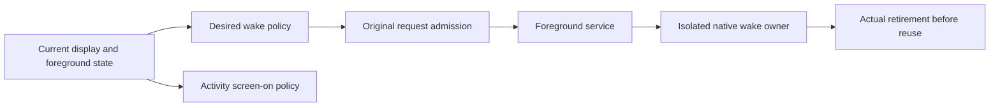

# Android display wake policy

The host and Android implementations are integrated. Automated joined checks
passed under [T1058](reviews/artifacts/2026-10-19-t1058/README.md) and
[T1011](reviews/artifacts/2026-10-19-t1011/README.md). These tests use controlled
native substitutes; they do not establish physical screen, suspend or power
behavior. The former T914 physical-acceptance tracking was retired without
claiming completion. Current actionable work is in [TODO.md](../TODO.md).

## What the policy controls

Wake locks ask Android to keep CPU or Wi-Fi work available. The Activity's
screen-on flag asks it to keep that window visible. Display pause or source loss
withdraws these requests; camera and audio keep their own consent and lifetimes.
Releasing a wake request does not prove that a decoder has stopped.

## Desired state

`StreamingPower` is an immutable, platform-independent policy input containing
battery-saver preference, authenticated media activity, observed transport and
display wake state. `StreamTransport` reports USB, network or unknown; charging
and a loopback address cannot infer the route. Its projection has no Context,
Intent, Service, Window, native lock, callback, queue or allocator dependency.

| Display state | Display wake demand |
| --- | --- |
| Waiting | Preserve normal/battery policy while a connection is pending. |
| Unsupported | Preserve the explicit fallback for hosts without observation support. |
| Active | Apply normal/battery policy to eligible display work. |
| Paused | Release display CPU, Wi-Fi and screen wake demand. |
| Unavailable | Release display wake demand after supported source loss. |
| Background | Release this Activity's display wake demand. |

For Waiting, Unsupported and Active, normal mode requests CPU and Wi-Fi wake
locks. Battery saver requests no CPU wake lock; it requests Wi-Fi only while media
is active on network/unknown transport. Wi-Fi withdrawal is immediate on USB and
uses the existing five-second idle grace on network/unknown transport. These
states retain screen-on demand while foreground. Paused, Unavailable and Background
request no locks or screen-on demand and bypass Wi-Fi idle grace. These are display
policy values; they do not revoke independent camera/audio consent or resources.

The framework adapter carries the same immutable fields in a private Intent.
An absent display-state field represents the explicit Waiting fallback. A present
unknown, null or wrongly typed state becomes Unavailable, including empty strings,
case changes and future values. Known values are fixed ASCII strings of at most
11 characters. Unknown transport remains unknown. The adapter consumes an existing
caller-owned Intent and returns one bounded value record; it retains no input
reference or native capability. The caller owns and bounds the containing Intent,
its extras and retained output copies. Synchronous conversion finishes without
creating cleanup obligations.

Eligibility is separate from ownership. Native adapters must validate the actual
original current foreground owner when admitting queued requests, applying locks
and running delayed release. Background/source-loss values cannot authorize a
later reacquisition. Actual wake handles remain owned by their service/window
adapters through partial failure, owner loss and cleanup; a hint or lock release
is not proof of decoder retirement and cannot authorize native decoder reuse.
Conditional eventual decoder cleanup still requires original worker/native
settlement and OS/scheduler progress, with unknown obligations retained and funded.

Permanent tests enumerate all 72 combinations of display state, battery policy,
media activity and transport against an independent table. Separate framework
tests round-trip those values on SDK 27 and 34, retain missing-field fallback,
and reject malformed-state demand, including a wrong native extra type and a
4,096-character invalid value. These tests establish value/adapter behavior,
not native lock timing, physical screen state or battery savings.

## Original request admission

T1062 supplies independent foreground-producer and native-receiver interfaces plus
a bounded request implementation. T1060 binds it to the foreground service.
One opaque owner identifies each original foreground claim; a request carries that
owner and an immutable desired policy, or null policy for withdrawal. Identity
does not wrap or derive from wire/process counters. Retaining an old view keeps
its identity distinct; it cannot compare equal to a new owner or current snapshot.

The channel retains one latest request, one dirty bit and at most one original
queued notice. Updates replace latest policy without issuing another notice while
that original notice is outstanding. Replacement immediately withdraws old producer
authority but retains the original queued admission. Its exact receipt can issue
one fresh notice for the replacement owner; it cannot return replacement policy
as an old owner's request. Foreign, duplicate and stale notices cannot consume a
new admission. Closure is terminal for its owner. A current original receipt after
closure yields withdrawal, and old producers cannot publish or close a replacement.
Applying a returned snapshot still requires exact current-view relevance.

Initialization has no owner/notice. Open installs a fresh immutable request before
admission. Publish/close require the exact live owner; closure installs withdrawal
before denying future writes. Receipt clears only the exact original notice, takes
latest state only for that same owner, then admits a still-dirty successor once.
The dirty bit always implies a latest request. These transitions preserve one
admitted notice and at most two retained immutable requests/owner identities within
the channel. Outputs are borrowed immutable views; callers bound additional retained
views and their containing native handoff lifetimes. No Context, callback, coroutine,
queue implementation or native handle is retained by this pure contract.

Unknown native delivery keeps the original notice and bounded capacity retained;
there is no timer-based settlement, counter reset or inferred native proof.
Conditional eventual notice cleanup requires original receipt and forwarding of
any returned successor. The backend must account for submission rejection, partial
failure and cancellation using actual original handoff evidence. Receipt only
settles this logical notice slot. Native service/lock cutoff, quiescence, settlement,
cleanup sponsorship and reuse remain separate T1060 obligations. In particular,
`current` is a snapshot relevance check, not an asynchronous native lease: native
adapters must serialize current-authority validation and effects within their
actual owner and keep original resource obligations through uncertain cleanup.

Permanent tests cover foreign/closed/replaced owners, retained snapshots, duplicate
notices and 1,000 coalesced updates. An independent finite model exhausts all 4,096
four-step histories over two producer slots, replacement, publish, close, receive
and duplicate receipt. Each trace allocates at most five local original owner names;
these are bounded test names, not production epochs. A deliberate foreign-owner
control is rejected by the permanent original-notice regression. The model covers
linearized channel operations, including forbidden stale publication/admission;
it does not establish native delivery fairness or unrestricted hardware safety.

## Original wake-handle ownership

T1063 supplies the independent WakeHandle contract and WakeLease owner; T1060
implements its Android backend. A factory returns a fresh, unadmitted handle;
it owns cleanup of any partial factory failure. The lease installs that handle's
cleanup owner before calling acquisition. Its operation guard covers the factory
as well as native effects. Settlement requires both no admitted handle and no
in-flight operation; an unfinished factory cannot advertise settlement.

Successful acquisition records a completed grant attempt. Repeated desired-on
requests allocate nothing while that original known handle remains owned. An
acquisition or retirement error retains the exact handle and failure, including
fatal errors which propagate unchanged. Uncertain handles cannot be reacquired or
replaced. Only that original handle's normal retirement return clears ownership
and admits a fresh successor. Reentrant mutation is rejected before changing state;
read-only settlement during an operation remains false. Native/backend calls are
serialized and non-suspending; an implementation must not wait for another call
back into this owner. The containing execution owner must isolate potentially
blocking native calls and retain/join them before releasing their context.

The lease retains at most one handle record, its last failure and an operation
flag, plus the caller-owned factory. The caller bounds failure/factory objects and
owns the containing lease lifetime and any external views. Backend callbacks and
borrowed native objects must be cut off/fenced by the backend retirement contract.
Configured native grant/deadline/capacity limits remain backend contracts; a grant
is not an unlimited wake promise. No timeout, cancellation request, diagnostic
held flag or reference count establishes actual retirement here.

Conservation requires every admitted grant/unknown obligation to have its exact
retained handle and cleanup sponsor. No second handle is allocated before original
retirement. Initialization starts empty; the factory guard precedes allocation;
admission precedes acquisition; failure preserves that owner; actual retirement
alone clears it. Conditional eventual cleanup requires the sponsor to keep calling
retirement and the backend eventually to supply actual original fence evidence.
Missing evidence keeps the obligation owned and funded. A caller stopping its
coroutine or losing foreground authority must retain the original native operation
and cleanup context; this pure owner does not provide native process/thread proof.

Permanent tests cover partial acquisition, factory failure, repeated desire,
fresh successors, release failure, fatal effects and reentrant factory/native
callbacks. An independent model checks all 1,296 four-step histories of desired-on,
stop and acquisition/retirement fault toggles, including failure after a simulated
grant. Its independent handle list supplies unconditional fixture cleanup. A
deliberate early-release control fails the permanent retirement/fatal regressions;
the factory-settlement regression was observed failing before its fix. These checks
prove bounded pure-owner behavior under the handle contract, not Android hardware
or native backend conformance.

## Foreground native service ownership

`StreamingPowerBinding` owns one opaque foreground claim and its policy observer.
Stopping it cancels that actual observer and withdraws only its original claim.
`StreamingPowerRuntime` owns the application handoff channel, one retiring native
worker plus one latest replacement, and one original idle-timer callback plus one
latest target. The manifest Application owns this runtime strongly for its process lifetime,
including outstanding handoffs and quarantined work after producer loss. There is
no weak-registry reset or second runtime for the same Application. Active bindings,
queued Binder capabilities and actual jobs borrow that original runtime.
All request/service/timer effects serialize on the main actor; native wake work
runs through `AndroidWorkerRun` in the private `:power` process. Independent camera,
microphone, speaker, display and metadata workers retain their separate owners.

The Android component remains private to the application. Its foreground
notification does not imply native lock ownership. A local Binder capability names
the exact original queued notice; immutable Intent fields must match that notice's
initial policy. Unknown, duplicate and stale capabilities cannot consume a newer
admission. Pending identity is checked before foreground promotion. A confirmed
never-admitted start/post rejection may settle that slot; an ambiguous exception
retains it, withdraws original authority and denies extra admission. Destruction
first detaches its original port, then fences its exact queued callback. Failed
cancellation keeps the slot until the original guarded callback arrives. An old
component or foreground producer cannot revoke a replacement owner.

The current original receiver publishes immutable request/task views. A lazy
worker waits for actual current delivery before native admission. Same native
tasks retain the original process; changed tasks cut off the old view and enter
the existing retirement lane. Late creators remain owned and joined. Original
native readiness must match its task and opaque stamp. Wrong readiness or worker
loss cuts off that original owner before UI reporting; it cannot automatically
reacquire. Actual original Binder death and in-flight control settlement precede
replacement admission. A framework disconnect, canceled coroutine, stopped flag,
readiness event or elapsed timeout is not that fence. Missing proof retains the
original lane and funded cleanup sponsor.

`PowerWakeRun` installs the CPU/Wi-Fi leases before native acquisition, stops
without native IO on the Binder/UI thread, and attempts both original retirements
even if either fails. Its Android handle requires normal original API release;
an uncertain unheld acquisition cannot manufacture proof from `isHeld == false`.
Factory/acquire/release faults retain the exact handle. The containing original
private process provides the final process-access fence for blocked/unknown calls.
The existing CPU grant is bounded to four hours; a subsequent current policy
receipt after that budget renews through an actual retired predecessor. This is
not an unlimited CPU-grant guarantee. Wi-Fi uses low-latency mode from API 29 and
the previous high-performance mode on older supported SDKs.

Idle Wi-Fi grace requires matching actual acquisition readiness. Its original
absolute five-second due time survives repeated idle requests; USB, pause and
source/background loss bypass grace. Enqueue/cancel ambiguity preserves one
original callback and withdraws grace demand. Negative/overflowing clock values
fail closed; a bad queued callback clock is contained and reported on the main
loop. Duplicate old callbacks cannot acknowledge a successor or release it early.

Conservation pairs every queued admission/native grant or unknown obligation
with its original retained cleanup owner. Reuse requires original receipt/callback
fencing or actual worker retirement respectively, never logical completion alone.
The containing runtime settles with its Application/process; its bounded queues
and native grants retain their separate original settlement obligations.
Conditional eventual cleanup assumes native delivery/scheduling, original control
calls and OS process/token cleanup eventually progress. Selected cached SDK 27/34
framework bytecode shows local held-state changes after synchronous release calls;
it does not prove unrestricted system-server/kernel cleanup timing. Robolectric
checks real adapters against bounded independent fault models and joined local
worker cleanup; physical process, device wake and battery acceptance remain T914.

## Original source-view relevance

T1069 adds an independent `DisplayPowerPermit` to immutable desired requests and
`DisplayPowerDemand` values. A fixed policy has no changing external view and uses
the fixed permit; actual foreground identity still applies. A dynamic permit reads
one original source view without blocking or mutation and is safe on UI/worker
threads. Once its original view is invalid it cannot revive; a fresh view supplies
a fresh permit. Normal reader exceptions fail closed; fatal failures propagate.
A permit supplies neither authentication nor native ownership/quiescence proof.

Channel `current(request)` retains its original exact-latest-request meaning.
Logical receipt can settle an original notice even when its desired source is no
longer relevant. Actual receiver validation checks both source relevance and latest
foreground identity, rechecking identity after a reader call so faulty reentrant
readers cannot install a retired owner's workflow. A stale request is unadmitted;
it does not close a valid foreground claim that is awaiting a fresh view. Withdrawal
never borrows a vanished source. Exact callback retry preserves the actual current
request's permit, including when its policy equals the original carrier value.

The lazy worker waits for actual delivered current policy plus a relevant original
view. After creating its lazy native wrapper it retains that wrapper and waits for
current relevance again before execution. A blocked late creator cannot skip this
second gate. Changed views with an unchanged native task refresh the existing view
and wake its waiter; they do not allocate a second process or imply retirement.
Native retirement and source relevance remain independent gates. Actual matching
readiness still describes that original native task's acquired handles, rather than
a new source permission. Idle timers additionally require current source relevance.

Foreground delivery compares whole immutable demands, so equal power values with
a changed source permit still publish. Activity wrappers retain only the pure
source reader and exact original observation. Each request retains one
permit reference and its caller-bounded read view. Production readers must retain
only narrow pure metadata rather than UI/socket/callback owners. The existing
channel, execution lane and original cleanup sponsors retain their prior bounds.
No new queue, timer, native allocator or deadline is introduced. Conditional
progress while a desired view is invalid requires a fresh current publication or
original owner cutoff; missing evidence cannot substitute for native retirement.

Permanent regressions cover stale receiver admission, pre-creation source loss,
source change during a held lazy creator, fenced callback retry and reentrant-reader
cutoff. Further tests retain equal-policy fresh-view delivery, 1,000 coalesced views,
reader faults, stale idle callbacks and independent source/native-retirement gates.
The containing original job is joined before retiring even an unopened late wrapper.

## Policy observer failure

T1073 adds a resource-local boundary around the original foreground policy observer.
An ordinary flow or publish failure cuts off only that original producer, cancels
its observer and withdraws its exact runtime claim. A canceled input also withdraws
its original claim before propagating coroutine cancellation. Completed flows retain
the foreground claim until explicit stop, preserving the existing waiting policy.
A late old failure cannot stop a replacement producer. Cleanup/reporter failures
are contained and attached without self-suppression; cancellation still reports an
independent cleanup failure. Fatal errors retain normal propagation semantics.

The observer owns no native handle. Its cutoff denies further publication before
cleanup; application-scoped queued admissions and actual native retirement remain
owned by the existing runtime/lane. Canceling an observer is not native quiescence.
The original scope and its callbacks remain funded until they settle, with immutable
old demands incapable of retargeting a replacement. Logging carries diagnostics
without coupling failure to independent camera/audio owners. An explicit collector
method retains separate native counters for policy delivery and observer settlement.

## Activity observation and Window ownership

T1061 reads the live original control source independently of queued UI delivery.
Observed activity requires foreground ownership, authentication and current applied
mode/decoder metadata. Pause denies wake immediately, even before its UI hint is
applied. Supported source loss stays Unavailable through notification coalescing;
a fresh explicit unsupported greeting retains the documented unsupported-source fallback.
An initial source without support history waits normally. Existing pen mode can
operate without a decoder, but cannot override pause or background cutoff.

The ControlSession owns conflated notification hints; its pure source retains no
subscribers, UI, socket or callback. Native requests borrow only that source's
read view and immutable snapshot. Distinct current views publish even with equal
power values. Observable foreground, settings and metadata state wake the policy
flow without depending on incoming frames. Notification hints are not authority.

ActivityWindowPolicy owns a separate Main-actor Window observer. MainActivity no
longer acquires screen wake in onCreate. Foreground start installs one original
epoch before its initial write; reentrant stop/replacement cannot install an old
observer. Every write rechecks original epoch and source relevance. Stop cuts off
old callbacks, cancels that observer and clears screen demand; sensor cleanup is
attempted independently. Canceled inputs withdraw without logging normal
cancellation; ordinary flow/write/reporter faults stay contained. Completed flows
retain foreground ownership until explicit stop. Actual observer jobs and hint
subscriptions settle in the permanent joined fixtures.

The Window is borrowed from Android for the containing Activity lifetime. No new
native allocation or Window release occurs here; uncertain flag writes retain the
framework/lifecycle owner. Native wake-worker retirement remains separately fenced
by the runtime. A cleared flag, canceled observer or fresh source view never proves
decoder or native wake retirement. Camera/audio owners remain independent.
