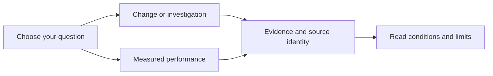

# Reading past results

Use the [user guide](../README.md) to run Blent today. Use this archive when you
want to understand a past change, check a measurement or trace its evidence.

| Your question | Start here |
| --- | --- |
| What changed, and why? | [Review archive](reviews/README.md) |
| What became faster or used fewer resources? | [Measurement overview](benchmarks.md), then the [benchmark archive](benchmarks/README.md) |
| Which logs, sources or checks support a claim? | [Artifact guide](reviews/artifacts/README.md) |
| What still needs work? | [Current TODO](../TODO.md) |

## Read a claim in context

1. Read the short result and its limits. Expand technical details only as needed.
2. Check the date, source revision, platform and workload. “Current” in an old
   report means current at that date.
3. Match the conclusion to the measurement. Less CPU time in one component does
   not establish lower screen latency or longer battery life.
4. Check later reports and the current guides before applying an old instruction.
   Historical commands may require the original checkout, tools or hardware.

A **baseline** is the starting version used for comparison. A **replay** feeds
recorded or synthetic input into a component. A **cohort** is a group of trials
run under specified conditions. A **median** is the middle value; **p95** is the
value at or below which 95% of observations fall. These describe that sample,
not a guarantee for another device or workload.

A **proposal** states intended behavior. **Implemented** means code exists.
**Validated** means the named checks ran successfully within their stated scope.
**Blocked** names missing evidence or a prerequisite at the report's date.
These terms are not interchangeable. The current TODO records active work;
removing a row does not prove that every historical acceptance step passed.

The [artifact glossary](reviews/artifacts/README.md#what-a-result-means) explains
fixtures, native checks, coverage, source fingerprints and counterexamples.
Exact logs, measurements and protected originals remain available. This
reading guide does not rerun or certify their results.
