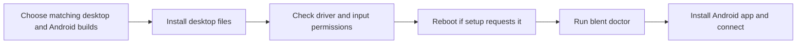

# Installing Blent for Linux

Blent needs a Linux desktop program and an Android app built from the **same
checkout**. The fork was unreleased as of 2026-09-17; upstream packages do not
contain its changes. Start with [building from source](development.md#building-from-source)
if you do not already have matching packages. The package instructions below
also apply to locally built artifacts; they do not announce a published release.

**Before connecting a display:** read the [current limitations](compatibility.md#current-fork-limitations).
A Cinnamon/Xorg crash during virtual-display attachment remains unresolved (T222).
Save your work before testing an affected desktop.



## Choose an installation

The portable packages target **Linux x86-64 with glibc 2.36 or newer**. This is a
library compatibility baseline, not certification of every desktop or GPU.
Local source builds may need a newer glibc.

| Route | What to do |
| --- | --- |
| Source checkout | Follow [development](development.md#building-from-source). Build both applications from that checkout. |
| `blent-<ver>-x86_64.AppImage` | Follow [AppImage setup](appimage-plan.md). It bundles desktop libraries but still needs host driver and permission setup. |
| `blent-<ver>-PKGBUILD.tar.gz` | Install AUR `evdi-dkms`, extract the recipe, then run `makepkg -si`. |
| `blent-<ver>-linux-x86_64.tar.gz` | Extract it, inspect `scripts/install.sh`, then run `./scripts/install.sh`. |

The Arch recipe downloads its declared source tag. Use the source route for an
unreleased checkout without that tag. `makepkg -s` installs repository packages;
it does not build AUR dependencies. Install [evdi-dkms](https://aur.archlinux.org/packages/evdi-dkms)
separately. Review each package transaction before accepting it.

AppImage replaces the Debian release asset. For an artifact set with a checksum
manifest, run `sha256sum -c SHA256SUMS` beside **all** files listed in it. Missing
files fail verification. See [release integrity](../SECURITY.md#release-integrity)
for signing limits.

## Linux artifacts and prerequisites

EVDI is the kernel driver that creates the extra display. Its userspace library,
**libevdi**, lets Blent communicate with that driver. Installing one does not
install or update the other.

| Requirement | Purpose |
| --- | --- |
| EVDI module compatible with the running kernel | Creates the extra display |
| FFmpeg with a usable encoder | Compresses the display stream |
| ADB | Connects the development/debugging USB route |
| libusb-1.0 shared runtime | Supports the native USB route |
| libdrm, libevdi and GUI libraries | Connect the desktop components |
| GPU drivers and access to `/dev/uinput` | Graphics support and touch/mouse input |

Automatic dependency installation covers Debian/Ubuntu and Arch-family systems.
Other distributions need manual setup with their own package manager. Detection
matches whole `ID`/`ID_LIKE` words; unknown families receive guidance without
repository changes or dependency installation.

| Family | FFmpeg / ADB packages | EVDI package to check |
| --- | --- | --- |
| Debian/Ubuntu | `ffmpeg`, `adb` | `evdi-dkms` for your kernel |
| Arch | `ffmpeg`, `android-tools` | AUR `evdi-dkms` |

Check `modinfo evdi` and, for DKMS installations, `dkms status`. If a driver build
fails, inspect its build log, kernel compatibility and installed kernel headers.
Follow your distribution or [EVDI upstream](https://github.com/DisplayLink/evdi)
instructions. No single version fixes every kernel combination.

For fast-reconnect failures, use a compatible stock kernel module containing
[upstream PR590](https://github.com/DisplayLink/evdi/pull/590).
[v1.15.1](https://github.com/DisplayLink/evdi/releases/tag/v1.15.1) includes it and
the import-page sizing fix from v1.14.16; check distribution backports separately.
An [isolated comparison](reviews/artifacts/2026-10-09-evdi-stock/reproduction.json)
reproduced a missing scanout after reconnect without a modeset on Ubuntu 1.14.15
and restored the frame on stock 1.15.1. That result does not validate every desktop
or import boundary. The historical T749 checks record those limits; this review
did not install or reload the host module.

### Which libevdi is used?

Portable tarballs/native packages place libevdi v1.15.0 beside the helper and use
an `$ORIGIN` library lookup. Source installations may use the system library;
see [development](development.md). AppImage bundles its own userspace dependencies.

On Debian-family systems, the installer checks for `libevdi.so.1` in a bundle or
system location for prebuilt programs, and the system `libevdi.so` linker file
for source builds. It checks standard locations plus `/usr/local/lib`,
`/usr/local/lib64` and their architecture subdirectories. If needed, it requests
`libevdi1` or `libevdi-dev`, respectively. FFmpeg, ADB and GUI dependencies are
handled separately. The kernel module is still required.

## EVDI setup and safe capacity changes

The full installer and native package hooks preserve loaded EVDI devices:

| Situation | Setup behavior |
| --- | --- |
| Enough devices already exist | Reuse them immediately. |
| More are needed; Xorg is absent | Load the module if needed and add missing capacity, normally up to two devices. |
| Xorg is running, or its process inventory cannot be checked | Defer loading/growth to reboot. |
| Provisioning fails | Report failure and ask you to check setup and reboot. |

Source/tarball reinstallation and `make setup-system` preserve an existing
`/etc/modprobe.d/blent-evdi.conf` exactly. They write the two-device boot default
only when that file is absent. Review empty, invalid or externally managed files
manually; do not overwrite them blindly.

GUI setup and `make setup-system` share the provisioning script. The GUI saves
its selected tablet capacity (one to four) for the next boot. If live growth is
unsafe, it reports failure/reboot while still configuring input permissions.
Under Xorg, the capture helper uses free, pre-created devices and refuses
automatic hot-add when none are free. Review `initial_device_count` and reboot
before starting Xorg to make more capacity available. Existing leases/displays
are preserved.

Boot options apply at the next module load. This guard avoids Blent-triggered
hot-add under detected Xorg; it cannot prevent an external display server from
starting concurrently or cure unrelated driver/compositor faults.

## Start the host

Run `blent doctor` to check setup, then start the host from the GUI. If the command
is not on `PATH`, use `~/.local/bin/blent` or add `~/.local/bin` to your shell's
path. `blent start` runs a foreground session in a terminal.

To start at login, enable **Start Blent with the desktop** in the GUI. The setting
also starts/stops the current daemon (the background desktop process).

- With systemd, a desktop login entry starts `blent.service`. This also works on
  desktops such as Cinnamon that do not activate `graphical-session.target`.
  If that target already started the service, systemd keeps the same daemon.
- Without systemd, the entry runs the daemon directly, without automatic service
  restart supervision.
- Disable autostart in the GUI to disable both the service and login entry.
  `systemctl disable` alone leaves the desktop login entry in place.
- If an enabled unit's user manager is unreachable, restore that manager before
  changing the route or disabling the unit. Blent reports an error in this case.

On desktops that activate `graphical-session.target`, this starts/enables the unit:

```sh
systemctl --user enable --now blent
```

The full source/tarball installer enables the service and creates its login entry
when the user manager is reachable; otherwise it creates a direct-daemon entry.
It reports the route and does not start the daemon during installation.
`make install` preserves the autostart preference and repairs the entry for an
already enabled service. Switching to systemd replaces a direct-daemon entry.

### Installed paths

| Files | Location |
| --- | --- |
| User programs | `~/.local/bin` |
| Launchers and icons | `$XDG_DATA_HOME`, default `~/.local/share` |
| User service | `$XDG_CONFIG_HOME/systemd/user`, default `~/.config/systemd/user` |
| Desktop login entry | `$XDG_CONFIG_HOME/autostart/blent.desktop`, default `~/.config/autostart/blent.desktop` |

Both user installers use these paths; empty/relative XDG values use the defaults.
Native packages use system-wide paths. For a custom program directory, use
`make install BIN_DIR=/absolute/path`; launchers, service, helper and stop commands
refer to that directory.

Autostart does not supply drivers or permissions. On another init system, arrange
for `evdi` and `uinput` to load at boot. Do not assume it reads `/etc/modules-load.d`.
For example, OpenRC uses the existing `modules` list in
[`/etc/conf.d/modules`](https://github.com/OpenRC/openrc/blob/master/conf.d/modules).
A device manager without udev-compatible rules also needs its own `/dev/uinput`
permission setup. Check both with `blent doctor`.

## Android and first connection

1. Install the matching APK. A debug build produces
   `android/app/build/outputs/apk/debug/app-debug.apk`. Android **8.1/API 27** is the
   minimum; the tablet must also decode the chosen video format.
2. For the ADB route, enable USB debugging in Android Developer options. On many
   devices, tapping *Build number* seven times reveals that menu. Connect a
   data-capable cable and accept the computer authorization prompt.
3. Start the host. It sets up ADB forwarding and, by default, launches the app.
   Enable/place the EVDI output in desktop Display settings if necessary. KDE
   Wayland has the most automation; see [compatibility](compatibility.md).

For the paired USB route and separate camera/audio permissions, see the
[main guide](../README.md). ADB authorization and Blent pairing are distinct.

The Android app defaults to 50% brightness and a 60 Hz display-mode preference
while its window is in use. Change them in its gear menu. They do not change
other apps' system settings; stream FPS is a separate control.

New configurations use [automatic encoder selection](video-codecs.md#automatic-selection)
with `libx264` fallback after tablet negotiation. Existing explicit choices stay
unchanged; choose `auto` or a supported encoder in Linux settings.

## Capture pipe capacity

Linux **Video → Capture pipe buffer** offers 1, 2, 4 and 8 MiB; default: 1 MiB.
Changing only this setting does not restart the display. The GUI shows actual
capacity and copyable commands for raising the kernel limit. See
[pipe configuration](pipe-buffer.md) for tradeoffs, commands and rollback.

## Initial window placement

On X11, Blent centers on the current primary monitor at launch, using live
coordinates, the available desktop work area, actual decorated window size and
scale. It waits until the window is mapped. Any monitor count/layout is allowed.
An oversized window keeps its top-left controls on that monitor; later user moves
are preserved. Missing primary-monitor data or a failed query leaves placement
to the window manager, with a standard-error message. On Wayland, the compositor
controls placement.

## GPU ordering before EVDI (T700)

The full installer, `make setup-system` and Arch hooks run
`scripts/gpu-boot-order.sh` before provisioning EVDI. It writes
`/etc/modprobe.d/blent-gpu-order.conf`, requesting that bound, loadable physical
GPU drivers load before EVDI. To run it separately, with those drivers bound:

```sh
sudo bash scripts/gpu-boot-order.sh
```

The helper deduplicates modules and maps NVIDIA to `nvidia_drm` and `virtio_pci`
to `virtio_gpu`. EVDI, simpledrm, built-in drivers and vanished devices add no
entry. It warns if no loadable physical GPU is found; it cannot discover an
unbound GPU or make a missing driver available.

Publication is atomic. Existing files and managed symlinks, including empty
configurations, are preserved. Review the file after changing GPU/driver.
The helper does not reload modules or restart the desktop. Its `softdep` rule
applies at the next EVDI load and requests ordering, not guaranteed GPU readiness.
If EVDI loads from the initramfs (the early boot image), follow your distribution's
procedure to include the rule/modules and regenerate that image.

AppImage includes this helper under extracted `usr/share/blent/`; its user
installer does not run privileged setup. An administrator can run it explicitly.
See the [original tests and native-validation limits](reviews/2026-09-28-gpu-boot-order.md).

For system changes and removal, see [security and installation effects](../SECURITY.md).
For failures, follow [troubleshooting](troubleshooting.md) before repeating setup.
