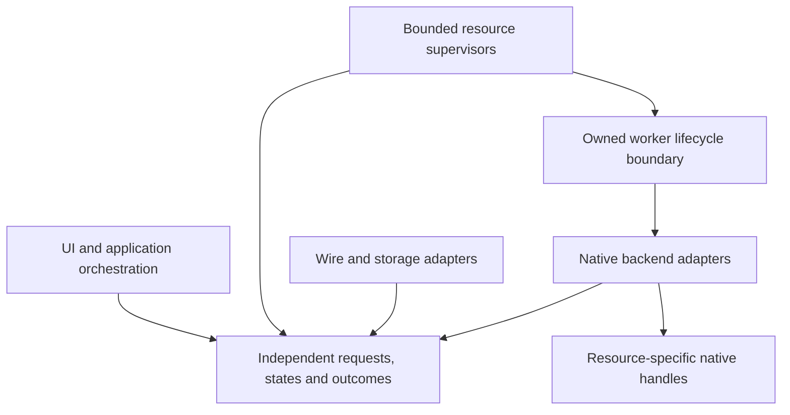

# Project coupling, SOLID and API boundary review

2026-10-09, source baseline `bb1648e80e51fcc4eb030336cae35b88473d7fa3`.
Review-only; no production refactor, download or native deployment. Findings are
tracked in [TODO.md](../../TODO.md), alongside the [Android](2026-10-09-resource-lifecycle.md)
and [host](2026-10-09-host-performance-lifecycle.md) resource reviews.

## Implementation follow-up (2026-10-10)

T821 now defines selection values independently of their media consumer. T824
moves filesystem methods off FileConfig and makes persistence workers depend on
focused snapshot/transaction/publication contracts. T826 uses these contracts
through bounded reusable native workers, keeping Wi-Fi policy off filesystem locks.
The sections below retain the
original review baseline; [current fixes and validation](2026-10-10-host-fixes.md)
record implemented behavior and remaining platform limits.

## Assessment

Decoupling is partially implemented, not complete. Shared Rust protocol/model
modules can compile and run without storage, command or platform features:
`CARGO_NET_OFFLINE=true cargo test --offline --locked -p blent-config --no-default-features --lib`
passed **123 tests** in this review. Existing CI also exercises that configuration.
Independent audio/camera settings and input interfaces, platform capability flags,
native adapters, bounded media leases and explicit resource owners are useful
foundations. They do not establish independence for every exposed contract.

The main violations concern dependency inversion and single responsibility.
There is also a concrete media/selection type dependency cycle and public C
implementation state. No evidence supports adding an interface to every class,
introducing a universal resource manager or rewriting working domain algorithms.
Use small contracts where ownership, platform variability or independent tests
require them. Contracts can use ordinary value containers without being tied to
the concrete queue, UI, storage or native resource owner.

| Area inspected | Existing boundary | Remaining evidence/finding |
| --- | --- | --- |
| `common/src` models, video/audio/camera/raw-frame negotiation | Feature-separated portable domain and wire types; independent tests | Filesystem methods extend `FileConfig`; persistence consumers take concrete storage (T824). |
| Host session, capture, media and selection | CaptureBackend/InputBackend and OS adapters exist | Capture contract exposes concrete orchestration/storage owners (T820); media/selection type cycle (T821); lifecycle outcomes erased (T813). |
| Android wire, decoder and resource owners | Some transport/native interfaces and generation/borrow gates | Wire data/parsing and native decoder policy are mixed (T822); Compose/permission/service/lifecycle ownership mixed (T810). |
| Owned C capture/conversion/exchange, raw-ring and GPU adapters | Linked modules, pixel-order and immutable lease contracts, separate OS helpers | Conversion/exchange headers expose pthread state and mutable buffers; callers take internal locks (T823). Raw-ring is explicitly a Linux adapter, which is appropriate. |
| GUI settings, status and native factories | Audio/camera trait objects, background status and save workers | Windows monitor enumeration executes directly in rendering (T825); settings persistence tied to storage implementation (T824). |
| Host Wi-Fi/USB and persistence | ADB Commands adapter and bounded dedicated persistence worker | Shared Wi-Fi async policy calls synchronous filesystem methods (T826). |
| Linux/Windows, installers, packaging and CI | Backend capability admission; shared setup/service scripts; native coverage and portable-build gates | Existing gates check compilation/coverage/complexity/packaging, not all dependency directions (T827). Windows native validation remains unavailable here; declined macOS/stylus work stays declined. |

This is a project-wide architectural boundary review, not a claim that every
function has been exhaustively verified or that every OS backend has native
acceptance. Existing complexity and per-function coverage requirements still
apply to subsequent changes; a passing domain suite is not a coverage report.

## Concrete boundary changes

**T820 — capture contract independent of its current session implementation.**
`host/src/session_core.rs` defines CaptureBackend next to orchestration. Its
CaptureContext exposes concrete `VideoSender`, `Attachment` and bidirectional
settings channels; CaptureResources exposes `CodecConfig` and `LatencyTracker`;
CaptureWorkers exposes raw task handles. A new backend must understand these
owners, rather than only frame publication, state observation, cancellation and
completion semantics. Extract explicit request, format, publication, observation
and terminal-outcome contracts. Keep queue/storage/telemetry/session adapters
outside them. Preserve immutable lease-backed payloads without new frame copies.
Test a fake backend using contracts alone, listener-before-native-start ordering,
failure propagation, retirement and packet-generation ownership. T813 consumes
the outcome contract; avoid a monolithic interface with unrelated operations.

**T821 — remove the media/selection type cycle.** `media.rs::EncoderSettings`
contains `selection::Selected` and calls its key against itself;
`selection_types.rs` imports EncoderSettings for `Key::new/matches`. Both are
portable today, but their dependency direction is cyclic and media data owns
selection policy. Define independent immutable selection request/key/result
values and keep matching/effective-choice policy in one domain module. Update
adapters/callers together, retaining exact-format/epoch invalidation, explicit
preference, fallback, worker count and calibration tests. Do not change current
wire behavior or add synchronization merely to reorganize types.

**T822 — Android wire contracts independent of decoder and Intent adapters.**
`StreamFormat.read` consumes/returns DecoderFormat declared in DecoderSession and
uses VideoReceiver defaults. VideoPacketReader/ChannelPacketReader use receiver
framing constants. DecoderSelection combines JSON parsing, profile policy,
MediaCodecList discovery and MediaFormat configuration. AudioEndpoint and
CameraEndpoint also combine values with Intent decoding. Extract portable
format/selection/endpoint/framing values and validation; keep JSON/Intent/native
inventory/MediaFormat mappings as explicit adapters. Reuse existing wire fixtures
and test malformed/range boundaries without Android or Compose stub owners.
Keep exact native capability checks; portable validity is not native support.
T810 separately owns lifecycle state machines, so do not duplicate that work.

**T823 — hide C synchronization and buffer implementation behind contracts.**
`host/evdi/conversion.h` includes pthread types and exposes `conv_pool` worker
arrays, kernel choice, counters and mutexes. `frame_exchange.h` exposes its
buffer triple, damage histories and locks; capture.c/writer.c directly lock
`frames->mutex`. Moving a pool or changing exchange synchronization therefore
depends on caller knowledge. Keep pixel jobs and frame leases independent;
use opaque owners/private headers and focused operations for atomic damage,
publication and observation. One allocation at owner creation or an explicit
storage adapter is preferable to adding hot-path allocation. Preserve fused
damage locking, cache locality, SIMD dispatch and zero-copy lifetime. Permanent
contract/retirement/property tests and sanitizers must survive; benchmark sparse
and dense paths before accepting structural overhead. No EVDI code changes.

**T824 — persistence contract independent of filesystem implementation.**
`common/src/storage.rs` implements load/save/transaction/file-lock methods directly
on the domain FileConfig type. `gui/src/settings.rs::PendingSave` and
`host/src/persistence.rs::Worker` require ConfigStore. The feature split already
keeps no-default builds portable; this finding is the remaining API/consumer
coupling, not a claim that all model builds open files. Define focused snapshot,
transaction, cancellation and commit/publication outcome contracts; make the
filesystem store implement them and keep pure merge/validation on values.
Independent fake-store tests must exercise failed commit, concurrent edits,
cancel-before-commit versus commit-in-progress and restart-after-success. Keep
existing real-file atomicity/lock/merge regressions. T826 can then inject a delayed
store without blocking an event thread.

**T825 — move Windows monitor enumeration out of GUI rendering.**
`gui/src/main.rs::setting_input_devices` invokes
`windows::monitors::NativeInventory.snapshot()` on each render. This crosses the
platform boundary and puts synchronous native enumeration in the UI loop.
Existing MonitorInventory and GUI status-worker patterns supply the right seams:
publish a bounded asynchronous snapshot and invalidate on relevant changes,
keeping stale/unavailable status explicit. Add a held-inventory regression,
count calls across redraws, test topology change/selection removal and preserve
coordinate identity. Native Windows timing/acceptance is still required; no
observed Windows freeze or measured gain is claimed.

**T826 — synchronous filesystem operations inside async Wi-Fi policy.**
`host/src/wifi.rs::reconnect/setup` call ConfigStore load/update directly between
ADB awaits. Update uses a blocking file lock and fsync; reconnect loads files on
the task's event thread. A held config lock or slow storage can stall that runtime
thread and delay cancellation. Use bounded owned persistence work through T824's
contract, preserving the second address check and commit-before-disconnect rules.
Permanent tests should hold a disposable config lock while another runtime task
and Stop make progress, release it and verify transaction ordering. No actual
filesystem stall induced in this review. Also keep one stuck-worker budget;
unlimited `spawn_blocking` retries would move rather than solve resource growth.

**T827 — enforce the agreed dependency directions.** Existing no-default common
tests are valuable but do not prevent Android parsers importing concrete owners,
media/selection cycles or C headers exposing backend layout. After the contracts
above are specified, extend build/source architecture checks for those concrete
boundaries and add fixtures proving forbidden dependencies fail. Do not pretend
regex imports prove behavioral SOLID or replace contract tests. Existing glibc
portability and source complexity gates serve different purposes.

## SOLID application and target ownership

| Principle | Application |
| --- | --- |
| Single responsibility | Separate value/validation contracts, native adapters, UI projections and resource supervision (T810/T820/T822/T824). |
| Open/closed | Add a backend or worker through focused publication/inventory/storage adapters, preserving explicit unsupported capabilities. No speculative plugin framework. |
| Liskov substitution | Specify blocking, cancellation, retirement, error and ownership semantics for all implementations. T811/T812 show those obligations need stronger contracts; no separate inheritance-specific violation was demonstrated. |
| Interface segregation | Separate frame publication, capability inspection, lifecycle control and status observation. Keep resource-specific behavior instead of one manager with camera/audio/display switches. |
| Dependency inversion | Contracts own values and outcomes; concrete queue, UI, filesystem and OS adapters depend on them. Remove the T821 cycle. |

This diagram is a proposed dependency direction, not current complete behavior.
Control state/deadlines must remain responsive outside a possibly stuck worker.
Each resource has bounded active, pending and uncertain-retirement ownership.
Worker failure retires its own generation and reports an outcome; unrelated
features continue. A timeout does not authorize freeing a borrowed native object.
Process isolation is a separate measured design choice (T809/T819), not something
an interface or coroutine automatically provides.

Implement minimal contract extractions with their consumers, then lifecycle
fixes and enforcement. Keep one commit per resolved TODO finding, permanent
red/green regressions for behavior changes and existing native acceptance limits.
