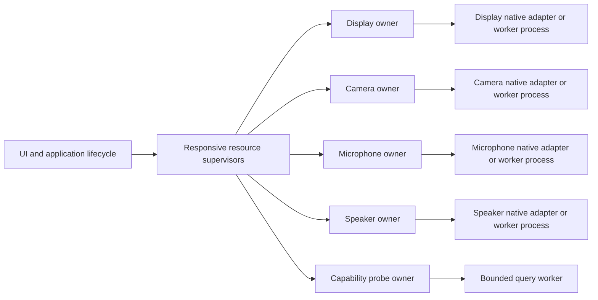

# Implementation update (2026-10-10)

T809 is implemented with separate on-demand Android native workers. See the
[current architecture and validation](artifacts/2026-10-10-android-process-isolation/README.md).
The proposal below records the earlier review and alternatives.

# Resource isolation and lifecycle review

Review-only extension of the [Android performance review](2026-10-09-android-performance.md).
“Unbind resources” means decouple ownership, progress and failure domains;
memory, queues, pending work and recovery attempts must remain bounded.
Production sources are unchanged. Fault injection uses owned code, local cached
tools and fake resources; no native driver was hung, device restarted or resource
downloaded. Host findings are in the [host review](2026-10-09-host-performance-lifecycle.md);
whole-project contracts and SOLID findings are in the [boundary review](2026-10-09-project-boundaries.md).

## Android evidence

The [offline probe](artifacts/2026-10-09-android-lifecycle/replay.py) compiles
unchanged `AudioBinding`, `CameraBinding` and `CameraResources`. Android,
Compose and endpoint/value types are minimal stubs; real kotlinx.coroutines
1.7.3 supplies jobs and dispatching. Injected capture/cleanup adapters isolate
the owner behavior. This is not native Android acceptance or permanent bug
regression coverage. [Results and source hashes](artifacts/2026-10-09-android-lifecycle/results.json).

| Injected condition | Observed result | Finding |
| --- | --- | --- |
| Audio cleanup held; 8 / 32 / 128 replacement commands | 10 / 34 / 130 live root child jobs, only one native capture admitted | T806: cancelled requests remain in a noncancellable predecessor chain; Stop still leaves 130 jobs until release. |
| Camera cleanup held; 8 / 32 / 128 choose/stop pairs | 9 / 33 / 129 retirement jobs, only one capture admitted | T806: retirement jobs accumulate behind the first owner. Safe admission prevents overlap, but pending bookkeeping is unbounded in request count. |
| Audio background-service stop throws | One exception reaches the root coroutine exception handler while SupervisorJob remains active | T807: supervision prevents sibling cancellation; it does not consume uncaught launch exceptions. Production has no corresponding local handler/outcome boundary. |
| Camera native close throws | Close attempted; `CameraResources.close()` reports success to its caller | T807: cleanup failures are discarded, preventing the supervisor from distinguishing confirmed retirement from unknown native state. |

Every held cleanup was released at the end. Counts measure jobs, not native
device instances, threads or heap bytes. Existing T707/T732 tests correctly
protect against freeing borrowed resources and starting overlapping replacements;
they must remain. Their short replacement sequences do not establish bounded
pending work under indefinite retirement.

## Android findings

- **T806 — bounded admission, retirement and visible stalled state.**
  `AudioBinding.launch` joins predecessor jobs in `NonCancellable`;
  `CameraBinding.stopCapture` appends retirement jobs which join predecessors.
  One stuck native operation/cleanup can keep these chains alive indefinitely.
  `CameraResources.close` also waits for every outstanding startup lease, so a
  Camera2 callback that never arrives keeps retirement unresolved even after the
  five-second coroutine startup timeout. `CodecLifetime.starting` and retiring
  owners similarly gate later display startup until the native call returns.
  Keep those safety guarantees, but use one active owner, bounded retirement
  tracking and at most one replaceable pending request per resource. A control
  deadline should publish `stalled` and reject/coalesce retries without pretending
  native destruction completed. Quarantined means logically detached and no new
  borrows, with storage retained until safe release or isolated process exit.
  Add permanent stuck-start/read/write/close/callback and rapid Start/Stop tests;
  assert bounded jobs/resources and unaffected feature progress.

- **T807 — cleanup errors must stay inside their resource boundary.**
  `AudioBinding` and `CameraBinding` call service-stop adapters from worker
  `finally` blocks, outside their operational catches. Main-thread Stop paths
  also call these adapters without containment. `MainActivity.onStop` invokes
  camera, microphone, speaker, window, power and session teardown sequentially;
  a thrown exception prevents later steps. `CameraResources.close` instead
  swallows all close failures. Return structured, resource-scoped cleanup results,
  attempt independent cleanup even when another fails, and preserve uncertainty
  about unreleased native handles. Distinguish dependent cleanup ordering from
  independent notification, focus, transport and state retirement. Do not use
  blanket Throwable suppression to claim recovery from VM/native faults.
  Permanent regressions must inject each ordinary teardown/service failure,
  prove remaining cleanup runs, and prove no uncaught main/root-coroutine error.

- **T808 — isolate native capability queries from lifecycle control.**
  `CodecReportReceiver.onReceive` calls MediaCodecList and capabilities directly
  on the broadcast callback. `DecoderCapabilities.report` holds a process-wide
  Mutex around native queries; all later reports wait behind one stuck query.
  Control cancels the coroutine, but cancellation cannot force a blocking native
  call to return. Give probes bounded admission and asynchronous, generation-
  checked outcomes; keep a responsive deadline owner outside the native worker.
  A stuck worker must not spawn unlimited replacements. This complements T802's
  redundant-query reduction; caching alone does not provide failure isolation.
  Reproduce with a latch-blocked query and a second request, checking UI/Stop and
  explicit unavailable/stalled results. No actual platform query hang observed.

- **T809 — evaluate a process boundary for native crash containment.**
  Main manifest services have no separate `android:process`; activities and
  media owners share the application's default process. Foreground services,
  different threads, SupervisorJob and Java catches do not isolate an in-process
  native crash. Move high-risk native ownership behind independently restartable,
  non-exported worker processes only after defining bounded asynchronous IPC,
  Surface/buffer ownership, generation/death notifications and consent/service
  lifetimes. Avoid transferring raw display/camera frames through parcel copies.
  One process for every media feature would still group their failure domain;
  compare that tradeoff against separate resource workers, startup time and RSS.
  Do not adopt Android `isolatedProcess` blindly: required permissions and
  resources differ from a same-UID private process. Keep process-loss tests in
  disposable worker fixtures; no intentional crash of the installed app.
  This can contain a worker-local failure; it cannot guarantee recovery from a
  system-wide media-service, driver or kernel hang.

- **T810 — separate lifecycle policy from Compose/Android orchestration.**
  AudioBinding and CameraBinding combine permissions, service commands, UI
  state, admission, retirement and failure handling. Define portable resource
  requests/outcomes/state transitions first, with explicit native, service and
  UI adapters. Reuse the bounded ownership policy where contracts match;
  preserve distinct camera, microphone, speaker and decoder behavior. This
  supplies a testable boundary for T806 and future T809 IPC, without making
  domain contracts depend on Context, MediaCodec, Compose or a concrete owner.
  Existing AudioOutput/SpeakerDevice and ReleaseCheckOwner/ReleaseCall are useful
  local examples. Avoid a generic manager full of resource-type conditionals.

**T798 remains the immediate UI issue:** display retirement can join for 500 ms
under the receiver monitor. It does not require process separation to fix.
**T803 also has a lock-coupling concern:** decoder render notification runs under
the decoder/receiver monitor and enters TouchCapture's control monitor, while
UI touch and control parsing use the latter. A delayed control operation can
therefore hold display callback progress and block UI access to those monitors.
No lock-order deadlock was established. Evaluate bounded outbound messages and
callbacks outside unrelated monitors while retaining authentication order,
generation checks and ACK semantics.

## Target behavior and architecture

The following is a proposal, not implemented behavior:

Each owner has explicit `idle`, `starting`, `running`, `stopping`, `stalled` and
`failed` outcomes with a generation and reason. These proposed states distinguish
“request accepted”, “native operation complete” and “resource actually released”.
Transport loss retires that session; a feature failure leaves unrelated owners
operational. Recoveries have backoff and a bounded budget. Background execution
and permission revocation remain explicit user/OS-controlled transitions.

Never wait for native startup/destruction on the UI or hold a shared monitor
while calling another owner. Keep watchdogs outside the potentially stuck worker.
A timer or coroutine timeout detects lateness; it cannot make borrowed native
memory safe to free. A dedicated bounded executor can confine blocked threads;
merely applying `limitedParallelism` to the shared IO dispatcher is not a separate
process or a guarantee of independent native execution. Do not allocate another
worker on every timeout.

Run permanent fake-adapter regression matrices before each behavioral fix:
permission denial/revocation, delayed and missing startup callback, Start/Stop
storms, Activity recreation, foreground/background, process/service death,
stale callback, throwing cleanup and never-returning native operation. Assert
unrelated heartbeat/progress, bounded retained jobs/buffers/handles, no late
publication, no premature free and correct consent. Then perform native target
acceptance and per-function coverage; host-JVM stubs cannot supply either.

Current strengths remain: process-level camera/audio owners use application
Context; Activity permission callbacks detach on Stop; run IDs reject stale
service notifications; camera and microphone capture use independent transport;
video socket retirement names its own socket; release checks use generations;
native borrow/retirement gates prevent unsafe replacement. The changes should
preserve these contracts while reducing how far a failure propagates.
