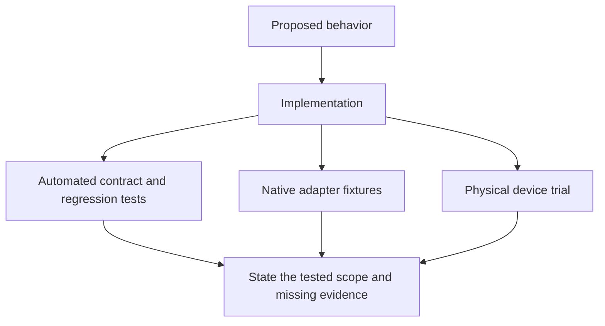

# Review archive

These reports explain what was investigated, changed or measured at a recorded
revision. Start with the short result; expand a long report for exact findings,
requirements, commands and test evidence. Dates and old task states are history,
not a statement of today's support or remaining work.

For current help, use the [user guide](../../README.md),
[settings](../settings.md), [architecture](../architecture.md),
[camera](../cameras.md), [audio](../audio.md) or [Windows status](../windows-port.md).
The [connection contract](2026-10-10-t846-connection-contract.md) is an active
reference, separate from this historical collection. [TODO](../../TODO.md)
records outstanding work. Removing an old task from tracking does not itself
prove that its acceptance passed.

For shared terms and a route through all three archives, see the
[archive guide](../history.md). The [artifact guide](artifacts/README.md) maps the
evidence files behind these reports.

## Read the evidence in its scope

A proposal defines intended work. An implemented fix needs its own verification.
Automated tests, native fixtures and a physical trial answer different questions:

A passing fixture is not a physical-device result. A physical result applies to
its recorded device, version and workload. A timeout or Stop acknowledgement is
not proof that a native resource is safe to reuse. See the
[ownership explanation](../architecture.md) for the current lifecycle.

Original requirements remain visible even when an attempted implementation failed.
Dated proposals do not authorize new work. Historical compatibility paths and
package names are not current instructions; use the guides above. Existing macOS,
stylus and large-machine campaign decisions remain in force. Reproduction commands
may need the recorded revision, private workspace or hardware.

## Find a report

The table summaries describe recorded outcomes. Later reports can supersede earlier
plans or layouts. Exact counters, failures, source identities and limits remain in
the linked reports and their artifacts. Checksum-protected evidence stays unchanged.

### 2026-09

| Report | Recorded result or purpose |
| --- | --- |
| [Architecture and responsibility review — 2026-09-17](2026-09-17-architecture.md) | A source review identified repeated session setup and mixed responsibilities across host, Android and packaging code. |
| [Cinnamon session restart during UScreen connection](2026-09-17-cinnamon-restart.md) | An Xorg crash followed display attachment before the corrective resolution change. |
| [Copy, mapping, loop and power review — 2026-09-17](2026-09-17-copy-loop-power.md) | This source review separated avoidable copies and wakeups from changes that need stronger ownership contracts. |
| [Performance and scalability research — 2026-09-17](2026-09-17-performance-scalability.md) | This report proposed measurements and optimization experiments; it did not run a hardware performance campaign. |
| [Benchmark completion and foreground ownership (T485)](2026-09-18-benchmark-completion.md) | Benchmark completion stopped relaunching the app, preserving whichever foreground app the user chose. |
| [Decoder transition evidence (T484)](2026-09-18-decoder-receipts.md) | Decoder changes gained configuration receipts so acknowledgements from an old decoder could not certify a new selection. |
| [T429 — preserve the live FIFO during encoder changes](2026-09-18-fifo-ownership.md) | FIFO cleanup was tied to the exact pipe its owner created, preventing an unused capture manager from deleting a live session’s path. |
| [T395 — Android foreground-service startup investigation](2026-09-18-foreground-start.md) | Thirty controlled starts did not reproduce the Android foreground-service timeout. |
| [Git ignore and history audit — T489](2026-09-18-git-hygiene.md) | An audit found no confirmed credentials in the scanned checkout and Git objects. |
| [Live profile change and saved tablet setup — T429](2026-09-18-low-latency-live.md) | A live encoder change resumed playback after a missing FIFO caused roughly 21 seconds of recovery. |
| [Low-latency profile transition investigation — T429](2026-09-18-low-latency-transition.md) | The inspected GUI saved encoder settings before requesting a full daemon restart. |
| [T478: bounded decoder/profile negotiation](2026-09-18-media-negotiation.md) | The dated negotiation extension matched encoder output with advertised decoder capabilities and tested bounded metadata and stale selections. |
| [Stock FFmpeg timestamp correction (T421)](2026-09-18-timestamps.md) | Stock FFmpeg filters made timestamps strictly increasing while retaining forward time gaps. |
| [T308 — AppImage packaging and process lifetime](2026-09-19-appimage.md) | The first AppImage packaging work verified independent process extraction lifetimes and bundled userspace dependencies in an isolated container. |
| [T444: credentials belong to logical tablet attachments](2026-09-19-attachment-credentials.md) | Attachment-specific credentials prevented retired tablet sessions from authenticating against reused slots. |
| [T445: attachment-only Activity launch](2026-09-19-attachment-launch.md) | Automatic Activity launch was limited to a fresh observed attachment, so routine repair could not repeatedly steal focus. |
| [T508 — build-output fixture signing prerequisites](2026-09-19-build-output-fixtures.md) | Build-output fixtures gained offline signing-tool responses so existing tests could reach their artifact assertions. |
| [T498: raw-frame alignment after encoder restart](2026-09-19-encoder-restart.md) | Encoder restart now waited for the old reader and rotated the owned FIFO, preventing stale frame suffixes and overlapping readers. |
| [T250 — fork Android identity and signed release gate](2026-09-19-fork-identity.md) | This dated release introduced the fork’s former Android package identity and a signature/manifest publication gate. |
| [Per-function coverage and retained tests — 2026-09-19](2026-09-19-function-coverage.md) | This coverage snapshot measured each production function separately and retained unavailable native Windows evidence as a failure to qualify. |
| [T507 — portable package fixture signing tools](2026-09-19-package-fixtures.md) | Portable packaging fixtures supplied offline signer and manifest responses after release verification became mandatory. |
| [T505 — offline SDK fixtures for bundle regressions](2026-09-19-packaging-fixtures.md) | Distribution fixtures gained deterministic Android SDK responses while the wrong-certificate rejection test remained intact. |
| [T480 — optional measured profile persistence](2026-09-19-profile-cache.md) | An optional cache reused a measured profile only after fresh compatibility and rendering checks. |
| [T321: conservative minimum display timing](2026-09-19-supported-timing.md) | The timing contract imposed a conservative 10 MHz minimum pixel clock and rejected unsupported explicit edits. |
| [T494: Windows command-line compilation boundary](2026-09-19-windows-cli.md) | The first Windows command-line boundary exposed diagnostics while rejecting unsupported actions. |
| [Windows cross-compilation check](2026-09-19-windows-cross-compilation.md) | This initial cross-compilation check built shared policy but found Linux dependencies blocking the full host and GUI. |
| [T495: GUI platform boundary](2026-09-19-windows-gui.md) | The GUI gained separate platform services and explicit unavailable-capability labels. |
| [T493: Windows shared-service foundation](2026-09-19-windows-services.md) | The Windows foundation introduced private state, exact process identity and owned process jobs. |
| [T496: Windows-native fixtures and CI](2026-09-19-windows-tests.md) | Command fixtures used their own executable and native process-exit evidence instead of Unix shell assumptions. |
| [Android performance assessment — T560](2026-09-20-android-performance.md) | The Android assessment found no measured reason to add a worker pool around one decoder. |
| [Host camera integration — T543](2026-09-20-camera-host.md) | Host camera controls gained explicit Start/Stop, saved settings and a bounded preview. |
| [Native tablet webcams — T539](2026-09-20-camera-implementation.md) | The first camera implementation exposed two Linux webcam entries with one active tablet lens. |
| [T536 — desktop login without the graphical session target](2026-09-20-cinnamon-autostart.md) | An enabled service could miss Cinnamon login because the graphical session target never activated. |
| [Tablet cameras as desktop cameras](2026-09-20-tablet-cameras.md) | Camera metadata supported a Linux prototype with two named endpoints and one active lens. |
| [Tray GUI after an AppImage update — T550](2026-09-20-tray-update.md) | The tray launched a stale GUI from an older AppImage extraction. |
| [Capture follow-ups, 2026-09-21](2026-09-21-capture-followups.md) | The replay builder gained a missing source dependency, while separate reports recorded shared damage tracking and optional GPU capture. |
| [Requested follow-up implementation](2026-09-21-follow-up-batch.md) | This batch fixed premature configuration-success logs and stale render-acknowledgement accounting, then shared session and diagnostic contracts across platforms. |
| [Four-item implementation batch](2026-09-21-reliability-batch.md) | This batch covered GUI registration, configuration diagnostics, experimental idle capture and frame observability. |
| [T597: algorithmic complexity versus measured cost](2026-09-26-algorithm-costs.md) | A percentile microbenchmark showed selection faster on some large samples but slower on sorted or small inputs. |
| [T587: allocation sizing and bounded Android growth](2026-09-26-allocation-sizing.md) | Android packet growth was capped at the largest legal packet without adding growth allocations for any legal sequence. |
| [T619 — runtime permissions during ADB installation](2026-09-26-android-permissions.md) | ADB installation gained the runtime-permission grant flag while preserving explicit camera Start/Stop. |
| [Retired Android SDK package in CI (T639)](2026-09-26-android-sdk-ci.md) | CI explicitly selected platform tools after an upstream default requested a retired Android SDK package. |
| [T586: Blent Linux and Android deployment](2026-09-26-blent-deployment.md) | The renamed Linux and Android builds passed specific display, touch and logical reconnect checks. |
| [T585: Blent application identities](2026-09-26-blent-identity.md) | The project adopted fresh Blent package, command and data identities without old-name migration or aliases. |
| [Blent rename, application updates and allocation review](2026-09-26-blent-plan.md) | This plan records the accepted fresh-identity rename and separate deployment and allocation-review outcomes. |
| [Blent follow-up validation](2026-09-26-blent-validation.md) | This follow-up corrected a lossy-video test assumption, closed scoped coverage gaps and fixed X11 touch mapping through validated display identity. |
| [Inputs needed for the reviewed TODO items](2026-09-26-blocker-inputs.md) | This dated dependency map records decisions and evidence needed by the former ledger, including declined stylus work. |
| [T607 — camera write-chunk sweep](2026-09-26-camera-chunks.md) | A chunk-size sweep retained the existing 8 KiB camera writer. |
| [Camera freshness — T614, T616, T617, T618](2026-09-26-camera-freshness.md) | Camera upload gained bounded acknowledgement, stale-frame recovery, whole-packet deadlines and rate adaptation. |
| [T594: bounded camera packet staging](2026-09-26-camera-staging.md) | Camera packets moved through bounded transport segments instead of allocating a whole-payload array. |
| [T620 — bounded camera producer-failure fixture](2026-09-26-camera-test-lifetime.md) | The producer-failure fixture gained coordinated completion and cancellation so an unfinished handshake could not keep a completed server alive. |
| [T608 — selective camera transport research completed](2026-09-26-camera-transport.md) | Isolated impaired-network replays supported retaining TCP/ADB for the camera route. |
| [Private namespace prerequisite in CI (T640)](2026-09-26-ci-namespaces.md) | CI added a narrow namespace permission and a real isolation preflight after a mandatory native test could not start. |
| [T604: retain the mouse while touch is enabled](2026-09-26-cinnamon-cursor.md) | A Cinnamon-specific cursor policy restored visibility when an owned virtual touchscreen triggered hiding. |
| [T626: CLI worker fixture drift](2026-09-26-cli-worker-fixture.md) | A CLI test still expected automatic encoder threading after the shared default changed to one worker. |
| [T629: physical panel metadata on the real control-open path](2026-09-26-control-handshake-coverage.md) | A real control-socket fixture covered authentication before native display dimensions, including absent physical-size fields. |
| [Isolate LLVM coverage objects (T638)](2026-09-26-coverage-object-isolation.md) | Stale instrumented executables contaminated a coverage report even though current source hashes matched. |
| [T553: simultaneous display and camera route assessment](2026-09-26-display-camera-routing.md) | A short simultaneous display/camera sample showed no sustained local socket backlog or reason to add automatic route balancing. |
| [T612: bounded encoder worker selection](2026-09-26-encoder-workers.md) | Automatic encoder selection compared bounded worker counts with quality, progress, CPU and memory guards. |
| [T599: display ownership is not independent of grabbing](2026-09-26-evdi-ownership.md) | The reviewed EVDI interface coupled pixel grabbing with display-flip completion. |
| [T623 — recovery warnings and duplicate grabs](2026-09-26-evdi-recovery.md) | A regression removed duplicate watchdog/fallback grabs while preserving recovery after lost readiness. |
| [T615 — EVDI setup investigation](2026-09-26-evdi-setup.md) | Stock EVDI logs showed connector queries and explicit unsupported mappings, not repeated helper attachment. |
| [T600: full-daemon thread-budget validation](2026-09-26-full-daemon-thread-budgets.md) | Matched full-daemon trials found encoder workers, rather than runtime-worker count, drove the useful CPU reduction in this workload. |
| [Per-function coverage and bounded fuzzing — 2026-09-26](2026-09-26-function-coverage.md) | The source-matched local coverage gate passed all listed functions, while a later remote Linux gate exposed missing empty-sysfs coverage. |
| [T578: explicit GPU layout prerequisite](2026-09-26-gpu-layout.md) | The X11 stack negotiated an older DRI3 version and could not supply the proposed explicit-layout export. |
| [T602: simpler installation and optional ADB](2026-09-26-installation-research.md) | This dated research separated APK installation from runtime transport and proposed guided bundled-ADB setup followed by an accessory prototype. |
| [T627: live decoder selection and capture readiness](2026-09-26-live-decoder-selection.md) | The live Android surface-codec path omitted the negotiated decoder selection, so valid render output lacked the required receipt. |
| [Blent follow-up implementation and validation](2026-09-26-next-batch.md) | This batch repaired replay completion and source copying, closed isolated camera coverage gaps and added native allocation and capture observations. |
| [T598: optimized client and thread attribution](2026-09-26-optimized-profiling.md) | Optimized-client profiling found codec work and wakeup volume, not a demonstrated application-lock bottleneck. |
| [Performance audit: host and Android](2026-09-26-performance-audit.md) | The audit separated sampled CPU, sleeping-thread time, allocation counts and native delivery. |
| [Blent performance graphs](2026-09-26-performance-graphs.md) | These graphs compare distinct recorded workloads, including unsuccessful chunk and transport proposals. |
| [Native encoder pipes (T529)](2026-09-26-pipe-encoder.md) | A shared stock-FFmpeg pipe adapter owned its input and child process through partial writes and shutdown. |
| [T624 — one ordinary Blent launcher](2026-09-26-profile-cleanup.md) | Disposable profiling APKs lost their ordinary launcher entry, and the runner owned installation and cleanup. |
| [Portable raw-frame writes (T635, prerequisite for T529)](2026-09-26-raw-frame-transfer.md) | The portable frame writer completed one validated NV12 frame or retired the failed stream before another frame could append. |
| [T613: temporary single-worker libx264 default](2026-09-26-single-worker-default.md) | The owner selected one libx264 worker as the shared default after matched measurements. |
| [Syscall and thread follow-up](2026-09-26-syscalls-and-threads.md) | Syscall traces motivated attribution and worker-budget experiments, not replacing APIs based on sleeping time. |
| [T603: tablet-guided self-tuning proposal](2026-09-26-tablet-self-tuning.md) | This proposal extended the existing selector with explicit objectives and bounded trials while preserving manual choices. |
| [Thread ramp at tablet geometry](2026-09-26-thread-ramp.md) | The thread ramp compared requested and effective encoder, conversion and runtime budgets at fixed geometry. |
| [T611: desktop and Android task flows](2026-09-26-ui-task-flows.md) | The UI grouped status with actions, made advanced controls expandable and added accessible Android settings and camera Stop actions. |
| [Windows camera-probe build boundary (T631)](2026-09-26-windows-build-boundary.md) | A Linux-only camera example broke Windows builds. |
| [Importing native Windows coverage (T636)](2026-09-26-windows-coverage-import.md) | The coverage importer learned Windows path forms while retaining strict tree boundaries and byte-exact source hashes. |
| [Windows 11 development VM (T633)](2026-09-26-windows-development-vm.md) | A retained Windows 11 development VM passed the recorded native setup and application tests. |
| [Runtime directory pinning (T634)](2026-09-26-windows-directory-pinning.md) | Windows directory handles needed directory-list access to participate in sharing checks and prevent rename/deletion. |
| [T521: Windows virtual-display driver decision brief](2026-09-26-windows-display-driver.md) | The driver review found a lab candidate whose global monitor-count interface could not provide per-application output ownership. |
| [Explicit Windows runtime-file ownership (T637)](2026-09-26-windows-file-ownership.md) | Windows runtime files could inherit a default owner different from the user required by the contract. |
| [Native Windows foundation acceptance (T493)](2026-09-26-windows-foundation.md) | The shared Windows foundation passed native security, path, process and ownership tests at the recorded revision. |
| [Windows interactive daemon lifecycle — T524](2026-09-26-windows-lifecycle.md) | Windows gained an interactive daemon lifecycle with exact process identity and independent GUI lifetime. |
| [Native Windows scheduling acceptance (T583)](2026-09-26-windows-scheduling.md) | Native Windows tests verified priority changes, child propagation and denied rights using exact handles. |
| [T625: retain unchanged XInput mappings during retries](2026-09-26-xinput-retry-cache.md) | XInput retries reused successful mappings only while exact device properties and topology still matched. |
| [T622 — cached X11 mapping queries](2026-09-26-xrandr-mapping.md) | X11 mapping used cached queries with bounded explicit refreshes until an unambiguous owned display appeared. |
| [T414: audio-gap follow-up](2026-09-27-audio-followup.md) | Bluetooth errors were not correlated with a reported audible gap, so no causal Blent fix was established. |
| [Autostart probe assertion sensitivity (T653)](2026-09-27-autostart-mutation-regression.md) | Autostart tests independently crossed command status and reported state, catching two previously surviving boolean mutations. |
| [Windows autostart assertion sensitivity (T658)](2026-09-27-autostart-ownership-mutation.md) | Native Windows autostart tests gained first-install, exact length-boundary and path-ownership cases. |
| [Autostart removal error regression (T656)](2026-09-27-autostart-removal-mutation.md) | A Linux autostart regression now distinguishes an absent entry from other removal errors and preserves unrelated contents. |
| [T652: tooling and bounded mutation campaigns](2026-09-27-bounded-mutations.md) | The owner accepted tooling and bounded mutation samples across maintained languages instead of every generated mutation. |
| [T703: preserve independent camera preference edits](2026-09-27-camera-setting-merges.md) | Configuration saves merged edited nested fields against the latest locked configuration instead of replacing the entire camera table. |
| [Include codec diagnostic consumers (T670)](2026-09-27-codec-consumer-mutations.md) | Apparent codec mutation survivors came from omitting existing diagnostic callers. |
| [Blent contribution notices (T662)](2026-09-27-copyright.md) | Blent contribution attribution was added to distributed notices while original and third-party license text stayed byte-identical. |
| [T417: read-only decoder diagnostics](2026-09-27-decoder-diagnostics.md) | Read-only Android diagnostics separate advertised decoder capability, requested hints and unknown effective settings. |
| [T708: discovery fixture port collisions](2026-09-27-discovery-ports.md) | A discovery fixture selected unchecked PID-derived ports. |
| [Distribution fixture library ownership (T642)](2026-09-27-distribution-fixture.md) | Distribution tests accidentally linked the installed library before their private fixture library. |
| [Encoder marker validation (T665)](2026-09-27-encoder-marker-mutation.md) | Encoder-worker tests gained an independent exact-marker requirement, catching marker mutations that previous invalid cases concealed. |
| [T558: renewed stock-library review](2026-09-27-evdi-acquisition.md) | The stock-library review found no ownership-preserving bounded acquisition API. |
| [Windows GUI mutation isolation (T660)](2026-09-27-gui-registry-isolation.md) | Windows GUI tests moved registry isolation outside the function being mutated. |
| [Idle-policy assertion boundaries (T667)](2026-09-27-idle-policy-mutations.md) | Idle-policy tests gained exact admission, timeout and cost boundaries. |
| [T709: retain provisioned EVDI boot configuration](2026-09-27-installer-capacity.md) | Reinstallation stopped overwriting existing EVDI boot configuration, including managed links and administrator options. |
| [T597: exact bounded latency summaries](2026-09-27-latency-summary.md) | A bounded hybrid percentile algorithm preserved exact reporting results and storage reuse. |
| [T705: Linux ADB route ownership](2026-09-27-linux-route-ownership.md) | Linux route setup adopted shared ownership checks to preserve foreign mappings and partial-startup cleanup. |
| [Match mutation and baseline test scope (T671)](2026-09-27-mutation-baseline-scope.md) | Mutation import now requires baseline and mutant commands to select the same tests and configuration. |
| [Mutation testing progress after reboot recovery](2026-09-27-mutation-progress.md) | This recovery checkpoint records completed scoped campaigns and corrected classifications, then lists work remaining at that date. |
| [Mutation testing checkpoint — T652](2026-09-27-mutation-testing-handoff.md) | This initial pause checkpoint recorded one parser campaign and missing broader tooling. |
| [Native Windows mutation runner (T652, T666)](2026-09-27-native-mutation-runner.md) | Native Windows mutation runs separated a transient linker failure from genuine source-invalid edits. |
| [Decoder negotiation assertion gaps (T668)](2026-09-27-negotiation-mutations.md) | Negotiation tests gained independent bounds, family and profile checks, catching the meaningful surviving mutations. |
| [Project rescan — 2026-09-27](2026-09-27-project-rescan.md) | This review-only snapshot recorded nine findings with different evidence strengths and preserved interrupted or incomplete test results. |
| [Project implementation and review — 2026-09-27](2026-09-27-project-review.md) | This implementation checkpoint combined isolated Linux, native Windows, Android and script evidence with per-function source-matched counters. |
| [Raw slot offset assertions (T669)](2026-09-27-raw-slot-mutations.md) | Raw-slot tests now require exact contiguous offsets and non-overlap, beyond checking only the final bound. |
| [Registry handle-release assertion (T659)](2026-09-27-registry-drop-mutation.md) | A native child-process test verified that dropping a registry owner invalidated its exact held handle. |
| [Registry values shrinking between reads (T663)](2026-09-27-registry-shrink-mutation.md) | A native registry test changed the value between size probing and reading to verify actual returned length. |
| [Replay regression monitor identity (T641)](2026-09-27-replay-monitor-regression.md) | The replay test now identifies the exact monitor and owning thread instead of accepting any blocked callback state. |
| [GitHub repository rename (T661)](2026-09-27-repository-rename.md) | The hosted repository was renamed while retaining its identity and history. |
| [TODO dependency and scope review — T684](2026-09-27-todo-review.md) | This planning review split broad deliverables and reconciled dependencies without claiming their completion. |
| [T537: Linux tray shutdown ownership](2026-09-27-tray-shutdown.md) | Linux tray shutdown gained explicit ownership of its independent D-Bus service. |
| [USB credential redelivery deadlines (T657)](2026-09-27-usb-delivery-mutation.md) | Credential-redelivery tests gained exact interval boundaries using a paused clock. |
| [USB inventory response bounds (T654)](2026-09-27-usb-inventory-mutation.md) | USB inventory tests independently crossed exit status and exact reply-size boundaries. |
| [USB campaign verification and equivalent mutation (T664)](2026-09-27-usb-mutation-final.md) | Complete Linux and Windows USB campaigns retained an equivalent survivor and compilation-invalid edits as distinct outcomes. |
| [Native USB listener fixture allocation (T655)](2026-09-27-usb-port-fixture.md) | The USB test helper serialized complete listener reservations after a native Windows baseline exhausted retries. |
| [Per-user Windows autostart (T532)](2026-09-27-windows-autostart.md) | Windows login startup gained an owned per-user registration and reused the existing daemon lifecycle. |
| [Windows feature-parity audit — T690](2026-09-27-windows-parity.md) | The parity audit distinguished implemented Windows foundations from missing user-visible backends and physical acceptance. |
| [T531: Windows notification-area tray](2026-09-27-windows-tray.md) | The Windows tray consumed shared connection state and owned its native window, icon and thread. |
| [Windows USB connection preview (T525)](2026-09-27-windows-usb.md) | The Windows USB preview integrated authenticated ADB routes and attachment state with native fixtures. |
| [T222 follow-up: distinguish Xorg failure signatures](2026-09-27-xorg-signatures.md) | Seven Xorg incidents had different signatures; the original gamma crash could not be closed by a later glamor assertion. |
| [Private Xvfb startup diagnostics (T643)](2026-09-27-xvfb-startup.md) | The Xvfb fixture retained a pipe writer and discarded stderr, hiding early server failure. |
| [T707: camera retirement off the Activity thread](2026-09-28-camera-retirement.md) | Camera Stop closed admission promptly while background cleanup waited for borrowed native operations and late callbacks. |
| [T706: camera service ownership](2026-09-28-camera-service-ownership.md) | Background camera services gained exact run identities so delayed teardown could not stop a replacement. |
| [T704: expire stalled camera status](2026-09-28-camera-status.md) | Camera status now expires to Waiting after two seconds without a fresh selected frame, matching output freshness. |
| [T701: shared Android test-worker lifecycle](2026-09-28-compose-test-lifecycle.md) | A shared Robolectric worker reset its looper before Compose’s queued work drained. |
| [T700: GPU preloading before EVDI](2026-09-28-gpu-boot-order.md) | GPU module preloading mitigated a reproduced Xorg startup-order failure in isolated boot tests. |
| [T692 Windows virtual-camera adapter contract](2026-09-28-windows-camera-contract.md) | This proposed Windows camera contract separates persistent endpoint registration from explicit capture sessions and requires black output after loss or Stop. |
| [T697 capture capacity preparation](2026-09-28-windows-capture-capacity.md) | Portable capacity policy and an owned Windows memory buffer were prepared with bounds and release tests. |
| [T689/T673 non-stylus input contract and preview](2026-09-28-windows-direct-input.md) | The opt-in Windows input preview maps touch or explicit finger-mouse events to a selected monitor under authenticated ownership. |
| [T530 isolated Windows encoder tooling](2026-09-28-windows-encoder-probes.md) | Windows encoder tooling probed generated frames with bounded processes and inspected actual output against decoder advertisements. |
| [T685 Windows encoder probe recipes](2026-09-28-windows-encoder-recipes.md) | A bounded Windows encoder-recipe catalog supplied validated stock-FFmpeg arguments for later probes. |
| [T695 portable cadence control](2026-09-28-windows-idle-contract.md) | A portable idle-cadence controller bound evidence to encoder, decoder and viewer identities, with an expiring owned request. |
| [T696 Windows daemon release notifications](2026-09-28-windows-tray-updates.md) | The Windows daemon gained bounded release checks and a tray notification that opens a fixed release page only on request. |
| [T691 shared Wi-Fi setup and reconnection](2026-09-28-windows-wifi.md) | Wi-Fi setup and reconnect policy became shared across Linux and Windows adapters. |
| [T700: late AMD GPU initialization after simpledrm](2026-09-28-xorg-hotplug.md) | A matched core identified late AMD initialization after a software primary screen as the cause of one glamor-registration crash. |
| [T717: shared audio foundation](2026-09-29-audio-foundation.md) | The audio foundation supplied independent session ownership, authenticated PCM framing, bounded queues and clock correction policy. |
| [T544: tablet microphone and shared audio contract](2026-09-29-audio-input.md) | This accepted microphone contract required an explicit selectable source, independent controls, bounded audio and visible consent. |
| [T718: Linux/Android microphone integration](2026-09-29-audio-microphone.md) | The microphone path delivered live PCM to a desktop consumer and retired its owned source on Stop and loss. |
| [T545: computer output on tablet speakers](2026-09-29-audio-output.md) | This speaker contract required a selectable output without changing system defaults, plus independent focus, routing and cleanup. |
| [T719: Linux/Android speaker integration](2026-09-29-audio-speakers.md) | Speaker integration passed private PipeWire transport tests and observed advancing native tablet playback counters. |
| [T621: native webcam consumer acceptance](2026-09-29-camera-acceptance.md) | A physical tablet and real Chrome camera consumers verified selected-lens frames, black inactive output and clean retirement. |
| [T715: installed durable tuning and native startup fixes](2026-09-29-display-acceptance.md) | Installed startup validation found saved-profile verification beginning before the encoder existed and a brief misleading connection overlay. |
| [T721: host mouse failure after concurrent validation](2026-09-29-host-pointer-incident.md) | The host mouse failure remained unattributed after reboot recovery. |
| [RX 6600 XT encoding configuration](2026-09-29-rx6600-encoding.md) | The owner’s explicit RX 6600 encoding selection was verified by stable device identity and advancing hardware counters. |
| [T714: first-connect desktop/connection-screen flicker](2026-09-29-startup-flicker.md) | Live calibration repeatedly replaced video sessions, causing connection-screen flicker. |
| [T540: physical USB camera acceptance](2026-09-29-usb-camera-readiness.md) | Operator-assisted cable removal verified black camera output, release after reconnect and fresh explicit Start before capture resumed. |
| [T720: native audio clock integration](2026-09-30-audio-clock.md) | Native audio counters were connected to bounded rate correction without subtracting unrelated absolute clocks. |

### 2026-10

| Report | Recorded result or purpose |
| --- | --- |
| [Android review implementation](2026-10-09-android-fixes.md) | This implementation record separates portable Android contracts, bounded requests and native retirement from UI control. |
| [Android performance review, 2026-10-09](2026-10-09-android-performance.md) | This static Android review used focused host-JVM probes to identify UI blocking, unbounded response memory and allocation opportunities. |
| [Owned C performance checks: T768, T769, T778](2026-10-09-c-performance.md) | C conversion experiments supported weighted work, bounded damage spans and runtime SIMD, with independent pixel oracles. |
| [Host performance and resource lifecycle review](2026-10-09-host-performance-lifecycle.md) | Host probes reproduced blocking controller destruction, stale status after worker panic and uncapped command output. |
| [Project coupling, SOLID and API boundary review](2026-10-09-project-boundaries.md) | The boundary review identified concrete contract dependencies, a type cycle and blocking native work inside policy/UI paths. |
| [Implementation update (2026-10-10)](2026-10-09-resource-lifecycle.md) | Lifecycle probes showed unbounded pending jobs and hidden cleanup failures despite safe native admission. |
| [T827: enforce scoped contract boundaries](2026-10-10-architecture-enforcement.md) | Scoped architecture guards and independent contract builds reject forbidden implementation dependencies. |
| [T818: reusable audio staging and identity-rate bulk copy](2026-10-10-audio-staging.md) | Audio staging reused connection-owned buffers and bulk-copied the exact identity-rate case while preserving interpolation and atomic validation. |
| [T823: private native owners, portable C contracts](2026-10-10-c-owner-contracts.md) | C public contracts hid thread and buffer-owner layouts while preserving explicit borrowed targets and immutable leases. |
| [T816: bounded camera frame reuse](2026-10-10-camera-frame-reuse.md) | Camera decoding gained a bounded pool whose outstanding readers prevent reuse. |
| [Fork name and attribution: local review](2026-10-10-fork-notices.md) | A local notice review distinguished the inherited license from new contribution attribution and found missing notices in a cached APK. |
| [Host review fixes (2026-10-10)](2026-10-10-host-fixes.md) | Host fixes separate public contracts from adapters, supervise worker failures, and bound command output while retaining ownership until native cleanup finishes. |
| [Host power following and unchanged frames](2026-10-10-host-power-idle.md) | Display pause keeps the virtual monitor and leaves camera and audio independent; suspend stops all resources. |
| [T819: optional native encoder isolation](2026-10-10-native-encoder-isolation.md) | Running the optional native encoder in a supervised child contains process failures. |
| [T841: retirement observer coverage snapshots](2026-10-10-retirement-counters.md) | A blocked retirement observer made LLVM infer an invalid coverage counter. |
| [T793: current-source shared-encode replay repair](2026-10-10-t793-shared-encode-replay.md) | The repaired replay builds against the current contracts at the recorded revision and produces matching FIFO/shared-memory encoded and decoded output. |
| [T845: notices travel with the standalone APK](2026-10-10-t845-android-notices.md) | The standalone Android APK includes project and dependency notices as readable assets. |
| [T846: USB-first ADB-free transport feasibility](2026-10-10-t846-usb-prototype.md) | The selected tablet completed one synthetic accessory-only USB echo run with debugging disabled, after failed attempts exposed a zero-length-packet handling bug. |
| [T994: delayed local Stop preserves the shared connection](2026-10-11-local-resource-cancellation.md) | A delayed local Stop could fail the shared connection after its resource had already retired. |
| [T1115: original FIFO unchanged-frame trials](2026-10-19-fifo-unchanged-policy.md) | The FIFO idle worker gained an internally selected unchanged-frame trial with original-session, viewer, decoder and timing checks. |
| [T1114: original idle namespace coordination](2026-10-19-idle-namespace.md) | Pinning the original directory and coordinating publication and cleanup prevents idle-request clobbering and pathname retargeting. |
| [T1117: original request retirement waits for filesystem evidence](2026-10-19-idle-retirement.md) | Idle-request cleanup retains its original identities and retries until the filesystem confirms removal or replacement. |
| [T1118: staging ownership stays inside the original directory guard](2026-10-19-idle-staging.md) | One temporary-file owner now keeps publication and cleanup inside the original directory guard. |
| [Original advice cannot qualify a replacement native reader](2026-10-19-native-idle-admission.md) | A replacement native reader pins and rejects advice that existed before its first source access. |
| [Shared native idle advice and bounded FIFO checks](2026-10-19-native-idle-control.md) | Shared idle-advice validation bounds record reads and lets the FIFO writer recheck advice while waiting for sparse frames. |
| [T1107: sparse delivery qualification](2026-10-19-sparse-delivery.md) | The tested software H.264, VP9 and AV1 recipes delivered isolated pictures across static gaps and supported fresh decoding of later keyframes. |
| [T1109: portable unchanged-frame policy](2026-10-19-unchanged-policy.md) | The portable policy measures a session before trying one-second unchanged-frame refreshes and permanently rejects that instance when its original conditions fail. |
| [USB capacity/deadline controls (T1098/T1099/T898)](2026-10-19-usb-preferences.md) | USB settings apply to the next connection and never grant consent or restart active media. |
| [Linux and Android local update — 2026-10-26](2026-10-26-deployment.md) | This local deployment replaced Linux executables and the selected tablet APK while preserving data and checking installed identities. |
| [T1268: tablet-resource workspace review](2026-10-26-host-ui.md) | The owner approved a tablet-centered workspace with independent resource controls and later selected per-tablet display Start/Stop. |
| [About navigation (T1276)](2026-10-27-about.md) | About gained stable navigation, build information and an offline viewer for exact project and dependency notices. |
| [C review fixes — 2026-10-27](2026-10-27-c-fixes.md) | Seven C review findings were resolved with separate fixes, retained regressions and scoped measurements; the ownership-comment correction needed no behavioral test. |
| [C ownership and correctness review — 2026-10-27](2026-10-27-c-review.md) | The C review found seven actionable issues in native ownership and benchmark correctness. |
| [Crate notice collection (T1279)](2026-10-27-crate-notices.md) | Crate notice collection now preserves nested notices and rejects missing, unsafe or empty inputs. |
| [Offline crate notice supplements (T1280)](2026-10-27-crate-supplements.md) | Pinned notice supplements fill missing files in selected crate archives through temporary source copies, leaving registry caches unchanged. |
| [Preserve targeted display Start scope (T1275)](2026-10-27-display-start-scope.md) | Manual USB display Start now waits for capacity instead of displacing another tablet, and ADB eligibility uses the same authoritative policy. |
| [Left-aligned GUI refinements — 2026-10-27](2026-10-27-left-aligned.md) | The owner replaced centered page content with stable left alignment and made About use one page scroll area. |
| [Installed component attribution recovery (T1278)](2026-10-27-local-notices.md) | The installed Linux bundle recovered component notices and a manifest tied to its exact executables and dependencies. |
| [Native tablet-resource workspace (T1273)](2026-10-27-resource-workspace.md) | The native workspace implements independent display/input, camera, microphone and speaker controls bound to exact tablet identities. |
| [Responsive GUI fixes — 2026-10-27](2026-10-27-responsive.md) | These first responsive-layout fixes bounded columns, centered forms and sized the notice reader to window height. |
| [Release Rust source selection (T1281)](2026-10-27-rust-source-graph.md) | Release source collection now follows each actual release build's normal/build dependency tree, avoiding development-only feature leakage. |
| [Per-tablet display controls (T1274)](2026-10-27-tablet-display-control.md) | Per-tablet display Start/Stop binds commands to the original daemon and tablet identity while leaving camera, audio and the connection independent. |
| [Workspace contracts (T1272)](2026-10-27-workspace-contracts.md) | Independent workspace contracts distinguish device identity, display assignment, resource activity and unknown external state. |
