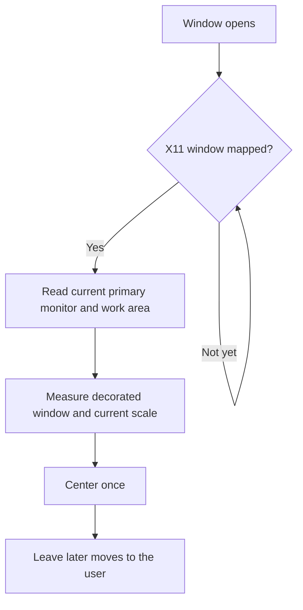

# T1315: center the window on the primary monitor

Initial X11 placement uses the current primary monitor and runtime geometry without a monitor-count cap. Native and pure-geometry tests passed; Wayland placement remains compositor-controlled and finite samples are not universal certification.

Historical evidence. Results apply to the recorded source and conditions. See the
[artifact guide](../README.md) for scope and terminology.

Recorded evidence and technical details

Blent now calculates its initial X11 window position from the current primary
monitor. Nothing assumes a particular monitor count, order, position or scale.
The calculation includes the usable desktop area and window decorations.

Wayland controls placement through its compositor. If X11 cannot identify the
primary monitor, Blent reports that limitation and keeps window-manager placement.
An oversized window aligns its top-left controls with the selected monitor.

## Regression evidence

- The original native regression failed: the window centered on the Xvfb root
  instead of the declared primary monitor at a nonzero offset (`before.log`).
- A second permanent case exposed a half-title-bar error under Metacity
  (`decorations-before.log`). Waiting for mapping and reading native frame
  extents fixes that case too.
- All 179 GUI unit tests and the actual-binary startup test pass. The placement
  fixture runs on private Xvfb servers, with and without Metacity, at scales 1
  and 1.25. It also changes primary positions, adds 23 unrelated monitor records,
  and checks work-area selection and unmapped/destroyed-window handling. These
  are finite regression samples, not implementation limits or universal native
  certification. No active desktop layout was changed.
- Pure geometry tests cover negative origins, portrait/landscape sizes, scales
  0.75 through 3, oversized windows, intersections, invalid values and overflow.
- Every changed production function has at least 94.1% executable-line coverage;
  every changed/new function is at complexity 9 or below. See
  `verified-metrics.json` for individual results, source hashes and tools.
- Production GUI Clippy and the Rust formatting gate pass. Strict GUI **test**
  Clippy exposes two pre-existing warnings in untouched fixtures, tracked as
  T1321; `clippy.log` records them. No warning suppression was added.

## Ownership and limits

The eframe window owns its native identity and outlives the App's startup request.
The pending request borrows only the X11 screen/window IDs, without retaining a
native pointer. Each observation owns a separate read-only X11 connection; reply
cookies settle within that call and dropping it closes the socket on success,
mapping wait or error. Once a position is submitted, or observation fails, the
pending identity is discarded. Subsequent frames cannot reposition that window.
Unmapped windows remain pending while the App/window exists; destroying the App
removes that small pending value. A destroyed native window is rejected and is
not retried. No worker, callback or native allocation survives this owner.

Geometry functions retain nothing and operate on finite dimensions/coordinates;
invalid or overflowing values produce no position. Native property reads request
at most four CARDINAL values. Monitor enumeration uses the server's current
records, with no application monitor-count cap. The tests own and retire their
private window managers and X servers; the user's desktop is only observed during
initial diagnosis. This is scoped lifetime/testing evidence, not an unrestricted
proof of external compositor behavior.

The complete LCOV and raw build artifacts remain in the owned local workspace
(`/tmp/blent-t1315/verified.lcov` and the T835 Cargo coverage target). The committed
report preserves the per-function results, source identities and command logs.

