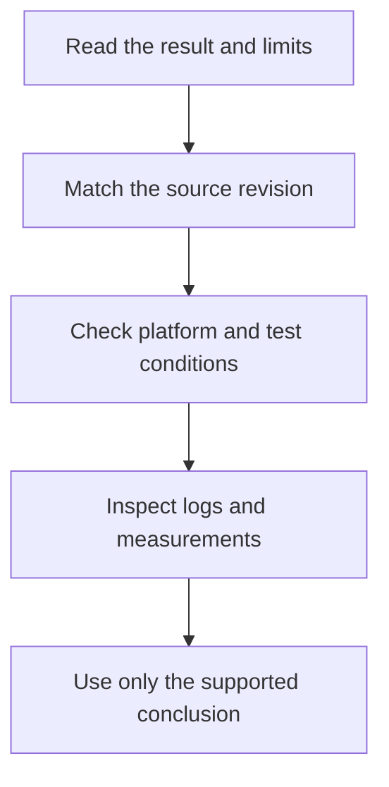

# Artifact guide

Artifacts are the files behind a review: logs, measurements, source snapshots and
notes explaining how a result was obtained. Start with a dated review in the
[review archive](../README.md), or choose an evidence note below.
For performance comparisons, use the [benchmark archive](../../benchmarks/README.md).
For current instructions, start with the [user guide](../../../README.md).
[TODO](../../../TODO.md) is the current work list.

## What a result means

Read the result and its limits first. Expand **Recorded evidence and technical
details** when you need exact commands, counters or failures. Short notes and
checksum-protected originals stay intact; the map below supplies their context.

| Term | Meaning |
| --- | --- |
| Fixture | A controlled test setup. It may simulate hardware or exercise a native API; check which. |
| Native | Run against the named operating system or API. It does not automatically mean a physical tablet trial. |
| Red / green | The same regression failed before a fix and passed afterward. |
| Coverage | How much code a test executed. A percentage alone does not prove correct behavior. |
| Complexity | A per-function count of decision paths. It does not measure runtime speed. |
| Source identity / hash | A fingerprint tying evidence to particular files. Changed code needs fresh evidence. |
| Counterexample | A concrete case that violates a proposed rule or implementation claim. |
| Acceptance | The specified checks passed within their recorded scope and conditions. |

These are historical records, not instructions to run old commands against a live
installation. Absolute paths may refer to the original investigator's workspace.
A missing file, an unmeasured platform or a failed trial remains a limit; a later
TODO removal does not establish that the missing acceptance passed.

Old “open”, “blocked” and “current” statements refer to the recorded date. Later
reports may replace them. For example, the October 21 complexity-tool decision
accepted local per-function measurements; older notes requiring SonarQube itself
are historical. Exact counters and checksum-protected documents remain unchanged.
Software models, operating-system fixtures and physical trials provide different
evidence; none alone certifies every device, interleaving or future version.

## Find evidence by date

Each date expands to its evidence notes. Summaries describe the recorded result,
not a fresh test run. **Original** marks checksum-protected Markdown retained byte
for byte. Raw logs and measurements are unchanged throughout this documentation review.

2026-09-26 — 2 evidence notes

| Note | Recorded result and limits |
| --- | --- |
| [T497 evidence](2026-09-26-function-coverage/README.md) | The source-matched coverage snapshot passed each of 2,230 maintained functions; a macOS-only function remains unmeasured. Later source changes require fresh counters. |
| [T611 audit and prototype, before production UI changes](2026-09-26-task-batch/t611/audit.md) | This UI audit and interactive prototype proposed clearer controls and consent flows. Prototype checks were developer walkthroughs, not a shipped interface or a usability study. |

2026-09-27 — 10 evidence notes

| Note | Recorded result and limits |
| --- | --- |
| [Final review evidence](2026-09-27-final-review/README.md) | The final combined gate passed 2,293 functions at its recorded revision using source-matched native and hosted evidence. The earlier runner stall remained unexplained. **Original.** |
| [T651 inventory validation complexity](2026-09-27-inventory-complexity/README.md) | Splitting inventory record validation restored the complexity limit without changing accepted inputs. Fresh Linux and Windows counters replaced only the changed-source records. |
| [T650 inventory validation](2026-09-27-inventory-validation/README.md) | Rejecting embedded NUL characters preserves an existing authenticated attachment when inventory is malformed. Native Linux and Windows regressions passed with matching source fingerprints. |
| [T652 initial mutation evidence](2026-09-27-mutation-checkpoint/README.md) | Existing parser tests caught 26 tested mutations. The candidate listing is not a project-wide mutation score or a completed mutation-testing system. **Original.** |
| [Host-independent sysfs coverage (T645)](2026-09-27-sysfs-coverage/README.md) | An isolated sysfs fixture filled two discovery-function coverage gaps without modifying host devices. Its source-matched local result is not a new CI run. **Original.** |
| [Windows regression runner evidence (T646)](2026-09-27-t646-vm-checks/README.md) | Windows runner fixes initialize AppLocker metadata and clear an intentional fixture exit status only after successful assertions and cleanup. The recorded step pass is not a whole-workflow result. **Original.** |
| [Repository DNS readiness evidence (T647)](2026-09-27-t647-vm-checks/README.md) | The VM readiness check now rejects failed or empty DNS answers. This detects a missing prerequisite; it does not fix the upstream resolver outage. **Original.** |
| [Windows autostart native evidence (T532)](2026-09-27-windows-autostart/README.md) | Windows autostart passed native ordinary-user regressions and scoped coverage. Tests used temporary registry keys and did not change the real startup preference. **Original.** |
| [T633 native development VM evidence](2026-09-27-windows-development-vm/README.md) | The configured Windows development VM passed native acceptance and application checks. Earlier clock and login snapshots are superseded; no physical GPU, USB or tablet acceptance follows. **Original.** |
| [T644 diagnostic readiness](2026-09-27-xvfb-diagnostics/README.md) | Added diagnostics capture live-child state before timeout cleanup and avoid inspecting reused process IDs. Local passes did not explain the historical runner stall. |

2026-09-28 — 12 evidence notes

| Note | Recorded result and limits |
| --- | --- |
| [T700 retained evidence and boot recipe](2026-09-28-gpu-boot-order/README.md) | Guest boot trials reproduced an Xorg failure and verified GPU-before-EVDI ordering. The recipe belongs in a disposable guest; it is not a host installer. |
| [T711: preserve Make setup capacity](2026-09-28-make-capacity/README.md) | Make setup now preserves existing EVDI capacity files and symlinks, creating defaults only when absent. Sandboxed regressions exercised the recipe without changing live modules. |
| [T530 encoder probe evidence](2026-09-28-t530-probes/README.md) | Encoder probes passed native Linux and Windows packet/profile checks with source-matched coverage. Missing ffprobe correctly failed; GPU and physical tablet acceptance remained separate. **Original.** |
| [T672 monitor mapping evidence](2026-09-28-t672-mapping/README.md) | Monitor mapping passed geometry, rotation, scaling and stale-topology tests plus native VM enumeration. Synthetic layout changes do not establish physical mixed-DPI or hotplug acceptance. **Original.** |
| [T685 encoder recipe evidence](2026-09-28-t685-recipes/README.md) | Windows encoder recipes passed portable checks and native syntax tests. Software encoding worked, but missing GPU runtimes prevented hardware qualification. **Original.** |
| [T689 direct input evidence](2026-09-28-t689-input/README.md) | Native Windows fixtures delivered touch and mouse input to an owned window and verified cleanup. This does not establish physical Android/USB delivery or concurrent-device acceptance. **Original.** |
| [T691 Wi-Fi evidence](2026-09-28-t691-wifi/README.md) | Wi-Fi regressions fixed false reconnect success and route-cleanup ownership errors on Linux and Windows. Fixtures do not establish physical network/tablet acceptance. |
| [T694 CLI admission evidence](2026-09-28-t694-cli/README.md) | Windows CLI capability checks now reject unsupported options before daemon startup and honor supported port overrides. Native tests do not add capture support. **Original.** |
| [T695 cadence evidence](2026-09-28-t695-idle/README.md) | Idle cadence contracts passed shared and native-event fixture tests. Windows capture integration and physical performance or battery acceptance were not established. |
| [T696 release notification evidence](2026-09-28-t696-updates/README.md) | Release notification tests preserve an existing notification on invalid metadata and keep tray actions usable after launch failures. Native timer-fixture races were corrected without weakening production delays. |
| [T697 capacity evidence](2026-09-28-t697-capacity/README.md) | Capture capacity contracts passed individual coverage and native buffer/thread fixtures. Those fixtures do not establish production Windows capture or conversion support. |
| [T702 USB retirement evidence](2026-09-28-t702-usb-retirement/README.md) | USB attachment retirement tests preserve replacements and retain unresolved route cleanup separately. These dated fixture results predate the later temporary-mapping ownership work and are not physical acceptance. **Original.** |

2026-09-29 — 11 evidence notes

| Note | Recorded result and limits |
| --- | --- |
| [2026-09-29-audio-foundation — README](2026-09-29-audio-foundation/README.md) | The shared audio foundation passed source-matched Linux tests without opening real audio devices. Native adapters and hardware acceptance were separate work. **Original.** |
| [T724: one five-second audio grant deadline](2026-09-29-audio-grant-deadline/README.md) | Audio negotiation now uses one five-second deadline for the complete invitation and grant. Slow partial reads cannot renew it; hosted regressions cover both early rejection and budget overrun. |
| [T718 microphone integration evidence](2026-09-29-audio-microphone/README.md) | Microphone integration passed automated suites and a selected-tablet level/cleanup check. Numeric sample activity establishes delivery, not speech intelligibility, acoustic delay or effective echo cancellation. |
| [T719 speaker evidence](2026-09-29-audio-speakers/README.md) | Speaker integration passed automated tests and selected-tablet native playback/cleanup observations. Playback counters do not establish audible quality or acoustic delay; unrelated camera/headset findings remained separate. |
| [2026-09-29-camera-acceptance — README](2026-09-29-camera-acceptance/README.md) | This bounded browser/V4L2 camera check retained numeric frame statistics, not recordings. Physical USB removal was outside its acceptance scope. **Original.** |
| [T723: camera fixture observes native retirement](2026-09-29-camera-retirement-fixture/README.md) | The camera fixture now waits for actual worker retirement before expecting replacement. Main-thread idleness alone was not completion; production behavior stayed unchanged. |
| [T715 validation evidence](2026-09-29-display-acceptance/README.md) | Native restart and reconnect checks verified saved-profile reuse and the revised connection overlay. Reboot and optical-latency acceptance were not observed. **Original.** |
| [T714 validation](2026-09-29-startup-flicker/validation/README.md) | Startup-flicker regressions and source-matched counters passed across the recorded scopes. Installed applications were unchanged, so this report did not establish a physical flicker fix. **Original.** |
| [T673 authenticated touch/mouse preview](2026-09-29-t673-input/README.md) | Authenticated Windows touch/mouse preview passed native owned-window and daemon-fixture tests. Physical tablet behavior, display streaming and stylus support remained outside acceptance; an all-features failure was recorded separately. **Original.** |
| [T722: complete Xvfb display publication](2026-09-29-t722-publication/README.md) | Xvfb startup now waits for the complete newline-terminated display number. Split-write regressions and isolated repeated trials confirm the fixture fix, without explaining a separate physical mouse failure. |
| [2026-09-29-usb-camera-readiness — README](2026-09-29-usb-camera-readiness/README.md) | The selected physical USB removal/reconnection trial passed camera readiness checks. It retained numeric observations and build identities, not camera images or audio. **Original.** |

2026-09-30 — 3 evidence notes

| Note | Recorded result and limits |
| --- | --- |
| [T720 validation](2026-09-30-T720/README.md) | Private PipeWire and hosted Android tests validated clocked audio delivery, drift handling and cleanup. Physical speech, duplex, route and acoustic acceptance remained separate. |
| [T726: Bluetooth distortion evidence](2026-09-30-T726/README.md) | Journal excerpts show Bluetooth transport errors, but their relationship to audible distortion or Blent was not established. Read-only investigation changed no settings or routes. |
| [T745: isolate GUI persistence fixtures](2026-09-30-T745/README.md) | GUI persistence tests now use owned temporary configuration stores. A permanent child-process regression proved and fixed writes to developer settings without changing production behavior. |

2026-10-09 — 14 evidence notes

| Note | Recorded result and limits |
| --- | --- |
| [T749 — isolate the virtual GL readback failure](2026-10-09-t749-readback/README.md) | Virtual GPU controls isolated missing CPU-visible rows before Blent conversion. Full readback is an active diagnostic workaround, not qualification of the original GL path or proof of an upstream root cause. |
| [T750 asynchronous request pacing](2026-10-09-t750-pacing/README.md) | Asynchronous capture callbacks now preserve the configured request-rate deadline. Native traces verify pacing and acknowledgements, but do not establish snapshot atomicity or exclude driver races. |
| [T750 snapshot and damage-order research — 2026-10-09](2026-10-09-t750-snapshot/README.md) | CPU-backed snapshot and damage-order trials passed independent frame checks. The GL path failed before conversion and remained unqualified; no new Blent corruption or general driver mitigation was established. |
| [T768 implementation evidence](2026-10-09-t768/README.md) | Adaptive conversion spans preserve unchanged gaps and pass independent pixel checks. Paired measurements describe local kernels, with historical replay inputs retained. |
| [T769 implementation evidence](2026-10-09-t769/README.md) | Weighted scheduling passed the retained regression and scalar-output checks. Paired timings establish a scheduling cost tradeoff, not end-to-end throughput. |
| [T777 regression evidence](2026-10-09-t777/README.md) | Benchmark admission now rejects malformed numbers and builds that disable essential assertions. Normal regression tests pass with sanitizers; no production runtime changed. |
| [T778 runtime dispatch evidence](2026-10-09-t778/README.md) | Runtime SIMD dispatch passed scalar-oracle and unsupported-build controls. Local conversion measurements do not establish native execution on other architectures or physical tablet performance. |
| [T779 evidence](2026-10-09-t779/README.md) | Counted-copy regressions verified the normalization change. Paired measurements include channel and padding checks but measure local conversion cost only. |
| [T782 evidence](2026-10-09-t782/README.md) | Box-conversion SIMD optimization preserved independently checked pixel results. Each worker uses a 1 KB scratch buffer; the recorded trials concern conversion cost, not total display latency. |
| [T783 native channel-order evidence](2026-10-09-t783/README.md) | Native channel-order conversion removed a redundant full-frame allocation/copy for tested RGBA input while preserving pixel and ownership checks. BGRA showed no corresponding copy benefit; timings exclude real readback. |
| [T784 — configuration write coalescing](2026-10-09-t784/README.md) | Configuration packets reuse vectored header/payload writes with byte-exact partial-write tests. Fewer writes improved the local configuration-packet trial, not every video frame. |
| [T787 — shared CPU input for stock baseline VAAPI](2026-10-09-t787/README.md) | Shared CPU input reduced measured conversion/transport/upload cost on the tested VAAPI setup. Upload remains, selection stayed explicit, and native acceptance on two AMD nodes is not all-GPU or end-to-end qualification. |
| [T789: bounded cursor ownership adoption](2026-10-09-t789/README.md) | Bounded adoption of small native cursor allocations reduced shape-update copies while preserving replacement ownership. Large images retain normalization; unchanged cursor frames do not gain from this optimization. |
| [T791: coherent cursor-image cache](2026-10-09-t791/README.md) | A coherent cursor-image cache avoids repeated image payloads while preserving ordered invalidation. Stable shapes improved locally, but churn costs rose and X round trips remain. |

2026-10-10 — 74 evidence notes

| Note | Recorded result and limits |
| --- | --- |
| [T801: native audio scheduling](2026-10-10-android-audio-scheduling/README.md) | Low-latency Android audio mode reduced a timestamp-based queue estimate on one tablet, without a measured CPU or acoustic-latency claim. Speaker opt-in and focus-event suspension retain existing bounds. |
| [T795 native ART queue replay](2026-10-10-android-audio/README.md) | An isolated Android queue replay reduced CPU time and allocation while preserving PCM checksums. Synthetic transfer ratios do not establish physical audio latency or source/sink behavior. |
| [T805: release encoded storage before decoder-input ACK](2026-10-10-android-camera-lease/README.md) | The camera sender releases encoded storage after transport flush, before waiting for the acknowledgement. Delayed-ACK regressions verify shorter lease holding without adding packet overlap or changing ACK-limited throughput. |
| [T796 ART drift-cache replay](2026-10-10-android-drift/README.md) | Caching unchanged drift-window calculations reduced measured allocation and thread CPU while retaining age checks. This isolated Android replay is not live acoustic or end-to-end evidence. |
| [T802 metadata query measurement](2026-10-10-android-metadata/README.md) | Request-scoped metadata reporting became cheaper in matched fresh-process trials with identical payloads. Cold-start improvement was not established. |
| [T797 PCM staging and typed-write measurements](2026-10-10-android-pcm/README.md) | Bulk PCM staging and typed speaker writes preserved data and reduced selected replay costs. Silent native output does not establish acoustic latency or zero-copy delivery. |
| [T809: on-demand native worker isolation](2026-10-10-android-process-isolation/README.md) | On-demand Android workers isolate independent media owners and wait for confirmed worker death before replacement. Native IPC trials and hosted tests validate supervision, with extra process-memory cost and no shared-driver fault-containment guarantee. |
| [T814 retirement evidence](2026-10-10-t814/README.md) | Retirement regressions keep native work, dependent cleanup and capacity owned after control returns. Scoped tests passed, but they do not promise cancellation of started native calls or recovery from kernel stalls. |
| [T815 bounded command output](2026-10-10-t815/README.md) | Command output now has bounded storage and collection work, including overflow during blocked input. Native Windows runtime evidence remained unavailable; scoped Linux tests do not imply whole-platform acceptance. |
| [T825 asynchronous monitor inventory](2026-10-10-t825/README.md) | Windows monitor inventory moves off redraw into a bounded worker with immutable snapshots and visible staleness. Portable tests passed; native enumeration timing and wiring counters were still unavailable. |
| [T834 cancellation-owned Wi-Fi attempts](2026-10-10-t834/README.md) | Canceled Wi-Fi attempts retain route and worker ownership through actual cleanup, preserving existing routes and newer configuration writes. Blent leases coordinate its own callers, not arbitrary external ADB clients. |
| [T836 checked retirement grace](2026-10-10-t836/README.md) | Unrepresentable retirement grace now returns an explicit error without abandoning process cleanup. A separate LLVM profile-flush race was retained rather than hidden as a clean strict merge. |
| [T837 deterministic overflow fixture retirement](2026-10-10-t837/README.md) | Overflow fixtures now stay alive until owned retirement, avoiding a race with exit-time coverage flushing. The unchanged assertions pass with strict profile merging; production code did not change. |
| [T838 Windows GUI fixture completeness](2026-10-10-t838/README.md) | The Windows GUI fixture gained its missing media panels and cross-compiles again. Compilation does not establish native Windows execution or coverage. |
| [T839 — encoder profile numeric contract](2026-10-10-t839/README.md) | Encoder profiles reject invalid numeric bounds before arithmetic. Permanent tests span registered encoders and preserve explicitly allowed low-level replay bitrates. |
| [T842 — strict current-toolchain Clippy](2026-10-10-t842/README.md) | Strict Clippy checks now pass without suppressions or behavioral policy changes. Scoped native counters and existing media/lifecycle regressions support the refactoring. |
| [T843 — literal preprocessor header probes](2026-10-10-t843/README.md) | The C metric parser now handles literal header probes without losing source positions or branches. A separate historical annotation-macro limitation still prevented a whole-source pass at this point. |
| [T846 offline prototype evidence](2026-10-10-t846/README.md) | This first USB prototype snapshot records offline build and fake-device checks. Later synthetic native attempts are separate; neither snapshot establishes production media readiness. |
| [T846 connection foundation evidence](2026-10-10-t846/connection/README.md) | Encrypted accessory-only echo trials passed on the selected Android 16 device, with original native bridge retirement observed. Production trust, broker/media integration and other native Android versions were outside this foundation result. |
| [T849 explicit channel activation](2026-10-10-t849/README.md) | Resource channels now need explicit activation after the authenticated management commit. Cross-language regressions prevent initial or replacement credit from granting access prematurely; broker integration is separate. |
| [T850 management record contract](2026-10-10-t850/README.md) | Shared binary fixtures validate management-record parsing and serialization in Rust and Kotlin. These codecs do not grant authority or enforce transaction ordering. |
| [T851 resource lease and settlement policy](2026-10-10-t851/README.md) | Portable resource state machines preserve sibling traffic and wait for actual retirement before reusing a slot. Production adapters must still honor complete-record publication and cleanup barriers. |
| [T852 persisted pairing composition](2026-10-10-t852/README.md) | Saved trust now composes with fresh mutual TLS, restart and revoke on both sides. Remembered approval never replaces possession proof; hosted interoperability is not physical provider acceptance. |
| [T853 Linux broker composition](2026-10-10-t853/README.md) | The Linux broker composes private ownership, selected-device setup, trust and bounded media bridges. Isolated executable/TLS tests passed, while tablet display integration remained separate. |
| [T854 production USB composition](2026-10-10-t854/README.md) | Android production USB composition joins permission, isolated setup and session ownership without sending media through Binder. Component tests passed with media capability still disabled pending endpoint integration. |
| [T856 portable peer and local route contracts](2026-10-10-t856/README.md) | Portable peer identities and local route contracts distinguish native connections from ADB adapters. Collision and stale-route tests passed; contracts alone do not establish working direct-USB media. |
| [T864 control credential snapshot regression](2026-10-10-t864/README.md) | Each control connection now snapshots its own credential before opening. Permanent tests prevent an old pending socket from using a replacement token. |
| [T866 worker fault fixture complexity](2026-10-10-t866/README.md) | Extracting fault injection reduced a worker fixture's complexity while retaining every ownership and retirement assertion. No production behavior changed. |
| [T867 durable host identity](2026-10-10-t867/README.md) | Linux host identity storage preserves keys across restart and rejects malformed or interrupted initialization without silently replacing identity. Fault/process tests do not prove power-cut durability. |
| [T868 persisted authenticated peer trust](2026-10-10-t868/README.md) | Persisted peer trust remains bound to local identity and fresh authentication. Fault tests and one Android filesystem smoke check validate bounded storage behavior, not power-loss durability or full pairing/media integration. |
| [T871 local registration and endpoint ownership](2026-10-10-t871/README.md) | Local registration transfers exact listener capabilities and retains them until explicit retirement. Native descriptor regressions reject duplicate ownership and unsafe listeners; reservation alone grants no remote media access. |
| [T872 authenticated host resource runtime](2026-10-10-t872/README.md) | The host resource runtime orders complete management publications, bounded channel loans and exact retirement callbacks. Tests cover draft race fixes and sibling progress, without claiming a complete production broker or tablet display. |
| [T873 asynchronous frame driver](2026-10-10-t873/README.md) | The asynchronous frame driver preserves partial progress and deadlines across canceled waits. Completed-body authority is rechecked; dropping the transport still does not prove external helper retirement. |
| [T874 private broker ownership and asynchronous IPC](2026-10-10-t874/README.md) | Private Linux broker ownership pins its directory and removes only its own socket. Bounded asynchronous IPC tests retain descriptor ownership through cancellation and replacement. |
| [T875 authenticated receive-window agreement](2026-10-10-t875/README.md) | Authenticated window negotiation selects the smaller bounded capacity before channel credit. Contract and I/O tests passed; production invocation and native cleanup remain separate responsibilities. |
| [T876 read-only supervised USB inventory](2026-10-10-t876/README.md) | USB inventory runs in a supervised helper that reads descriptors without opening or switching devices. Candidate metadata is not identity or approval; cancellation retains native completion ownership. |
| [T877 local broker control contract](2026-10-10-t877/README.md) | Typed local broker commands bind selection and approval to exact revisions and tickets. Codec tests do not replace the broker's authority enforcement or presentation work. |
| [T878 bounded local endpoint pump](2026-10-10-t878/README.md) | The endpoint pump preserves exact leases, partial offsets and credit until full local write/flush. Regressions bound allocations to negotiated capacity; resource-wide teardown remains its owner's job. |
| [T879 selected USB metadata gate](2026-10-10-t879/README.md) | Selected USB setup now rechecks descriptor metadata before any mode-switch command. The replacement regression rejects with no control transfer; metadata still is not authenticated identity. |
| [T881 Android framing and window agreement](2026-10-10-t881/README.md) | Android framing and window negotiation passed shared vectors and real Rust/JVM TLS exchanges. Exact array loans remain owned through native completion; hosted tests do not prove physical syscall or process termination. |
| [T882 Android tablet resource session](2026-10-10-t882/README.md) | The tablet resource session keeps bounded loans and sibling progress through revoke and generation replacement. Ring aliasing, publication and cleanup-event regressions passed; native service/media acceptance was separate. |
| [T883 bounded Android native session runner](2026-10-10-t883/README.md) | Fixed native read, write and close workers keep blocking calls off the serialized Android session owner. Interoperability tests observe worker exit; a cleanup deadline alone never authorizes replacement. |
| [T884 private Android connection process and IPC](2026-10-10-t884/README.md) | The private Android connection process accepts bounded typed control IPC and retains canceled native calls. Hosted Binder lifecycle tests require death plus outstanding-call return, without claiming physical termination acceptance. |
| [T886 authenticated Android setup ownership](2026-10-10-t886/README.md) | Android authenticated setup separates authority work from its cleanup owner and observes stage deadlines independently of native progress. Canceled durable writes report facts without granting a live transport; physical provider acceptance is separate. |
| [T887 Android USB selection, permission and opening](2026-10-10-t887/README.md) | Android accessory selection excludes permission-gated serial metadata and rejects ambiguity. Permission and late-open regressions retain exact owners; hosted fixtures do not qualify a physical permission dialog or Binder termination. |
| [T888 authenticated runtime supervision](2026-10-10-t888/README.md) | Authenticated runtime supervision gates new work on current approval while still accepting exact cleanup evidence after Stop. Draft terminal-event races are fixed; hosted interoperability does not establish physical USB retirement. |
| [T889 supervised USB admission](2026-10-10-t889/README.md) | USB admission separates native-operation deadlines from human consent time. Late grants and canceled startup cannot admit replacement workers before actual cleanup. |
| [T890 configured connection shutdown budgets](2026-10-10-t890/README.md) | Android shutdown budgets now account for configured native retirement before requesting process exit. Ended can accelerate EXIT but cannot substitute for Binder death or outstanding-call completion. |
| [T891 USB fault-fixture isolation](2026-10-10-t891/README.md) | The USB fault fixture now restores injected failure state and closes its owner in finally. Combined-suite contamination is fixed without changing production behavior. |
| [T892 — portable pairing presentation and lifecycle](2026-10-10-t892/README.md) | Pairing presentation binds actions to exact attempt and peer objects. Failed retirement keeps the old owner and a visible diagnostic rather than marking a queued replacement active. |
| [T893 — production Android pairing controls](2026-10-10-t893/README.md) | Android pairing controls survive Activity recreation, distinguish both fingerprints and keep consent explicit. Hosted UI tests passed; physical pairing and media acceptance were separate. |
| [T894 — production host USB pairing controls](2026-10-10-t894/README.md) | Host pairing controls show exact command outcomes, current fingerprints and pending native cleanup. Closing discovery leaves independent connections running; Linux UI tests do not qualify Windows or physical media. |
| [T895 — remembered peer presentation](2026-10-10-t895/README.md) | Remembered peer metadata now reaches Android presentation without becoming TLS proof or a new prompt. Stale metadata is suppressed after Stop, while durable trust facts remain separate. |
| [T896 — authenticated presentation follows completed setup](2026-10-10-t896/README.md) | Android publishes authenticated status only after TLS proof, durable storage, window validation and I/O installation complete. Failed or canceled setup cannot claim success early. |
| [T899 — retain the concurrent authentication regression](2026-10-10-t899/README.md) | The concurrent authentication fixture now uses the normal connection factory so it captures the required immutable route. Existing ordering and retirement assertions remain unchanged. |
| [T900 — portable host pairing presentation model](2026-10-10-t900/README.md) | The host presentation model accepts only complete bounded snapshots and invalidates stale actions across broker replacement. Snapshot completion grants no remote authority. |
| [T901 — bounded Linux broker presentation client](2026-10-10-t901/README.md) | The Linux presentation client keeps bounded transactions and native worker ownership outside redraw. Stale commands cannot starve refresh, and closing the client does not stop independent broker/media owners. |
| [T903 — exact host command outcomes](2026-10-10-t903/README.md) | Host commands now retain exact admitted IDs and outcomes across polling. Missing, canceled or failed replies remain unconfirmed instead of appearing successful. |
| [T904 — retire cleared Android session credentials](2026-10-10-t904/README.md) | Clearing an Android ADB credential now retires old control/video work and blocks late callbacks from reviving it. Initial token delivery and explicit fresh reconnect retain their separate behavior. |
| [T905 — bounded Android local-channel byte pump](2026-10-10-t905/README.md) | The Android local pump keeps exact channel loans through full write/flush and checks both active deadlines before transfer. Sibling failure isolation and loopback tests do not establish physical USB support. |
| [T906 Android local endpoint/resource ownership](2026-10-10-t906/README.md) | Android endpoint ownership retains late bind, uncertain construction and failed close until actual retirement. Hosted loopback tests pass while production media advertisement remains a separate integration step. |
| [T907 Android display route and Activity composition](2026-10-10-t907/README.md) | Android display routes now require authenticated matching peer authority and preserve camera/audio independence. Hosted Activity tests and mask-1 negotiation establish composition, not physical rendered frames or touch. |
| [T909 private display lease publication](2026-10-10-t909/README.md) | Private display-route publication carries exact lease metadata without media bytes in Binder. Cancellation revokes the route before cleanup; stale closures cannot clear a replacement. |
| [T910 portable registration lifecycle](2026-10-10-t910/README.md) | The portable registration model tests bounded state transitions, cancellation and exact remote retirement. Native worker integration and physical display acceptance remain separate. |
| [T911 Linux media-registration client](2026-10-10-t911/README.md) | The Linux registration client now sends Unregister after idle close and preserves local versus remote retirement evidence. Isolated socket/TLS tests do not establish tablet acceptance. |
| [T912 retained session listeners](2026-10-10-t912/README.md) | Session listeners now report their actual nonzero ephemeral ports and retain descriptors through session cleanup. Local rollback tests do not qualify native Windows or physical USB. |
| [T916 registered attachment renewal](2026-10-10-t916/README.md) | Attachment renewal now binds credentials and generation transitions atomically. Stale, absent or exhausted transitions cannot restore authority or cross another handoff. |
| [T917 shared display capacity](2026-10-10-t917/README.md) | Shared display capacity prefers free slots and retains retiring work until exact cleanup. The recorded automatic USB-preemption policy is distinct from the later cooperative manual Start behavior. |
| [T919 actual session retirement before slot reuse](2026-10-10-t919/README.md) | Monitor capacity now waits for actual session retirement after a bounded logical stop. A held native-worker regression proves siblings can progress without prematurely reusing its slot. |
| [T920 registered display renewal lifecycle](2026-10-10-t920/README.md) | Registered display renewal uses conditional generation changes so late close, retry or replacement cannot overwrite a newer owner. Portable lifecycle tests do not certify physical rendering. |
| [T921 reject ambiguous certificate-to-link registration](2026-10-10-t921/README.md) | Registration now rejects ambiguous live links sharing one certificate before consuming endpoints. An unrelated certificate and the remaining original link still work after ambiguity clears. |
| [T922 typed display status](2026-10-10-t922/README.md) | Typed display status represents native USB peers without requiring ADB serials. Linux regressions retain native-only status during ADB failure; Windows runtime evidence remains unavailable. |
| [T924 bounded selected-USB discovery](2026-10-10-t924/README.md) | Selected-USB discovery retains one client through retirement and rejects ambiguous new peers before preemption. Failed polls cannot slide retry deadlines or revive old snapshots. |
| [T926 Windows GUI fixture compilation](2026-10-10-t926/README.md) | The Windows GUI test fixture now initializes its connection panel. Offline cross-compilation passes; native execution remains unvalidated. |

2026-10-11 — 73 evidence notes

| Note | Recorded result and limits |
| --- | --- |
| [T1000: automated joined duplex isolation](2026-10-11-t1000/README.md) | Joined microphone, speaker and display fixtures preserve sibling traffic through either Stop order and held retirement. An intermittent admission timeout remained unexplained despite a passing retry; physical duplex is separate. **Original.** |
| [T1001: explicitly owned coverage cache marker](2026-10-11-t1001/README.md) | The coverage collector marks only its exclusively created target as owned before Cargo cleanup. A real offline regression preserves unrelated cached binaries and rejects preexisting caller output. |
| [T844: declaration annotation macros](2026-10-11-t844/README.md) | The metric parser now handles proven declaration annotation macros without blanking executable bodies. Full parsing exposed existing complexity violations rather than reporting a false project-wide pass. |
| [T848: authored Kotlin initialization coverage](2026-10-11-t848/README.md) | Kotlin coverage inventory now includes authored initialization and requires every native constructor variant. Source-matched counters validate the gate; a separate remote-status fixture failure remained visible. |
| [T869: bounded identity crash fixtures](2026-10-11-t869/README.md) | Identity crash fixtures now bound their protocol waits and verify actual child disappearance after timeout. Original crash-boundary persistence assertions remain; production code is unchanged. |
| [2026-10-11-t880 — README](2026-10-11-t880/README.md) | Fresh owned Rust coverage collection excludes stale cached objects and attests measured source bytes. A native contaminated-counter regression demonstrates the difference; no production behavior changed. |
| [T885 actual media-worker retirement](2026-10-11-t885/README.md) | Media-worker retirement now requires original Binder death and completion of outstanding local calls. Framework binding loss or Ended alone cannot release ownership; hosted tests do not prove physical process death. |
| [T908 Linux production USB display composition](2026-10-11-t908/README.md) | Linux production USB display composition joins discovery, capacity and actual session ownership. Real protocol fixtures carry synthetic frames and input; they do not establish Android decoding or physical display/touch acceptance. |
| [T925 joined display ownership](2026-10-11-t925/README.md) | Joined display ownership retains registration, native work and listener capabilities until each original cleanup completes. Canceled startup cannot acquire replacement authority; production daemon and physical acceptance remain separate. |
| [T927 portable USB connection coordination](2026-10-11-t927/README.md) | Portable USB coordination reserves capacity before startup and destroys retained listeners before reuse. Discovery failure still advances cleanup, while stale or ambiguous intent cannot preempt working owners. |
| [T929 optional ADB diagnostic](2026-10-11-t929/README.md) | Native-USB builds now explain that ADB is optional for automatic discovery. The message fix preserves inventory behavior and does not add new device support. |
| [T931 portable camera invitation and target contract](2026-10-11-t931/README.md) | Camera invitation contracts separate transport acceptance from capture permission and validate explicit USB targets. At this stage native sharing remains disabled pending composition. |
| [2026-10-11-t932 — README](2026-10-11-t932/README.md) | Original USB consent now joins application-owned isolated camera capture, with exact cleanup proof and display/camera capability enabled. Hosted tests do not establish physical USB or provider acceptance. |
| [2026-10-11-t933 — README](2026-10-11-t933/README.md) | Linux camera sharing now composes authenticated USB registration independently of display slots. Real private protocol tests preserve listener and cleanup ownership; physical camera acceptance remains separate. |
| [T934 exact camera consent ownership](2026-10-11-t934/README.md) | Camera consent requires the original prompt, current local intent, fresh OS permission and actual protocol admission. Closing a prompt revokes intent without proving native retirement. |
| [T935 consent-gated camera local endpoint](2026-10-11-t935/README.md) | Camera endpoints now require an explicit permit before opening. Provider and unopened-state regressions preserve independent display traffic and retain failed cleanup ownership. |
| [T936 joined private camera composition](2026-10-11-t936/README.md) | Joined private camera fixtures carry consent and exact completion through real hosted Binder and local TCP. Synthetic permission and capture consumers do not qualify hardware camera or debugging-off USB. |
| [T937 camera local ownership and independent cleanup](2026-10-11-t937/README.md) | Camera ownership tracks route exposure separately from actual endpoint and capture-consumer cleanup. Either cleanup order is supported; socket EOF or Stop cannot release the original claim. |
| [T938: bounded camera frame sizes](2026-10-11-t938/README.md) | Camera frame sizing now rejects unsupported or overflowing dimensions before allocation. Independent bounded debug/release tests preserve existing image-layout contracts. |
| [T939 bounded private camera schema](2026-10-11-t939/README.md) | Bounded private camera schemas validate consent, profile and cleanup metadata without granting permission. Hosted Binder tests preserve display bytes; media remains outside Binder. |
| [T940 retained camera runtime and actor dispatch](2026-10-11-t940/README.md) | The camera actor now accepts exact retained consumer completion after cancellation while refusing new consent. Joined loopback tests validate cleanup dispatch, not physical camera retirement. |
| [T941 original camera publication and terminal IPC relay](2026-10-11-t941/README.md) | The original camera cleanup relay remains usable after Stop and cannot bind a replacement. Exact publication identity prevents stale completion or permission actions from changing a newer owner. |
| [T942 separate resource retirement proof](2026-10-11-t942/README.md) | Resource lanes publish execution end separately from successful retirement or proof that work never started. Observer exceptions cannot skip cleanup; fatal Error handling was addressed separately. |
| [T943 portable capture target and native ownership](2026-10-11-t943/README.md) | Portable capture claims remain owned through lens replacement and actual native retirement. Permission is checked around lazy construction; equal metadata cannot identify a replacement target. |
| [T944: application camera consent observation](2026-10-11-t944/README.md) | Application-owned camera consent now samples permission on foreground/background transitions. Revoked permission closes the original capture rather than relabeling a new prompt. |
| [T947 native ownership through fatal failures](2026-10-11-t947/README.md) | Fatal cleanup failures retain the original native owner and block replacement while propagating the error. Synthetic Error tests verify ownership paths, not real heap exhaustion or hardware faults. |
| [T948 original USB camera capture authority](2026-10-11-t948/README.md) | Original USB camera authority retains every capture claim and sends cleanup to the original worker after UI replacement. A bounded retry relay cannot manufacture completion from socket EOF or a deadline. |
| [T949 portable camera consent and SDK prompt lifetimes](2026-10-11-t949/README.md) | Portable camera consent and SDK prompt lifetimes reject stale, forged and overlapping results. Fresh permission and original foreground/background intent govern effects; native Activity integration remains separate. |
| [T950: original legacy camera permission identity](2026-10-11-t950/README.md) | Camera permission results now bind to the exact original request, even for identical endpoints. Fresh permission is rechecked before capture; this fix does not itself wire USB consent. |
| [2026-10-11-t951 — README](2026-10-11-t951/README.md) | Microphone permission and Activity ownership now reject stale callbacks and old Activity detach. Independent audio workers retain cleanup and background consent; direct USB audio integration is separate. |
| [T953: shared setup panic fixture](2026-10-11-t953/README.md) | Shared setup-panic fixtures remove duplicated checks while preserving all failure and cleanup assertions. Complexity falls without production changes. |
| [T954: audio benchmark source generation responsibilities](2026-10-11-t954/README.md) | Audio benchmark generation separates responsibilities and produces byte-identical output under a controlled offline builder. This verifies generation, not APK runtime or performance. |
| [T955: cohesive management boundary fixtures](2026-10-11-t955/README.md) | Management boundary fixtures separate profile tests from credential and capability checks. All original values and rejection assertions remain in the normal suite. |
| [T957: isolation probe control/operation separation](2026-10-11-t957/README.md) | The isolation probe separates Binder admission from worker operations while preserving Surface ownership. Compilation is not a new native isolation result. |
| [T958: worker factory and operation ownership](2026-10-11-t958/README.md) | The worker probe factory delegates execution and retirement to one cohesive owner. The disposable APK builds offline, without installation or stronger containment claims. |
| [T959: permanent worker probe contract compilation](2026-10-11-t959/README.md) | The retained worker probe now compiles in normal Android tests against the explicit route contract. Existing ownership assertions remain; no device acceptance follows. |
| [T960: explicit coroutine opt-in](2026-10-11-t960/README.md) | The benchmark declares its required coroutine API opt-in. Runtime logic is unchanged and compilation no longer emits that warning. |
| [T961: original camera Activity/SDK ownership](2026-10-11-t961/README.md) | Original Activity and SDK request identities prevent an old stop or result from replacing current camera ownership. Hosted regressions do not establish physical permission-provider acceptance. |
| [T962: paused Looper retirement fixture](2026-10-11-t962/README.md) | The paused-Looper fixture now advances its clock so scheduled retirement observation can run. It still requires actual worker death; a separate audio race remained visible. |
| [T963: thread-safe Binder fixture ownership](2026-10-11-t963/README.md) | Thread-safe Binder fixture storage preserves all concurrent recipient registrations and exact unlink counts. The change fixes test ownership, not production behavior. |
| [T964: native audio read failure survives renderer completion](2026-10-11-t964/README.md) | Audio orchestration now joins its original reader after normal renderer completion so delayed native failures remain visible. Full tests passed, while newly exposed coverage gaps stayed separately recorded. |
| [2026-10-11-t965 — README](2026-10-11-t965/README.md) | The Kotlin metric inventory now includes authored initialization, callbacks and other method kinds. Source-matched native coverage stays unchanged; conservative source rows do not imply runtime non-inlining. |
| [T966: no executable null-only initialization](2026-10-11-t966/README.md) | Compiler evidence distinguishes null-only generated initialization from authored executable work. Removing false inventory rows preserves missing-counter failures for real constructor bodies. |
| [2026-10-11-t967 — README](2026-10-11-t967/README.md) | A permanent test now exercises the real default monotonic-clock constructor and its bounded mailbox lifecycle. This closes a coverage gap without production changes. |
| [2026-10-11-t968 — README](2026-10-11-t968/README.md) | A permanent test exercises the default I/O adapter and exact camera claim retirement. The full native Android report passes each maintained function without changing production behavior. |
| [2026-10-11-t969 — README](2026-10-11-t969/README.md) | Portable USB camera ownership binds one explicit registration to exact discovery and route identities. Delayed cleanup blocks replacement; Linux listener composition and physical acceptance remain separate. |
| [2026-10-11-t970 — README](2026-10-11-t970/README.md) | Fresh Rust coverage collection now accepts validated explicit feature selections. Its accessory-build smoke test is not full per-function or physical USB acceptance. |
| [2026-10-11-t971 — README](2026-10-11-t971/README.md) | Camera Stop and producer failure now interrupt a pending invitation. Focused counters cover the changed functions while leaving untouched native-entry gaps explicit. |
| [2026-10-11-t972 — README](2026-10-11-t972/README.md) | Native input fingerprints now include exempt Rust sources without imposing production coverage thresholds on benchmarks. Real offline import checks preserve source and object attestations. |
| [2026-10-11-t973 — README](2026-10-11-t973/README.md) | Android camera controls bind Start/Stop to the rendered original USB offer and keep permission separate. Status reports admission, not delivered frames; physical acceptance remains separate. |
| [2026-10-11-t974 — README](2026-10-11-t974/README.md) | Host camera controls select exact USB or ADB targets independently of display. Editing stays passive and unsupported saved choices remain visible; fixtures do not qualify physical USB camera use. |
| [2026-10-11-t975 — README](2026-10-11-t975/README.md) | One independent permission mediator now serves camera and audio callers without duplicate implementations. Existing stale-result and cancellation regressions validate the behavior-preserving extraction. |
| [2026-10-11-t976 — README](2026-10-11-t976/README.md) | One portable media-registration owner now serves camera and both audio directions. Changed functions passed scoped coverage while three untouched enum gaps were explicitly tracked. |
| [2026-10-11-t977 — README](2026-10-11-t977/README.md) | Shared media contracts validate complete audio targets before controller or native admission. USB audio remained explicitly unavailable until its adapter integration; private fixtures preserve existing ADB behavior. |
| [T978: joined Android leased USB speaker playback](2026-10-11-t978/README.md) | Android leased speaker playback joins private services, consent and original cleanup ownership, enabling the speaker capability. Synthetic device and Binder fixtures do not establish physical sound or real process separation. |
| [T979: host audio transport controls and full boundary validation](2026-10-11-t979/README.md) | Host audio controls validate complete options and transport availability before native creation. Saving remains passive; the recorded speaker-only USB capability preceded microphone integration. |
| [2026-10-11-t981 — README](2026-10-11-t981/README.md) | Permanent byte-tag and audio-profile properties close the three management coverage gaps. Fresh source-matched counters pass without altering production behavior or historical results. |
| [2026-10-11-t982 — README](2026-10-11-t982/README.md) | Camera and audio now share original-owner consent contracts while retaining resource-specific policy. Hosted tests preserve explicit local intent; native audio composition and physical acceptance remain separate. |
| [2026-10-11-t983 — README](2026-10-11-t983/README.md) | Shared media consumer claims retain exact targets through queued replacement and worker failure. Invalid initial audio options reject before ownership, without treating Stop as actual cleanup. |
| [2026-10-11-t984 — README](2026-10-11-t984/README.md) | Leased speaker ownership now requires local consent and independent endpoint/consumer retirement. Private transport fixtures preserve bootstrap bytes; production enablement and acoustic acceptance are separate. |
| [T985: original audio consent and Activity controls](2026-10-11-t985/README.md) | Android audio controls and observations bind each direction to its original offer and Activity attachment. Saved preferences cannot consent to a new offer, and synthetic tests do not establish physical process separation. |
| [2026-10-11-t986 — README](2026-10-11-t986/README.md) | Legacy audio now uses the same fresh-permission guard as selected targets. Revoked queued work cannot create a replacement; a worker created during revocation remains owned until cleanup. |
| [2026-10-11-t988 — README](2026-10-11-t988/README.md) | Private audio schemas carry bounded consent and exact completion metadata, never PCM or native handles. Contract tests do not enable media or replace current authority checks. |
| [2026-10-11-t989 — README](2026-10-11-t989/README.md) | Original audio publication and cleanup now share the media owner and bounded retry relay. A wrong-direction regression prevents microphone metadata from answering a speaker request. |
| [T991: shared original USB media registration and connection adapters](2026-10-11-t991/README.md) | Shared Linux media adapters validate exact bootstrap credentials before registration. Camera behavior and retirement remain covered; audio PCM integration is a separate step. |
| [T992: Linux leased speaker PCM composition](2026-10-11-t992/README.md) | Linux leased speaker PCM joins exact USB registration with the existing audio protocol and never silently falls back to ADB. Private fixtures preserve cleanup ownership but do not qualify acoustic output. |
| [T993: validate native audio helper arguments](2026-10-11-t993/README.md) | Native audio helper arguments now reject malformed credentials and profiles before slicing or spawning. Permanent tests reproduce the earlier panic and invalid native admission. |
| [T994: obsolete local resource cancellation is harmless](2026-10-11-t994/README.md) | Obsolete local cancellation now preserves replacements and sibling media without weakening strict wire callbacks. Deterministic regressions and bounded joined speaker trials pass. |
| [T995: admission follows actual original native retirement](2026-10-11-t995/README.md) | Audio controller admission now stays occupied until both original USB and helper cleanup proofs complete. Errors, panics and bounded Stop return cannot make a replacement safe early. |
| [T996: shared original media consent](2026-10-11-t996/README.md) | One portable consent state machine now serves camera, microphone and speakers. Closing consent cannot prove native retirement, and this extraction alone does not enable microphone support. |
| [T997: original microphone permission routing](2026-10-11-t997/README.md) | Microphone permission replies now traverse exact original worker, prompt and lease identities. Fresh OS permission remains required; speaker playback cannot request microphone consent. |
| [T998: joined Android leased microphone uplink](2026-10-11-t998/README.md) | Android microphone composition enables all four resource capabilities with independent original cleanup proofs. Joined synthetic capture tests do not establish physical microphone, acoustic or process-separation acceptance. |
| [T999: Linux direct-USB microphone PCM and controls](2026-10-11-t999/README.md) | Linux direct-USB audio now supports both directions with explicit targets and no silent ADB fallback. Private protocol and GUI tests pass; physical audio qualification remains separate. |

2026-10-12 — 13 evidence notes

| Note | Recorded result and limits |
| --- | --- |
| [T1004: joined fixture input stays inside actor advancement](2026-10-12-t1004/README.md) | The intermittent joined-audio timeout came from fixture frames arriving outside the production actor turn. Queuing them through that turn fixes the controlled race without weakening consent or retirement checks. **Original.** |
| [T1005: joined fixture recipient snapshot race](2026-10-12-t1005/README.md) | The Binder fixture now iterates a coherent recipient snapshot instead of racing separate size/get calls. Exact original callbacks and unlink semantics remain tested. |
| [T1006: explicit offline Rust binary unit targets](2026-10-12-t1006/README.md) | The offline Rust collector supports explicit library and binary unit targets while retaining owned output isolation. Selection tests do not resolve unrelated packaging prerequisites. **Original.** |
| [T1007: original broker exit recovers registration ownership](2026-10-12-t1007/README.md) | An original broker process-lifetime handle now permits registration recovery after confirmed broker exit. Local cleanup and endpoints must still retire; missing observation keeps ownership quarantined. **Original.** |
| [T1008: bounded original Linux activity observations](2026-10-12-t1008/README.md) | Linux activity observations pin original D-Bus owners and reject malformed or replaced sources. Lock and display state remain separate from auxiliary demand; private fixtures do not qualify physical transitions. **Original.** |
| [T1012: restore the workspace formatting gate](2026-10-12-t1012/README.md) | Workspace formatting and offline compilation pass after layout-only changes. Earlier coverage remains tied to its original source hashes rather than being relabeled current. **Original.** |
| [T1013: independently owned X11 DPMS observations](2026-10-12-t1013/README.md) | A read-only isolated X11 helper reports bounded DPMS observations with original creator/child ownership. Native fixtures validate adapter behavior, not physical monitor transitions or power savings. **Original.** |
| [T1014: activity snapshots retain host stop fences](2026-10-12-t1014/README.md) | Activity snapshots retain stop fences across coalesced pause/resume so old work cannot revive. Native cleanup and original authority remain required before replacement. **Original.** |
| [T1017: activity assembly convenience belongs to the fixture](2026-10-12-t1017/README.md) | A test-only activity assembly helper moves into the fixture module. Runtime boundaries and permanent regressions remain unchanged, with fresh scoped counters. **Original.** |
| [T1018: owned activity source following](2026-10-12-t1018/README.md) | Activity following reserves capacity before exposing creation and retains every creator/native certificate. Source loss, timeout or last-view removal cannot release unfinished ownership. **Original.** |
| [T913: portable host activity policy](2026-10-12-t913/README.md) | Portable host activity policy separates display-only pause from whole-machine unavailability. Held cleanup blocks only its original resource; this contract alone activates no native pause adapter. **Original.** |
| [T928: independently retained display startup recovery](2026-10-12-t928/README.md) | Display startup recovery now retains original task and native completion proofs before exposure. Panic or cancellation cannot free capacity, and the shared primary does not reserve an extra session. **Original.** |
| [T930: eliminate the discovery candidate copy](2026-10-12-t930/README.md) | Discovery coordination now moves its returned candidate vector instead of cloning it. Exact local allocation savings do not justify a new snapshot cache or establish battery gains. **Original.** |

2026-10-16 — 31 evidence notes

| Note | Recorded result and limits |
| --- | --- |
| [T1015: guarded source-to-display runtime](2026-10-16-t1015/README.md) | Guarded display runtime waits for original cleanup before resume and retains a healthy virtual monitor during pause. Scoped CLI/native-worker tests passed; physical power acceptance and broader SDK prerequisites remain separate. |
| [T1020: retain original helper startup cleanup](2026-10-16-t1020/README.md) | Helper startup now records original child completion immediately after spawn. Canceled or malformed handshakes cannot admit a replacement while dependent cleanup remains held. |
| [T1021: retain native monitor while capture is paused](2026-10-16-t1021/README.md) | The first retained-monitor pause implementation waits for original writer release before acknowledging pause. Its no-grab-while-paused rule was later corrected by T1185 to keep EVDI flips progressing; these counters describe the earlier revision. |
| [T1022: bound helper announcements and observe failed transport](2026-10-16-t1022/README.md) | Helper announcements now have bounded framing and persistent failure observation. Closed stdout wakes cleanup but does not prove the original child or its resources retired. |
| [T1023: acknowledged capture activity contract](2026-10-16-t1023/README.md) | Capture activity uses exact sequenced requests and acknowledgements across canceled waits. An acknowledgement certifies that transition only, not encoder or process retirement. |
| [T1024: revoke original helper publication before cancellation](2026-10-16-t1024/README.md) | Original helper publication is revoked before cancellation, and replacement waits for child plus stdout cleanup. Late reports cannot mutate the next generation or reuse its FIFO. |
| [T1025: resume snapshots satisfy fallback pacing](2026-10-16-t1025/README.md) | Resume snapshots now advance the existing fallback deadline, avoiding one redundant grab while retaining lost-update recovery. No physical power or CPU gain is claimed. |
| [T1026: session retirement includes original native evidence](2026-10-16-t1026/README.md) | Session retirement now observes original creators and every registered native completion separately from parent-task results. Pending cleanup retains admission even after the supervisor exits. |
| [T1027: one daemon-owned activity source](2026-10-16-t1027/README.md) | One daemon-owned activity source supplies read-only views to all sessions and retains native ownership through shutdown. Propagation tests do not establish physical power-transition acceptance. |
| [T1028: original Linux capture proofs survive session stop](2026-10-16-t1028/README.md) | Linux capture records helper, encoder and reader proofs before fallible handoffs. Whole-session Stop cannot lose original native cleanup; scoped joined counters do not certify broad SDK or physical behavior. |
| [T1029: idle-controller retirement survives reader completion](2026-10-16-t1029/README.md) | Idle-controller completion now survives reader-result consumption and canceled waits. Replacement requires exact task and dependent cleanup; synchronous file responsiveness remained separate work. |
| [T1030: task results do not release dependent cleanup](2026-10-16-t1030/README.md) | Task results now remain separate from dependent resource retirement. Isolated cleanup prevents a held destructor from blocking siblings, while helper and X11 replacements retain the original completion proof. |
| [T1031: original command and collector observations](2026-10-16-t1031/README.md) | Command adapters now expose original child and collector completion before returning or failing. Cancellation and output delivery do not establish retirement; Windows assignment-failure evidence remained unavailable. |
| [T1032: probe and selection work retain original session evidence](2026-10-16-t1032/README.md) | Probe, selection and cache work now forward original creator and native proofs to the session. Late children remain covered after creator completion; calibration permit retention was fixed separately. |
| [T1033: calibration permits follow original native retirement](2026-10-16-t1033/README.md) | The single calibration permit now stays owned until every original creator and native cleanup completes. Parent cancellation cannot admit another probe early, and cached profiles still bypass measurement. |
| [T1034: isolate native idle file effects](2026-10-16-t1034/README.md) | Idle file effects now run on an admitted native thread so held file locks cannot block control progress. Cancellation retains the same worker, lease and cleanup capacity. |
| [T1035: retain original helper activity control](2026-10-16-t1035/README.md) | Helper activity control retains its original socket with the child through failed startup and cleanup. Canceled requests resume their exact acknowledgement state; physical monitor acceptance is separate. |
| [T1036: original encoder generation retirement](2026-10-16-t1036/README.md) | Each encoder generation now owns a reporting group before preflight and native creation. Replacement and FIFO rotation wait for original creators, readers and cleanup, independently of the retained monitor. |
| [T1037: original activity and native selector retirement](2026-10-16-t1037/README.md) | Selection now checks original activity and profile authority around work and completed results. Coalesced Stop or replacement invalidates trials; native preflight cleanup still blocks reuse. |
| [T1038: negotiated frame-independent video liveness](2026-10-16-t1038/README.md) | Negotiated heartbeats keep an original video socket alive without inventing frames or authority. Only acknowledged connections receive them; fresh configuration and keyframes remain required after retirement. |
| [T1039: original-connection liveness negotiation and reception](2026-10-16-t1039/README.md) | Video liveness negotiation and reception bind to the original authenticated socket. Heartbeats create no decoder input, render acknowledgement or first-frame event; physical acceptance remains separate. |
| [T1041: original negotiated viewer capability at capture boundary](2026-10-16-t1041/README.md) | Capture now observes actual viewer membership and each original liveness grant. Retained notices cannot prolong membership or grant a replacement, and all viewers must acknowledge readiness. |
| [T1043: shared activity work observation and original watch view](2026-10-16-t1043/README.md) | One read-only activity interpretation preserves original stop fences and separates display from auxiliary demand. Unknown supported state denies work; explicit unsupported composition keeps its stated behavior. |
| [T1044: production capture import regression](2026-10-16-t1044/README.md) | The normal daemon build now checks production imports separately from test compilation. Removing an accidental test-only guard fixes the retained compile failure without changing function behavior. |
| [T1045: shared per-session viewer demand](2026-10-16-t1045/README.md) | Per-session viewer continuity now detects a coalesced empty-and-rejoin transition without restarting for continuous membership. Shared selection/capture views preserve saved preferences and original machine fences. |
| [T1046: retained-monitor native display quiescence](2026-10-16-t1046/README.md) | Retained-monitor quiescence joins the original encoder cleanup with its helper pause acknowledgement before rotating FIFO and headers. Cancellation or grace expiry retains progress and cannot fabricate completion. |
| [T1047: retry encoder retirement after cancellation](2026-10-16-t1047/README.md) | Encoder retirement now consumes a reader result once and can retry waiting for original idle cleanup after cancellation. The permanent regression reproduces the earlier consumed-task panic. |
| [T1048: optional encoder fixture uses the owned receiver contract](2026-10-16-t1048/README.md) | The optional encoder fixture now uses the owned asynchronous receiver contract. Native tests pass without restoring a removed production alias or weakening frame assertions. |
| [T923: bounded Linux display status](2026-10-16-t923/README.md) | Linux display status now bounds bytes and unique assignment records before decoding or publication. Invalid replacements and publication failures preserve prior ownership; status grants no authority. |
| [T987: completed local producer scratch reuse](2026-10-16-t987/README.md) | Completed partial-read scratch now reuses one array only after exact completion and transport acceptance. Full transferred blocks remain independently owned; local JVM allocation savings do not establish Android power gains. |
| [T990: immutable endpoint projection per publication](2026-10-16-t990/README.md) | Endpoint metadata now reuses one immutable projection per exact publication. Replacement identity still forces a fresh projection; local JVM measurements do not establish Android battery or end-to-end gains. |

2026-10-18 — 22 evidence notes

| Note | Recorded result and limits |
| --- | --- |
| [T1009: joined host display activity acceptance](2026-10-18-t1009/README.md) | Joined host activity fixtures hold original acknowledgements and cleanup before fresh registration or capture. Failure paths now await owned cleanup too; synthetic native tests do not establish physical rendering. |
| [T1016: joined renewable USB display acceptance](2026-10-18-t1016/README.md) | Joined renewable-display tests cover every original broker/capture/selector retirement order and preserve independent media. Fresh packet generations and retained helper identity are verified without a physical compositor or tablet. |
| [T1040: reject video headers before payload admission](2026-10-18-t1040/README.md) | Video readers now reject invalid type/length/permission headers before growing payload storage. Permanent tests bound consumed bytes and retain valid framing behavior. |
| [T1049: reversible renewable display registration suspension](2026-10-18-t1049/README.md) | Display registration suspension revokes the old route but retains intent and ownership. Resume waits for exact original cleanup and creates fresh credentials; bounded model traces are not physical acceptance. |
| [T1050: original native display quiescence](2026-10-18-t1050/README.md) | Native display quiescence requires matching original capture and selector receipts after actual cleanup. Faulty early receipts fail permanent tests; the finite model does not prove unrestricted device safety. |
| [T1051: renewable USB activity composition](2026-10-18-t1051/README.md) | USB activity composition retains selected capacity and geometry during pause, renewing only after original broker and native settlement. Coalesced observations cannot reopen stale work. |
| [T1052: explicit idle retention and test-only thread observation](2026-10-18-t1052/README.md) | Idle retention fields and test-only observation are now explicit without changing runtime cleanup. Existing held-owner regressions and fresh scoped counters remain. |
| [T1053: feature boundaries without dead-code diagnostics](2026-10-18-t1053/README.md) | Feature conditions now match actual production consumers while retaining all test paths. Warning-free builds and scoped regressions support unchanged ownership behavior. |
| [T1054: native fixture trace publication](2026-10-18-t1054/README.md) | The native fixture records the original request before sending an acknowledgement. Deterministic trace tests fix the diagnostic race without changing production behavior. |
| [T1055: independent display activity signal contract](2026-10-18-t1055/README.md) | Independent display-activity hints retain nonwrapping revisions and stop fences without granting media or cleanup authority. Shared vectors and bounded traces validate the values before integration. |
| [T1056: original control-scoped activity publication](2026-10-18-t1056/README.md) | Original authenticated control sessions now publish bounded activity hints and preserve coalesced Stop. Private-socket tests do not establish physical rendering or Android wake behavior. |
| [T1057: original Android display eligibility](2026-10-18-t1057/README.md) | Android display eligibility now withdraws decoder demand on pause or lost authority while retaining configuration. Exact original cleanup fences replacement; hosted tests do not qualify physical decoding. |
| [T1059: independent display wake values](2026-10-18-t1059/README.md) | Pure wake policy distinguishes display activity, energy mode and transport without owning native locks. Complete bounded policy tests pass; Activity/service integration and physical power evidence are separate. |
| [T1060: original Android foreground/native power ownership](2026-10-18-t1060/README.md) | Android's Application owns power work until the original native handles retire, even after Activity loss or uncertain IPC. Hosted SDK 27/34 tests passed; physical wake behavior and system-server cleanup timing were not established. |
| [T1062: bounded original power request admission](2026-10-18-t1062/README.md) | Power requests coalesce into one pending notice without allowing old owners to acknowledge newer work. All 4,096 bounded model histories passed; logical receipt alone grants no native permission. |
| [T1063: original wake-handle ownership](2026-10-18-t1063/README.md) | A wake lease installs cleanup ownership before acquisition and retains uncertain handles until actual retirement. Fault tests and 1,296 model histories passed; native fence evidence remains a separate backend obligation. |
| [T1064: original observer fixture handoff](2026-10-18-t1064/README.md) | An Activity test fixture now retires its original observer before replacing the power binding. The failure and repair were reproduced on SDK 27/34; production behavior did not change. |
| [T1065: original local worker settlement](2026-10-18-t1065/README.md) | The local Binder fixture reports worker death only after original execution and cleanup settle. Tests cover held cleanup and late creators; this fixture cannot emulate forced OS death of an uncooperative native thread. |
| [T1066: concurrent audio fixture command observations](2026-10-18-t1066/README.md) | A concurrent audio-test log now gives readers stable snapshots. A deterministic regression reproduced the original ConcurrentModificationException; no production synchronization changed. |
| [T1067: retained original observation-support history](2026-10-18-t1067/README.md) | Display-source history survives closure, malformed announcements and control replacement. Hosted tests passed; remembered support does not authenticate a source or prove retirement. |
| [T1068: narrow original-source relevance](2026-10-18-t1068/README.md) | A small read-only display view checks both source identity and snapshot revision without retaining Activity or socket objects. All 13 measured methods reached exactly 100% line coverage; the view is not an asynchronous resource lease. |
| [T1070: intentional platform permission callbacks](2026-10-18-t1070/README.md) | Narrow annotations explain intentional deprecated framework calls in permission tests. Existing assertions stayed intact and offline compilation produced no warnings. |

2026-10-19 — 76 evidence notes

| Note | Recorded result and limits |
| --- | --- |
| [T1011: joined Android display activity acceptance](2026-10-19-t1011/README.md) | Joined Android tests exercised pause, resume, stale routes and held decoder retirement through the real application components. The codec and sockets were simulated: all 2,234 tests passed, but physical rendering and suspend/resume remained unvalidated. |
| [T1058: joined display wake acceptance](2026-10-19-t1058/README.md) | Joined wake tests kept camera, microphone and speaker runs independent while display wake paused and resumed. The focused 114-test collection passed; it measured neither physical media delivery nor battery savings. |
| [T1061: current display demand and Activity Window](2026-10-19-t1061/README.md) | Current display authority now gates native wake and Window demand, including queued work and background transitions. All 2,224 hosted tests passed; physical window, kernel and power behavior were not measured. |
| [T1069: current-demand permits through native admission](2026-10-19-t1069/README.md) | Native admission rechecks the exact display-source view, even after delayed creation or reentrant callbacks. The final clean collection passed after separately recorded stale-compiler and inline-counter gaps were addressed. |
| [T1071: fresh coverage test compilation](2026-10-19-t1071/README.md) | Coverage builds force fresh unit-test compilation so obsolete compiled callers cannot pass as current evidence. The offline faulty-control fixture reproduced the stale-class failure; the original incremental compiler defect was not diagnosed. |
| [T1072: warning-free Android unit fixtures](2026-10-19-t1072/README.md) | Android test fixtures compiled without warnings while retaining native signatures and assertions. The focused pass followed a separate pairing-fixture repair; this was not a new full-suite result. |
| [T1073: original policy observer failure boundary](2026-10-19-t1073/README.md) | Policy-observer failures withdraw only their original foreground claim and cannot stop a replacement. Application-owned native cleanup remains independent of observer completion; hosted fault tests passed. |
| [T1074: authored inline counter gaps](2026-10-19-t1074/README.md) | Coverage reports now expose missing authored inline-body counters instead of accepting factory-only coverage. Retained false-pass evidence fails the stricter checker; ambiguous compiler mappings still require independent evidence. |
| [T1075: report collection without unrelated parsers](2026-10-19-t1075/README.md) | Report reading no longer imports unrelated source parsers. Source discovery still requires its actual parser dependencies; the focused import checks do not establish a full inventory pass. |
| [T1076: Activity teardown and pairing UI sandbox isolation](2026-10-19-t1076/README.md) | Ordered tests reproduced pairing UI failures after Activity teardown in a shared Compose sandbox. Separating fixture sandboxes restored all 118 focused cases without weakening assertions; production behavior did not change. |
| [T1077: library counters do not attribute authored inline bodies](2026-10-19-t1077/README.md) | Library coverage counters cannot stand in for an authored inline callback's missing execution evidence. The stricter checker rejects the retained false pass while preserving all 39 independently measured T1061 functions. |
| [T1078: SDK-correct null-binding fixture](2026-10-19-t1078/README.md) | A worker fixture called an API 28 callback on API 27, causing a delayed NoSuchMethodError. SDK-appropriate callbacks fixed the hosted failure; the complete 2,234-test collection then passed. |
| [T1079: progressing integration commands retain ownership](2026-10-19-t1079/README.md) | The integration harness now retains progressing child commands instead of killing builds at a fixed elapsed limit. Cancellation still signals and joins the owned child; offline Rust/Android interoperability passed. |
| [T1080: independent auxiliary activity workflow](2026-10-19-t1080/README.md) | Auxiliary media waits for its original native work to settle before resuming after machine-power changes. Bounded models and actual worker-cancellation tests passed; individual backend integration remained separate. |
| [T1081: shared auxiliary activity source](2026-10-19-t1081/README.md) | Camera and audio can share one independently owned Linux activity source. Last-client release requests stop, while thread join and native source retirement separately gate reuse; private-bus tests do not prove physical suspend support. |
| [T1084: auxiliary machine-power observations](2026-10-19-t1084/README.md) | A focused logind source reports machine power without invoking compositor or display helpers. Private-bus tests passed and missing capabilities remain explicit; no host power state was changed. |
| [T1085: truthful retained-intent status and report cutoff](2026-10-19-t1085/README.md) | Camera/audio status distinguishes paused intent, active startup and pending cleanup, while old report permits cannot publish after replacement. Hosted tests and 4,096 bounded histories passed; a status change is not proof of native retirement. |
| [T1086: bind the original auxiliary transport target](2026-10-19-t1086/README.md) | Each manual media intent retains its first successfully resolved tablet target. Fake-ADB and concurrent tests prevent silent reselection; target identity alone grants no media permission or physical support. |
| [T1087: compose private batch code only with its native caller](2026-10-19-t1087/README.md) | Portable builds exclude private batch code whose only caller is the Linux runtime. Offline compiler checks passed; public contracts and function bodies stayed unchanged. |
| [T1088: successful camera work cannot hide cleanup failure](2026-10-19-t1088/README.md) | A successful camera session now reports a failure in its subsequent mapping cleanup. The private-device regression passed after the fix; broader mapping retirement remained separate work. |
| [T1090: legacy ADB mapping retirement prerequisite](2026-10-19-t1090-audit/README.md) | A fake-ADB audit showed that listing then removing a mapping cannot prevent another client's intervening replacement. This was prerequisite evidence, not a production fix; the later exclusive-endpoint ownership decision and T1090 implementation supersede its blocked status. |
| [T1091: wake the original Android local resource actor](2026-10-19-t1091/README.md) | Actual Android local-I/O completion now wakes the owning connection actor through a bounded notification channel. Loopback and full hosted tests passed; this wiring alone established no CPU or battery improvement. |
| [T1092: bounded absolute-deadline actor waits](2026-10-19-t1092/README.md) | Connection actors wait for notifications or the nearest known deadline, with bounded fallback for unknown providers. Deterministic deadline tests and all 2,291 hosted cases passed; expiry never substitutes for native cleanup evidence. |
| [T1093: original transport budgets as immutable snapshots](2026-10-19-t1093/README.md) | Immutable deadline snapshots preserve both tighter known budgets and explicitly unknown providers. Focused transport tests passed; these initial projections did not yet change actor scheduling. |
| [T1094: original setup and accessory-admission budgets](2026-10-19-t1094/README.md) | Setup and accessory admission expose their existing absolute budgets without advancing state. Focused fault and maximum-time boundary tests passed; expired budgets still do not release blocked native resources. |
| [T1095: local and runtime deadline aggregation](2026-10-19-t1095/README.md) | Local endpoints, media groups and runtimes expose existing deadlines while preserving unknown providers and outstanding consumer cleanup. All 130 focused cases passed; these metadata getters alone changed neither timers nor resource authority. |
| [T1096: original actor notifications before longer waits](2026-10-19-t1096/README.md) | Native admission and trust writes notify their original actor before tighter budgets can block. Fault tests and a bounded virtual-timer model passed; notifications do not prove resource retirement. |
| [T1097: reuse immutable deadline snapshots](2026-10-19-t1097/README.md) | Deadline composition reuses immutable snapshots when their values already match. Matched JVM measurements show much lower allocation in the tested patterns, not zero total allocation, ART results or battery savings. **Original.** |
| [T1098: portable USB preference editing](2026-10-19-t1098/README.md) | A portable eleven-field USB preference schema validates complete edits before publication. Boundary and malformed-input tests passed; storage, UI and active workers remained outside this contract. **Original.** |
| [T1099: persisted Android USB capacity/deadline controls](2026-10-19-t1099/README.md) | Android exposes and persists eleven USB capacity/deadline settings for the next connection. Tests cover uncertain writes, cancellation and the repaired small-window layout; hosted round trips do not establish physical persistence after power loss. **Original.** |
| [T1100: process-owned broker authority admission](2026-10-19-t1100/README.md) | Broker startup shares one process-owned authority pool, so old initialization or cleanup cannot be bypassed with a fresh pool. Native exhaustion and held-destructor regressions passed; physical USB support was not tested. **Original.** |
| [T1101: configured broker retirement observation](2026-10-19-t1101/README.md) | The broker exposes a bounded shutdown-observation timeout and validates it before native effects. Expiry reports unresolved cleanup without releasing its resources; timer-boundary and held-retirement tests passed. **Original.** |
| [T1102: identity consumers retain original store ownership](2026-10-19-t1102/README.md) | TLS keys, configurations and selected signers retain the original identity-store guard. Real Linux lock tests prevent premature store reopening after provider loss; logical task completion alone cannot release native ownership. **Original.** |
| [T1103: configured original-link resource admission timeout](2026-10-19-t1103/README.md) | Each broker link receives its selected resource-admission timeout through a typed independent contract. Expiry tests preserve unrelated admitted media and native cleanup obligations; physical acceptance remained separate. **Original.** |
| [T1104: selected whole-operation TLS deadline](2026-10-19-t1104/README.md) | One selected deadline covers TLS, peer verification and the complete protocol preface. Both roles pass delayed-peer and whole-operation tests; timer precision and native retirement remain separate constraints. **Original.** |
| [T1105: original broker link owns selected TLS setup budget](2026-10-19-t1105/README.md) | The broker forwards its selected TLS timeout through the original link, with approval waiting timed separately. Real mutual-TLS regressions catch default substitution; resource cleanup still requires original completion evidence. **Original.** |
| [T1106: camera probe composes the shared ADB command adapter](2026-10-19-t1106/README.md) | The camera feedback example now includes the shared ADB command adapter it imports. Offline compile checks passed without running capture or resolving native mapping ownership. **Original.** |
| [T1107: sparse CPU codec delivery qualification](2026-10-19-t1107/README.md) | Artifacts preserve sparse CPU-codec commands, framing checks and hosted Android observations. The qualification arithmetic regression passed after repair; no physical decoder, suppression feature or battery result was established. |
| [T1108: original benchmark command ownership](2026-10-19-t1108/README.md) | Benchmark commands retain their children through actual completion and repeated cancellation. Offline command checks passed; a separate C replay API drift prevented measurement, and arbitrary daemonizing children remain outside the ownership claim. |
| [T1109: bounded portable unchanged-frame policy](2026-10-19-t1109/README.md) | The portable unchanged-frame policy passed ten tests and a 5,184-trace cutoff model. No native adapter was enabled by this policy-only step. |
| [T1113: isolated writer uses the current frame contract](2026-10-19-t1113/README.md) | The isolated writer replay now uses the current frame-generation and publication contracts. Compile, byte-oracle and sanitizer fixtures passed; this was benchmark repair, not physical display acceptance. |
| [T1114: coordinate the original idle namespace](2026-10-19-t1114/README.md) | Idle-request updates and cleanup now coordinate through the original directory owner. Regressions reproduced snapshot clobbering and renamed-directory mistakes; later cleanup findings remained separate. |
| [T1115 original FIFO policy integration](2026-10-19-t1115/README.md) | FIFO integration validates the current viewer, encoder and acknowledgement again after native waits. Rust and C fixtures passed, including 500/1000 ms advice; physical display and optional-backend qualification remained separate. **Original.** |
| [T1117: retain original request identities through failed cleanup](2026-10-19-t1117/README.md) | Failed idle-request cleanup retains its original identity until positive removal evidence arrives. A 257-trace retry model and native fixtures passed; elapsed time alone does not settle ownership. |
| [T1118: retain exact staging ownership through cleanup and owner loss](2026-10-19-t1118/README.md) | Temporary idle files remain tied to their original directory and file identity through cleanup failures and owner loss. Native recovery tests passed without deleting replacement objects. |
| [T1119 native cadence checkpoint](2026-10-19-t1119/README.md) | The native writer accepts one-second advice and checks it at the required earlier deadline. Native coverage and sanitizer checks passed; this checkpoint alone did not expose or qualify the full user feature. **Original.** |
| [T1120 original native reader admission](2026-10-19-t1120/README.md) | A new native reader pins and rejects preexisting advice throughout its lifetime while accepting fresh publication. Deterministic descriptor-reuse and actual-writer regressions passed; shared capture and physical presentation were not qualified. **Original.** |
| [T1121 exact native idle records](2026-10-19-t1121/README.md) | Native idle records must end exactly at the bytes read, so hidden data after NUL cannot authorize sparse cadence. All 8,192 suffix cases and truncation/NUL-position checks passed after the fix. **Original.** |
| [T1122 native fixture ownership](2026-10-19-t1122/README.md) | Each native test harness owns a unique directory, preventing one fixture from deleting another's binary. The same-label regression and complete native suite passed; production ownership was unchanged. **Original.** |
| [T1123 native retirement observation clock](2026-10-19-t1123/README.md) | Native cleanup observations use a real monotonic clock instead of paused media time. The regression retains and settles the original work before assertions; no production timeout changed. **Original.** |
| [T1124 original retirement observations](2026-10-19-t1124/README.md) | A bounded observation table reserves metadata before native creation and retains exact completion proofs. Tests and 32,768 histories passed; observing completion neither creates it nor owns the native resource. |
| [T1125 camera controller retirement fence](2026-10-19-t1125/README.md) | Camera controllers wait for all original completion proofs before replacement or terminal status. Controller regressions passed; native creator wiring and process-death safety were separate later steps. |
| [T1126 original camera creator fences](2026-10-19-t1126/README.md) | Camera child, feeder, decoder and USB creators reserve observations before native effects and bind their exact completions. Default and accessory suites passed; process-death and ADB endpoint ownership were still separate at this revision. |
| [T1127 Rust formatting](2026-10-19-t1127/README.md) | Cargo workspace formatting passed after mechanical edits. The separate Linux include-formatting stage remained deferred; no whole-wrapper pass was claimed. |
| [T1129 camera/audio CLI signal cleanup](2026-10-19-t1129/README.md) | Camera/audio CLI signal failures request stop and await the original work before returning. Shared signal regressions and per-function checks passed; external process loss still depends on underlying native owners. |
| [T1130 portable connection lint maintenance](2026-10-19-t1130/README.md) | Portable connection lint changes preserve borrowed frame lifetime and input bounds. Focused tests passed; a serial retry did not fix the separately recorded timing failures. |
| [T1132 negotiated audio transfer contract](2026-10-19-t1132/README.md) | Audio transfer receives one composed negotiated result while borrowing its existing native owners. The behavior-preserving signature change passed audio fixtures and individual coverage checks. |
| [T1133 fixed USB inventory records](2026-10-19-t1133/README.md) | USB inventory decoding uses fixed-size records after exact-length validation. Existing invalid-input and helper-lifetime tests passed; physical inventory was not requested. |
| [T1134 bounded link admission payload](2026-10-19-t1134/README.md) | A boxed link-admission command preserves the exact original connection on full or closed queues. Real private-TLS ownership tests passed; no runtime speedup was claimed. |
| [T1137 — original camera output ownership](2026-10-19-t1137/README.md) | Camera output writes stay on the originally locked files and retain them through actual native worker return. Private process-loss tests and an isolated v4l2loopback guest passed; physical tablet/browser acceptance remained separate. |
| [T1138 variable scope cleanup](2026-10-19-t1138/README.md) | Descriptive local names clarify observer, producer and USB creator identities. Mechanical renaming preserved behavior, ownership and existing regression assertions. |
| [T1139 successful startup versus timeout observations](2026-10-19-t1139/README.md) | Success-path test fixtures allow realistic executable startup while explicit timeout controls keep their short budgets. A controlled 350 ms startup regression passed; it does not diagnose every earlier timing failure. |
| [T1140 broker registration boundary](2026-10-19-t1140/README.md) | Broker registration composes the existing portable request while keeping Linux descriptors at the adapter boundary. Native server tests passed without changing admission or rollback behavior. |
| [T1141 original authority-job rejection](2026-10-19-t1141/README.md) | A full or closed authority queue returns the exact original job in an owned box. Existing lifecycle tests and scoped Clippy passed; native thread retirement remains independently required. |
| [T1142 isolate collector response measurement](2026-10-19-t1142/README.md) | Collector responsiveness is measured after unrelated process setup finishes. A delayed-preparation regression passed while preserving the original response and cleanup assertions; production timeouts did not change. |
| [T1143 owned Linux output configuration](2026-10-19-t1143/README.md) | Linux output configuration uses the originally admitted file and verifies format, stride, size and frame rate. Hosted ABI checks and an isolated v4l2loopback guest passed; these results qualify Linux x86_64 primitives, not physical camera use. |
| [T1144 — whole-frame output capability](2026-10-19-t1144/README.md) | The output writer sends one complete frame per native write and becomes unusable after uncertain native failure. Byte-boundary, ownership and isolated-driver tests passed; full camera integration was still separate. |
| [T1145 — owned output worker](2026-10-19-t1145/README.md) | One admitted worker owns camera output configuration and writes until actual return and join. Cancellation and runtime-loss fixtures retain blocked files and frames; this adapter checkpoint preceded full pipeline integration. |
| [T1146 — reject endpoints without taking a terminal](2026-10-19-t1146/README.md) | Opening an invalid camera endpoint can no longer acquire a controlling terminal. The private-session PTY regression failed before O_NOCTTY and passed afterward without touching a live terminal. |
| [T1147 — cancellable output admission](2026-10-19-t1147/README.md) | Camera endpoint admission moves blocking native work off the coordinator so Stop stays responsive. Original files remain owned through delayed return and cleanup; private fixtures and isolated-driver integration passed. |
| [T1148 — output operation progress](2026-10-19-t1148/README.md) | Output progress reports a logical timeout for a stuck configuration or frame write. Tests confirm the original native task, file and frame remain owned until actual return; timeout is not retirement. |
| [T1150 — saved-computer trust contract](2026-10-19-t1150/README.md) | Saved-computer views bind selections to exact identity and revision without exposing mutable trust storage. Contract tests passed; private-process maintenance and UI integration were separate steps. |
| [T1153 — admit saved-computer lists before copying](2026-10-19-t1153/README.md) | Saved-computer lists are size-checked before copying, preventing oversized caller data from being materialized. Boundary and mid-copy failure tests passed without publishing partial views. |
| [T1154 — admit persisted trust lists before copying](2026-10-19-t1154/README.md) | Persisted trust lists are size-checked before copying. Shared bounded-copy tests passed; the pending private-process maintenance adapter was not qualified by this result. |
| [T898: joined configurable USB software acceptance](2026-10-19-t898/README.md) | Rust and Android acceptance tests agree on nine shared USB settings, defaults and ranges. Hosted storage round trips passed; physical persistence, media acceptance and native timing parity were not established. **Original.** |
| [T918: measured Android actor idle fallback](2026-10-19-t918/README.md) | The Android actor's known-provider idle fallback changed from 10 to 100 ms after hosted measurements showed less idle work. Unknown-provider and retirement checks retain tighter bounds; no ART battery result follows from these JVM trials. **Original.** |

2026-10-20 — 85 evidence notes

| Note | Recorded result and limits |
| --- | --- |
| [T1179: terminal control connection and settings admission](2026-10-20-all-open/T1179/README.md) | Control connections and queued settings deny new admission at terminal counters while preserving exact callback identities. Hosted boundary tests passed; revoking a notice does not release native sockets or decoders. |
| [T1182: terminal camera callback authority](2026-10-20-all-open/T1182/README.md) | Camera callback grants cannot wrap or revive stopped work, including reentrant service callbacks. Bounded wider-integer models and hosted retirement tests passed; native cleanup remains independently required. |
| [T1183: terminal independent audio generations](2026-10-20-all-open/T1183/README.md) | Microphone and speaker use independent nonwrapping callback grants. Boundary and held-cleanup tests preserve direction isolation; exhausting one direction cannot revive or release another's work. |
| [T1187: terminal decoder metadata/selection epochs](2026-10-20-all-open/T1187/README.md) | Terminal decoder epochs deny metadata, selection and calibration without wrapping. Wider-integer and held-native-creator tests passed; metadata invalidation alone cannot release original work. |
| [T1189: current probe decoder and original retirement ownership](2026-10-20-all-open/T1189/README.md) | The camera probe now uses current production decoder/controller retirement APIs. Offline compile and late-creator tests passed; this does not qualify physical camera use or unscoped remote cleanup. |
| [T1192: bounded current-caller compatibility audit](2026-10-20-all-open/T1192/README.md) | This bounded caller audit removed obsolete formats while retaining paths then believed necessary for current callers. Its KScreen boolean assessment was later corrected under T1330; dated conclusions are not current compatibility policy. |
| [T1193: remove obsolete encoder alias](2026-10-20-all-open/T1193/README.md) | The obsolete vaapih264enc alias was removed while current encoder profiles remain selectable. Schema and bounded-name regressions passed; optional native encoder qualification remained separate. |
| [T1194: remove obsolete persisted cache preference](2026-10-20-all-open/T1194/README.md) | The unused persisted profile_cache preference was removed from current serialization and GUI naming. Targeted tests passed; an unrelated instrumented retirement failure remained separately tracked. |
| [T1195: terminal recalibration requests](2026-10-20-all-open/T1195/README.md) | Recalibration requests stop at the maximum counter instead of wrapping to an old cache identity. GUI persistence, durable-cache and wider-integer tests passed; valid manual profiles remain usable. |
| [T1197: native readmission fixture observes actual exit](2026-10-20-all-open/T1197/README.md) | A native readmission fixture now observes actual child exit before asserting an Exited phase. The held-child regression validates that ordering without changing production deadlines or diagnosing missing historical timing. |
| [T1199: scoped protocol2 without V1 downgrades or qualification bypasses](2026-10-20-all-open/T1199/README.md) | Decoder reporting and qualification require current protocol 2 scope, removing V1 downgrade paths. Rust and hosted Android tests passed while retaining current manual choices, native ownership and output qualification. |
| [T1200: test fixture cutoff precedes native release](2026-10-20-all-open/T1200/README.md) | Camera test cleanup cuts off pending admission before releasing held native gates. The deterministic concurrent-modification regression passed; production behavior did not change. |
| [T1201: bounded camera-probe timestamp admission](2026-10-20-all-open/T1201/README.md) | The camera probe admits a fixed sample capacity before native setup and fails visibly on exhaustion. Boundary tests preserve the exact recorded prefix; incomplete history cannot count as a complete measurement. |
| [T1202: probe transport and limit admission precedes native effects](2026-10-20-all-open/T1202/README.md) | Camera-probe preflight rejects unsupported USB targets and invalid delays before listeners or ADB effects. Portable boundary tests passed; this ADB-only tool gained no USB implementation. |
| [T1203: remove obsolete V4L2 probe CLI and narrow decoder requests](2026-10-20-all-open/T1203/README.md) | Obsolete V4L2 probe flags were removed, and decoder helpers now borrow only the portable camera profile. Current caller and native ownership tests passed; full probe integration remained separately tracked. |
| [T1204: scoped camera cutoff without replacement invitations](2026-10-20-all-open/T1204/README.md) | Camera Stop names the original credential and port instead of sending a replacement invitation. Rust, Android and bounded key-model tests prevent stale Stop from withdrawing another request; acknowledgement is not native retirement. |
| [T1205: exact current Android broadcast acknowledgement](2026-10-20-all-open/T1205/README.md) | Camera/audio invitations require exactly one valid Android completion summary with result 1. Native-adapter and malformed-response tests reject result 10, duplicates and invalid UTF-8. |
| [T1206: remove the obsolete HEVC-only shell inventory](2026-10-20-all-open/T1206/README.md) | Shell inventory requires current version 2 throughout the receiver, worker, formatter and doctor. Old-version and boundary tests passed while unavailable current evidence remains explicitly unknown. |
| [T1207: empty candidates need no capture readiness](2026-10-20-all-open/T1207/README.md) | An empty encoder shortlist returns immediately without waiting for capture readiness. Nonempty trials retain their original deadline and native qualification requirements. |
| [T1208: current TLS fixture setup budgets](2026-10-20-all-open/T1208/README.md) | The TLS example supplies the current separate approval and TLS budgets. Offline compilation and Android interoperability passed; no compatibility overload or wider timeout was introduced. |
| [T1210: current USB source-output fixtures](2026-10-20-all-open/T1210/README.md) | Installer source-output fixtures generate the current broker and native USB helper through their proper build owners. Source/freshness tests passed after the separate compiler fix; no live installation was performed. |
| [T1212: offline native host test environment](2026-10-20-all-open/T1212/README.md) | The offline native runner uses explicitly selected cached SDK and installed tools. Focused native suites passed, but the unfiltered historical baseline still had three failures; no complete-suite or physical-media pass was claimed. |
| [T1213: explicit native USB build compiler and freshness](2026-10-20-all-open/T1213/README.md) | Native USB helper builds receive the selected compiler and rebuild from current C inputs. Isolated freshness and package fixtures passed without installing or publishing anything. |
| [T1214: settle the original FIFO fixture on native startup failure](2026-10-20-all-open/T1214/README.md) | A FIFO fixture now retains and joins its original reader even when encoder startup fails. The unavailable-encoder regression passed; production encoder behavior and deadlines stayed unchanged. |
| [T1215: historical prerequisite audit](2026-10-20-all-open/T1215/README.md) | This audit records historical prerequisite state before backlog pruning. Current TODO.md owns current work; the audit provides no physical acceptance or authorization for live trials. |
| [T1217: current package outputs and dependency setup](2026-10-20-all-open/T1217/README.md) | Packaging and dependency setup use the current supported output formats and distro routes. Isolated package/install/release fixtures passed; no real package installation or publication occurred. |
| [T1218: metrics for current source formats](2026-10-20-all-open/T1218/README.md) | Metrics cover current source formats and retain strict parser failures. Complexity tests passed, but three coverage fixtures lacked a usable Rust grammar; that collection was not a complete pass. |
| [T1219: current distribution documentation and references](2026-10-20-all-open/T1219/README.md) | Distribution documentation and references were reconciled with current package formats. The tooling target still had two native-fixture failures; removing obsolete records did not convert those failures into passes. |
| [T1220: native retirement-counter fixture module layout](2026-10-20-all-open/T1220/README.md) | The native retirement-counter fixture compiles byte-identical production sources in their real module layout. The original LLVM assertion passes after repair, with source hashes checked before interpreting counters. |
| [T1222: current fixture callers](2026-10-20-all-open/T1222/README.md) | Current fixture constructors and supported-platform expectations replace removed calls. Focused checks passed, while the preserved native distribution child still failed on its separate missing inputs. |
| [T1223: complete manual USB runtime guidance](2026-10-20-all-open/T1223/README.md) | Manual installation guidance now includes libusb-1.0 for unsupported package-manager families. Isolated installer and native Bash checks passed without package changes. |
| [T1224: canonical local candidate metadata](2026-10-20-all-open/T1224/README.md) | Local candidate metadata was regenerated canonically for version 1.2.3 and the recorded date. Validation passed while publication and download fields remained explicitly unset. |
| [T644: current diagnostics pass; historical cause evidence is missing](2026-10-20-all-open/T644/README.md) | Current private-Xvfb diagnostics passed, but they did not recover the missing cause of the historical runner failure. The old blocked status is historical; a successful rerun is not causal evidence. |
| [T833: current distribution acceptance](2026-10-20-all-open/T833/README.md) | Distribution acceptance combines verified current-format changes while retaining native-fixture and grammar failures. It is neither complete release qualification nor physical media acceptance. |
| [T861: native USB distribution boundary](2026-10-20-all-open/T861/README.md) | Linux distribution layouts require both USB helper executables and their runtime dependencies. Packaging checks and offline builds passed; missing pinned libevdi prevented complete portable-release staging. |
| [T865: joined software exhaustion acceptance](2026-10-20-all-open/T865/README.md) | Joined exhaustion tests cover independent Rust and Android ownership domains without counter wrap. Current software counters passed; numeric cutoff never substitutes for native cleanup or physical acceptance. |
| [T1225: tolerate transient AOA reopen I/O](2026-10-20-media-acceptance/T1225/README.md) | After an observed USB mode-switch failure, the helper tolerates transient post-switch I/O errors within its existing retry bound. Tests passed and the existing target reopened; a fresh full switch/pairing/media cycle was not established. |
| [T1226: preserve audio retirement across private IPC Stop](2026-10-20-media-acceptance/T1226/README.md) | Audio cleanup messages remain deliverable after private IPC Stop, with exact generation and queue bounds preserved. Hosted tests passed; signed-APK construction alone did not complete physical audio acceptance. |
| [T1227: accept native asynchronous Binder transport flags](2026-10-20-media-acceptance/T1227/README.md) | Binder validation accepts the asynchronous flag together with other native transport flags. The repaired production worker completed USB/Binder/TLS pairing on the selected tablet with debugging enabled; debugging-off media acceptance remained separate. |
| [T1228: preserve original registration cleanup after admission failure](2026-10-20-media-acceptance/T1228/README.md) | Failed resource admission now requests cleanup on the original socket before exiting. Native-socket regressions and a physical pending-offer expiry passed without requiring broker restart; broader media acceptance remained incomplete. |
| [T1229: expose lower camera output profiles](2026-10-20-media-acceptance/T1229/README.md) | The camera GUI exposes 180p and 360p profiles without starting capture on selection or Save. Native metadata supports 360p on the selected tablet; 180p export requires the separate capture projection. |
| [T1230: offer explicit lower desktop stream presets](2026-10-20-media-acceptance/T1230/README.md) | Desktop presets export 180p or 360p from a 720p captured desktop and require an explicit restart. GUI tests and selected-tablet render acknowledgements passed; no universal latency claim follows. |
| [T1231: explicit180p export from native360p capture](2026-10-20-media-acceptance/T1231/README.md) | The 180p webcam profile captures supported 360p input and exports bounded 180p frames. Real FFmpeg tests and selected-tablet frame samples passed; consent, debugging-off and full lifecycle acceptance remained separate. |
| [T1233: distinguish USB media from desktop discovery](2026-10-20-media-acceptance/T1233/README.md) | Android distinguishes authenticated USB media from desktop discovery and opens media controls directly. Hosted Activity tests and selected-tablet UI checks passed without granting media consent automatically. |
| [T1234: bounded media approval budget](2026-10-20-media-acceptance/T1234/README.md) | Media approval defaults to the shared 120-second admission contract, with startup and cleanup budgets kept separate. Boundary tests and a physical approval after 35 seconds passed; full media acceptance remained separate. |
| [T1235: foreground media screen demand](2026-10-20-media-acceptance/T1235/README.md) | Foreground camera/audio demand shares the existing Window owner to keep the screen awake. Hosted tests and a selected-tablet camera idle/Stop observation passed without changing global screen-timeout settings. |
| [T1236 — bounded native USB failure diagnostics](2026-10-20-media-acceptance/T1236/README.md) | USB failure logs expose bounded phase, identity and error-kind fields without sensitive payloads. Broker tests passed; improved diagnostics alone did not fix software reconnect. |
| [T858 physical acceptance checkpoint — 2026-10-20](2026-10-20-media-acceptance/T858/README.md) | The October 21 follow-up completed selected-tablet camera retirement after debugging-off software reconnect. Earlier profile and revocation observations remain scoped; the uninstrumented prior Stop report has no established cause. |
| [T859 native microphone/duplex acceptance checkpoint](2026-10-20-media-acceptance/T859/README.md) | Selected-tablet microphone/duplex checks verified real PCM, independent Stop and later original Android worker exit. Bounded sample statistics do not establish intelligibility, acoustic echo cancellation or sustained clock stability. |
| [T860 native speaker acceptance checkpoint](2026-10-20-media-acceptance/T860/README.md) | Selected-tablet speaker checks verified audible playback and original endpoint/worker retirement while siblings continued. These observations qualify the stated device and scenarios, not acoustic quality, sustained drift or other providers. |
| [T1175: terminal attachment epochs](2026-10-20-small-items/T1175/README.md) | Attachment epochs stop permanently at exhaustion instead of reviving stale leases. Boundary and wider-integer tests passed; terminal authority does not certify native resource retirement. |
| [T1176: checked controller admission](2026-10-20-small-items/T1176/README.md) | Input-controller claims reserve a checked epoch before initialization or device effects. Concurrent final-admission tests preserve the last valid owner and reject stale releases. |
| [T1177: reject exhausted viewer admission](2026-10-20-small-items/T1177/README.md) | Viewer exhaustion rejects subscription before registry or encoder work. Focused tests passed; a separate example compile failure prevented a broad-build pass. |
| [T1178: checked process-wide worker revisions](2026-10-20-small-items/T1178/README.md) | Media and connection adapters share a checked worker-generation contract with distinct process-wide domains. Hosted boundary and concurrency tests passed; generated identities do not prove physical process retirement. |
| [T1180: terminal display callback authority](2026-10-20-small-items/T1180/README.md) | Display callback authority uses checked grants and arithmetic-free revocation. Boundary, concurrency and bounded-history tests passed while original native workers remain owned until their own retirement. |
| [T1181: checked receiver start, arithmetic-free stop](2026-10-20-small-items/T1181/README.md) | VideoReceiver checks start capacity before allocating work and stops without incrementing its identity. Hosted socket/codec and wider-integer tests passed; a held native creator still blocks retirement. |
| [T1188: private attachment helper](2026-10-20-small-items/T1188/README.md) | A private attachment helper no longer exposes its internal State type. Native builds and existing attachment regressions passed without the visibility warning. |
| [T1190: terminal native-deadline notifications](2026-10-20-small-items/T1190/README.md) | Native-deadline notifications reject exhausted grants and cannot revive stale timer status. Timer tests passed; notification exhaustion or expiry is never proof of native cleanup. |
| [T804: bounded update metadata](2026-10-20-small-items/T804/README.md) | Update metadata is byte-bounded before text/JSON decoding, with exact declared-length checks. Hosted HTTP tests passed without external requests; the bound includes documented buffering and decoding overhead. |
| [T1151 — private-process saved-trust maintenance](2026-10-20-t1151/README.md) | Saved-trust maintenance runs in the private connection process with bounded requests/pages and read-only identity browsing. Hosted ownership tests passed; Android provider isolation and a separate lint failure remained unqualified. |
| [T1152 — joined offline saved-computer software acceptance](2026-10-20-t1152/README.md) | Joined saved-computer tests cover bounded lists, full-identity confirmation, durable forgetting and connection exclusion. Hosted software acceptance passed; actual tablet/provider deployment remained separate. |
| [T1155 — admit canonical peer length before reading](2026-10-20-t1155/README.md) | Private IPC validates the exact 64-byte peer field before reading or allocating its payload. Prefix-only and malformed-byte regressions passed without changing valid wire bytes. |
| [T1156 — preserve the original kernel trust lock](2026-10-20-t1156/README.md) | A rejected second trust-store open can no longer drop the original process-wide POSIX lock. Independent-process probes verify lock retention until actual close; failed close keeps admission reserved. |
| [T1157 — preserve original identity-file ownership](2026-10-20-t1157/README.md) | Identity loading prevents duplicate and hardlinked lock opens from releasing another call's POSIX lock. Native lock and partial-failure tests passed under a private stable-namespace assumption; physical Android providers remain separate. |
| [T1158 — explicit USB callback registration](2026-10-20-t1158/README.md) | USB callback registration explicitly applies NOT_EXPORTED policy through the installed AndroidX adapter. Lint errors and hosted ownership tests passed; no callback exposure bug or physical-provider qualification was claimed. |
| [T1159 — codec constants on older supported SDKs](2026-10-20-t1159/README.md) | Newer codec profile constants compile to numeric vocabulary usable on older supported SDKs. Actual inventory and format checks still gate availability; the advisory review changed no production behavior. |
| [T1160 — explicit backup exclusions](2026-10-20-t1160/README.md) | Backup rules explicitly exclude credentials on older and newer Android backup paths. Packaged-policy tests passed; every OEM transfer implementation was not tested. |
| [T1161 — composable naming](2026-10-20-t1161/README.md) | The input-controls composable follows the required naming convention without changing behavior. Existing UI/lifecycle tests, full-file counters and lint passed. |
| [T1162 — landscape request and orientation evidence](2026-10-20-t1162/README.md) | Automatic orientation remains landscape-only, with saved pins and platform override limits. Documentation was corrected; hosted rotation tests do not qualify foldables, OEMs or multi-window behavior. |
| [T1163 — API eligibility is not provider qualification](2026-10-20-t1163/README.md) | SDK eligibility is checked separately from actual TLS/provider qualification. Hosted secure-connection tests passed; physical API 27/28 provider and accessory evidence remained missing. |
| [T1164 — unqualified adaptive launcher resource](2026-10-20-t1164/README.md) | The adaptive launcher resource moved without changing its XML bytes. A stale incremental APK failed the permanent packaged-resource test; regenerated outputs passed, without claiming a general build-system fix. |
| [T1165 — primitive state with preserved equality](2026-10-20-t1165/README.md) | Integer FPS state uses primitive Compose storage while float state preserves its existing equality semantics. Settings tests and counters passed; no performance or battery improvement was measured. |
| [T1166 — themed launcher layer](2026-10-20-t1166/README.md) | A monochrome adaptive-icon layer reuses the existing geometry. Packaged resource checks passed; physical themed-launcher appearance remained unvalidated. |
| [T1167 — shared private-connection access](2026-10-20-t1167/README.md) | Connection and saved-trust maintenance share one process-owned admission slot. Hosted cancellation and Binder tests retain that slot until actual delegate retirement; mode labels and logical completion cannot release it. |
| [T1168 — bounded saved-computer coordination](2026-10-20-t1168/README.md) | Saved-computer coordination publishes only complete results after original maintenance retirement. Bounded page, stale-view, cancellation and store-failure tests passed; view closure cannot undo an already committed forget. |
| [T1169 — Android saved-computer settings](2026-10-20-t1169/README.md) | Android settings exposes saved computers with explicit refresh and full-fingerprint confirmation. Joined UI/store/Binder tests passed after stale-view cutoff fixes; hosted acceptance does not qualify actual tablet providers. |
| [T1170 — definite assignment in retained native oracles](2026-10-20-t1170/README.md) | Four redundant test initializers became definitely assigned values. Byte comparison preserved every assertion and cleanup operation; the original native-oracle cases passed. |
| [T1171 — fixture-owned Compose platform sandboxes](2026-10-20-t1171/README.md) | Compose fixtures use separate platform sandboxes to prevent cross-fixture initial-idle failures. Ordered tests passed; incomplete old JVM runs remain failures and the precise private framework cause was not established. |
| [T1172 — return retired display-fixture history capacity](2026-10-20-t1172/README.md) | A display fixture returns codec-history capacity only after actual original cleanup. Repeated SDK 27/34 executions passed with unchanged original assertions and deadlines; production streaming was unchanged. |
| [T1184: physical off/wake acceptance](2026-10-20-t1184-acceptance/README.md) | One approved physical off/wake cycle passed on the original Cinnamon/AMDGPU target after the pause-completion fix. Desktop responsiveness and tablet updates recovered; the original incident's initiating request and binary identity remain unknown. |
| [T1184: previous-boot desktop hang](2026-10-20-t1184-desktop-hang/README.md) | Historical logs showed a display-path stall, and an isolated stock-EVDI guest later reproduced paused flips waiting for resume. The matching mechanism was repaired and physically checked; it does not reconstruct every cause of the original incident. |
| [T1185: keep retained EVDI output progressing during media pause](2026-10-20-t1185-fix/README.md) | Paused capture now services retained EVDI flip completion at up to 10 Hz while media conversion and encoding stay paused. Permanent tests, a stock-driver guest and later physical off/wake acceptance passed; native readback cost and incident-attribution limits remain explicit. |
| [T1186: trace retained-display pause boundaries](2026-10-20-t1186-diagnostics/README.md) | Diagnostics record original pause requests, acknowledgements and sampled native grab boundaries. Native and physical checks passed; the logs aid future attribution without recovering missing history or proving kernel retirement. |
| [T862 — retained acceptance evidence audit](2026-10-20-t862-review/README.md) | A generic historical USB-open failure lacks enough evidence to identify its cause. Existing fake-libusb tests passed, but later successful lifetimes cannot retrospectively supply that missing native status. |
| [T897 — saved-computer management milestone](2026-10-20-t897/README.md) | Saved-computer management reached joined hosted software acceptance with explicit confirmation and stale-view protection. This milestone did not certify physical providers or unrelated media and transport work. |

2026-10-21 — 17 evidence notes

| Note | Recorded result and limits |
| --- | --- |
| [T1221 actionable offline parser replacement](2026-10-21-ledger-review/T1221/README.md) | Cached Rust parser dependencies made an offline source-inventory replacement actionable. Dependency availability alone was not a working parser or metric pass; the later replacement has separate evidence. |
| [T1244 accepted local cyclomatic verification](2026-10-21-local-complexity/T1244/README.md) | The owner accepted suitable local cyclomatic tools while keeping the per-function maximum of 9. Rechecked Kotlin rows matched; separate parser limitations and native coverage obligations remained explicit. |
| [T1238 current-build hot-reconnect Stop acceptance](2026-10-21-media-acceptance/T1238/README.md) | Current-build debugging-off software reconnect and separate media Stops passed on the selected API 36 tablet. Original Android exits, host reaping and endpoint identities provide retirement evidence; earlier uninstrumented reports still have no established cause. |
| [T1249 cached-SDK physical audio launch environment](2026-10-21-media-acceptance/T1249/README.md) | Physical audio setup initially used incompatible plugin paths; the corrected cached-SDK environment produced READY and working media. This repaired the invocation, not production behavior; failed runs remain distinct from later acceptance. |
| [T1250 broker help follows implemented media integration](2026-10-21-media-acceptance/T1250/README.md) | Broker help was corrected to describe implemented paired display/media support while retaining the experimental label. Native before/after help matched on every other line; behavior and defaults were unchanged. |
| [T1242 rendered media controls, reconnect and original cleanup](2026-10-21-offline-integration/T1242/README.md) | Rendered controls preserve independent camera/audio consent and cleanup across reconnect. Joined hosted tests passed, but synthetic workers and transport do not establish physical media retirement. |
| [T1243 joined truncation and isolated native media acceptance](2026-10-21-offline-integration/T1243/README.md) | Truncated microphone packets retire the original native helper while remote route proof remains independently required. Private PipeWire and fake-libusb tests passed without physical audio, camera or USB acceptance. |
| [T1245 rendered audio controls through private Binder and real sockets](2026-10-21-offline-integration/T1245/README.md) | Rendered audio controls exercise private Binder and real loopback sockets with synthetic native devices. Held microphone cleanup preserves speaker progress; hosted results do not establish acoustic or physical process behavior. |
| [T1246 joined fixture clock has no elapsed-work cutoff](2026-10-21-offline-integration/T1246/README.md) | A joined fixture clock no longer fails merely because progressing work lasts ten seconds. The regression passed while actual consent, I/O and cleanup deadlines stayed unchanged. |
| [T1247 rendered media actions retain their original owner](2026-10-21-offline-integration/T1247/README.md) | Compose media controls use reference-identity keys so captured old actions cannot target a replacement offer. Rendered-control regressions and hosted counters passed; this was not established as the cause of the earlier physical Stop report. |
| [T1248 joined admission waits for its exact prepared generation](2026-10-21-offline-integration/T1248/README.md) | The audio fixture waits for Prepared and route records matching its exact new lease. Repeated-generation regressions passed; production transport was unchanged. |
| [T1239 offline reconnect, Stop and cleanup audit](2026-10-21-offline-reconnect/T1239/README.md) | The offline reconnect audit verified independent media Stop/receipt ordering and found the separately fixed stale-control cutoff race. Bounded models and native fixtures do not attribute the earlier uninstrumented physical episode. |
| [T1241 original control failure cannot stop a replacement](2026-10-21-offline-reconnect/T1241/README.md) | A delayed control-send failure can stop only its original attempt, including reentrant replacement. All 24 regression cases passed; actual native retirement remains separate from command failure. |
| [T1251 offline pairing acceptance prerequisite](2026-10-21-pairing-acceptance/T1251/README.md) | Existing host and Android pairing suites passed as prerequisites for physical acceptance. Real TLS and storage checks complement hosted UI/Binder tests but do not establish actual tablet trust persistence. |
| [T1252 selected-device physical pairing acceptance](2026-10-21-pairing-acceptance/T1252/README.md) | Selected-tablet pairing, remembered trust, denial, Forget and debugging-off revocation passed with original process identities retained. This bounded physical run did not exercise host GUI clicks, media consent or other devices. |
| [T855 selected-device production pairing acceptance](2026-10-21-pairing-acceptance/T855/README.md) | Pairing acceptance combines automated prerequisites with the selected API 36 tablet's physical trust and revocation checks. Broader display/touch, provider and media qualification remains separately scoped. |
| [T1237 USB reconnect transport fence](2026-10-21-t1237/README.md) | USB reconnect claims and resets the old interface, then requires a genuinely fresh native device object before admission. Fixtures and selected-tablet debugging-off reconnect passed; universal Android reset behavior was not established. |

2026-10-25 — 2 evidence notes

| Note | Recorded result and limits |
| --- | --- |
| [T1090: retained temporary ADB media mappings](2026-10-25-t1090/README.md) | One retained owner manages Blent's temporary ADB mappings under the explicit exclusive-endpoint policy. Private CLI/server regressions passed; selected-tablet acceptance remains T1258 and whole-process crash recovery is outside this claim. |
| [T1221 Rust source frontend replacement](2026-10-25-t1221/README.md) | The locked syn frontend replaced the obsolete Rust parser across source inventories. Normal parser/metric suites and the whole-project complexity gate passed; macro expansion and native application coverage remain separate. |

2026-10-26 — 11 evidence notes

| Note | Recorded result and limits |
| --- | --- |
| [Project review — 2026-10-26](2026-10-26-project-review/README.md) | The October 26 review recorded seven findings with reproductions and explicit suite failures. Later individual fixes carry their own evidence; this review was not exhaustive platform or lifetime certification. |
| [T1259: remove obsolete platform-linux feature](2026-10-26-t1259/README.md) | The unused platform-linux compatibility feature and its architecture prose were removed. Both current portable feature configurations checked successfully; runtime behavior was unchanged. |
| [T1260: retain cleanup admission through native worker exit](2026-10-26-t1260/README.md) | Cleanup retains admission until the original worker actually exits, including TLS destructors. Linux tests and counters passed; Windows cross-compilation does not satisfy the native validation still tracked by T1266. |
| [T1261: enforce ABI checks for every shipped binary](2026-10-26-t1261/README.md) | The release ABI gate checks all seven shipped binaries, including both USB executables. Invalid-ABI regressions and individual function measurements passed. |
| [T1262: require the current initial stream format](2026-10-26-t1262/README.md) | Initial Android stream greetings require codec and both encoded dimensions. Partial updates remain valid after initialization; hosted full-suite tests passed without inventing panel-based formats. |
| [T1263: preserve newer observations during cancelled-drain cleanup](2026-10-26-t1263/README.md) | Cancelled UI drains preserve newer pending observations under the same owner lock. Deterministic lost-update regressions and the full hosted suite passed; the result does not attribute every historical timeout. |
| [T1264: preserve exact ADB endpoints in native audio fixtures](2026-10-26-t1264/README.md) | Native audio fixtures preserve device-side and host-side ADB endpoints exactly. Existing private PipeWire scripts passed with their original PCM and retirement assertions; no real ADB or audio device was accessed. |
| [T1265: reject malformed Android release responses](2026-10-26-t1265/README.md) | Android release parsing requires one complete strict JSON object and document exhaustion. Shared malformed-response tests passed while preserving byte limits and response ownership. |
| [T1267: reserve complete native USB test fixtures](2026-10-26-t1267/README.md) | Native USB test fixtures reserve all derived endpoints before admitting a candidate. Allocation and full host cohorts passed; releasing guards before real bind still cannot exclude unrelated processes during that handoff gap. |
| [T1269: current authentication guidance](2026-10-26-t1269/README.md) | Authentication guidance describes the current policy instead of an old-app compatibility rationale. The Linux opt-out remains an implemented setting; this prose change did not alter authentication or Windows support. |
| [T1270: route-specific connection guidance](2026-10-26-t1270/README.md) | Connection guidance separates direct USB from optional ADB media routes. Rendered-widget and capability tests passed while genuine display prerequisites and Windows preview limits remain visible. |

2026-10-27 — 4 evidence notes

| Note | Recorded result and limits |
| --- | --- |
| [T1313: collect, retain and merge native USB coverage](2026-10-27-followup-fixes/T1313/README.md) | CI collects and merges native USB coverage from all required suites. All 38 helper functions passed the measured USB slice; no remote CI or physical USB acceptance was claimed. |
| [T1314: distinct native discovery coverage identities](2026-10-27-followup-fixes/T1314/README.md) | Distinct fixture filenames preserve separate GCC coverage identities for every C source. The regression and discovery suite passed without changing native fixture contents. |
| [T1298: one current audio wire contract](2026-10-27-review-fixes/T1298/README.md) | Host and Android use one current audio format with a required counter prefix, including zero counters when native timing is unavailable. Regression and native/hosted evidence preserve framing, independent duplex ownership and cleanup limits. |
| [T1315: center the window on the primary monitor](2026-10-27-t1315/README.md) | Initial X11 placement uses the current primary monitor and runtime geometry without a monitor-count cap. Native and pure-geometry tests passed; Wayland placement remains compositor-controlled and finite samples are not universal certification. |

