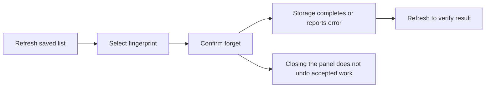

# Manage saved computers on Android

A saved computer is one whose identity you previously approved. Its fingerprint
is the full identifier shown in Blent. Forgetting it requires approval again on
its next connection; it does not change separate camera/microphone permissions
or USB capacity settings.

## View or forget a computer

1. Disconnect USB and wait for cleanup to finish.
2. Open **Settings (⚙) → Saved computers**, then **Refresh saved computers**.
   Refresh reads saved trust; it does not connect a computer or start media.
3. To remove an entry, choose **Forget** beside its full fingerprint. Check the
   confirmation, then choose **Confirm forget computer**. **Keep computer** cancels.
4. Choose **Close saved computers** when finished. Refresh keeps the panel open
   and leaves Refresh/Close available.

If the list changed before confirmation, refresh and confirm the current entry
again. **No saved computers** can also mean this tablet has no initialized
identity; reading the list does not create a key. The store holds at most 1,024
peers. Corrupt or mismatched identity/trust reports an error and preserves data.

## Closing, cancellation and cleanup

Closing the panel or settings does not undo an accepted read or forget. Accepted
work continues across Android Activity recreation (when Android rebuilds the
screen). Reopen to see its result; an unconfirmed selection must be selected again.
An expired view must be closed and reopened before it can accept commands.

**Stop saved-computer access** requests cancellation. A forget already accepted
by storage may have completed, so refresh after cleanup to check its result.
While access is closing, conflicting operations remain disabled. A cleanup
warning means ownership is unsettled; a timeout does not permit another operation.
Current-peer revocation and independent media controls retain their own lifetimes.

## What has been validated

[T1252 selected-device acceptance](reviews/artifacts/2026-10-21-pairing-acceptance/T1252/README.md)
passed on 2026-10-21 with an API 36 RugKing Pad 2 Pro. It covered independent reads
after the original worker exited, Forget cancellation/confirmation, both denials,
explicit remembered approval, persisted reconnect with debugging off after source
broker restart, and original-peer revocation. A new read after revocation showed
no saved computers. Original tablet/helper exits preceded restoration of debugging
and existing power settings. Pairing sent no media offers.

A denial ends that endpoint's local setup; the peer can still be in its own
approval/readiness window. In the selected host-denial run, Android's unapproved
dialog ended at its 120,000 ms approval deadline. Local denial does not guarantee
immediate remote notification. Wait for both endpoints' cleanup before reconnecting
or accessing saved trust.

[Earlier T1237 evidence](reviews/artifacts/2026-10-21-t1237/saved-trust.json)
records the initial persisted-list read. These checks do not qualify every
store/provider, API 27/28 native provider/accessory behavior or broader joined
T846 behavior. Camera T858, speakers T860 and microphone/duplex T859 have separate
selected-device records. Automated UI/store/Binder tests are separate evidence.
